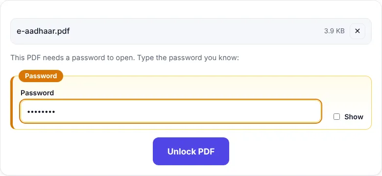

When you download your **e-Aadhaar** from the UIDAI website or app, the PDF is protected with a password. The password is not sent to you by SMS. It is built from your own details, so you can work it out in a few seconds.

> **Short answer:** first 4 letters of your name in CAPITAL letters + your year of birth (YYYY). Example: **RAHU1995**.

## The e-Aadhaar password format

The password has two parts, with no space between them:

1. The **first four letters of your name**, in CAPITAL letters, exactly as printed on your Aadhaar.
2. Your **year of birth** in four digits (YYYY), not the full date of birth.

So most passwords are 8 characters long, such as SURE1988 or PRIY2001.

## Examples

| Name on Aadhaar | Year of birth | Password |
|---|---|---|
| RAHUL SHARMA | 1995 | RAHU1995 |
| PRIYANKA PATIL | 2001 | PRIY2001 |
| ALI MONDAL | 1976 | ALIM1976 |
| S.N. SHEKHARAN | 1976 | S.N.1976 |
| OM | 2000 | OM2000 |

Points to notice in the table:

- **Spaces are skipped.** ALI MONDAL has only three letters in the first name, so the M of the surname is used.
- **Dots count as characters.** S.N. SHEKHARAN starts with S.N. so the password starts with S.N.
- **Very short names** use the whole name, followed by the year.

## How to open the Aadhaar PDF

**On a phone**

1. Tap the downloaded file in your Downloads or Files app.
2. When it asks for a password, type it in CAPITAL letters followed by the year.
3. Tap OK. Your e-Aadhaar opens.

**On a computer**

1. Double click the PDF. It opens in your browser or PDF reader.
2. Type the password and press Enter.

## Password not working? Check these

| Problem | Fix |
|---|---|
| Typed small letters | The letters must be CAPITAL. RAHU1995 works, rahu1995 does not. |
| Used full date of birth | Use only the year, for example 1995, not 15061995. |
| Used a nickname | Use the name exactly as printed on the Aadhaar card. |
| Added a space | There is no space between the letters and the year. |
| Name has an initial | Include the dot, as in S.N.1976. |

If it still does not open, download the e-Aadhaar again from the official UIDAI website and try once more, because a broken download can also stop the file from opening. You can also try **[Repair PDF](/repair-pdf/)** on a file that shows an error instead of a password box.

## Save a copy without the password

Some job, exam, bank and admission portals cannot accept a password protected PDF. If you know the password, you can save a copy that opens without it:

1. Open **[Unlock PDF](/unlock-pdf/)**.
2. Choose your e-Aadhaar PDF.
3. Type the password, for example RAHU1995.
4. Click **Unlock PDF** and then **Download PDF**.

Your original file stays as it was. You get a new copy with no password.

## If the form asks for a small file or an image

Upload portals often have size or format limits. After unlocking:

- **PDF must be under 100 KB or 200 KB:** use [Compress PDF](/compress-pdf/). Our guide on [compressing a PDF to 100 KB](/guides/compress-pdf-to-100kb/) shows what to do if it is still too big.
- **Form wants a JPG:** use [PDF to JPG](/pdf-to-jpg/), then [Reduce Image Size in KB](/reduce-image-size-in-kb/) to hit the exact size.
- **Only the front side is needed:** remove the second page with [Remove Pages](/remove-pages/).

## Keep your Aadhaar safe

An unlocked Aadhaar PDF can be opened by anyone who gets the file. A few good habits:

- Share it only with organisations that really need it.
- Where a full number is not required, use the **masked Aadhaar** option on the UIDAI website. It hides all but the last four digits of the number.
- Delete unlocked copies from shared computers, cyber cafe PCs and chat downloads after use.
- If you want to send it by email, you can add your own password again with [Protect PDF](/protect-pdf/).

For other password protected documents, such as bank statements and payslips, see [how to remove a password from a PDF](/guides/how-to-unlock-pdf/).
