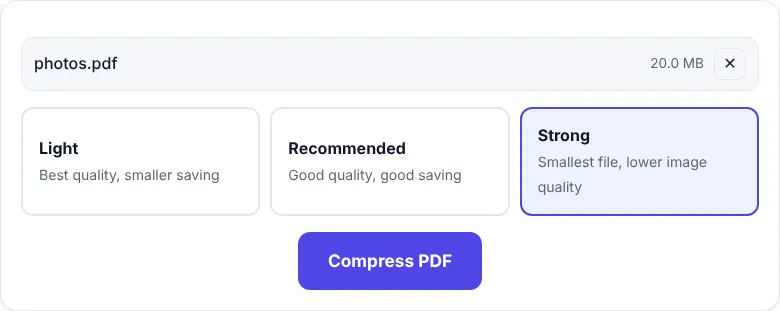

Many online application portals in India, for exams, jobs, admissions, scholarships and government services, ask for documents like certificates, ID proofs or caste certificates as **PDFs under 100 KB, 200 KB or 500 KB**. A phone scan of a single page can easily be 2 to 5 MB. Here is how to get it down to size.

> **Check the portal's instructions first.** Each website has its own limits, and some also have a *minimum* size.

## Why scanned PDFs are so big

A scanned page is a **photo** of paper. Phone scanner apps often save it at high resolution and high quality, so one page can be 1 to 3 MB. Typed PDFs (exported from Word) contain real text and are usually tiny.

| PDF type | Typical size per page |
|---|---|
| Exported from Word / Excel | 20 to 100 KB |
| Scanned at "high quality" | 500 KB, 3 MB |
| Phone photo turned into PDF | 1 to 5 MB |

So the trick is always to **shrink the images inside the PDF**.

## Method 1: Compress PDF (fastest)

1. Open **[Compress PDF](/compress-pdf/)**.
2. Choose your PDF.
3. Select **Strong** for limits of 100 to 200 KB (or **Recommended** for 500 KB, 1 MB).
4. Click **Compress PDF** and check the new size.
5. Click **Download PDF**.

For a one-page certificate scanned with a phone, Strong usually gets the file well under 200 KB and often under 100 KB.

## Method 2: Remove what you don't need

Every page adds size. Before compressing:

- Delete **blank pages** and back sides with [Remove Pages](/remove-pages/).
- Keep **only the pages the portal asks for**, for example just the first page of a certificate.

Then compress again.

## Method 3: Rebuild the PDF from small images (for strict 100 KB limits)

When a multi-page scan still won't fit, rebuild it with exact control:

1. Convert the pages to images with [PDF to JPG](/pdf-to-jpg/) at **Normal (100 DPI)** quality.
2. Shrink each image to a size in KB with [Reduce Image Size in KB](/reduce-image-size-in-kb/), for a 2-page PDF under 100 KB, aim for about **40 KB per page**.
3. Put them back together with [JPG to PDF](/jpg-to-pdf/) using **A4** size and **no margin**.

This gives you full control over the final size.

## How small can text be and still be readable?

As a rule of thumb, a scanned A4 page stays readable at about **100 to 150 DPI**. Below that, small print and stamps start to blur. Always open the compressed PDF, zoom in on the smallest text and the official seal, and make sure everything is clear before uploading.

## Size targets at a glance

| Portal limit | What to try |
|---|---|
| Under 1 MB | Compress PDF → Recommended |
| Under 500 KB | Compress PDF → Strong |
| Under 200 KB | Strong + remove extra pages |
| Under 100 KB | Strong; if needed, Method 3 |
| "Between 50 KB and 100 KB" | Method 3 with ~45 KB per page, so you stay above the minimum |

## Tips for better scans next time

- Scan in **"Document"** or **black-and-white** mode for text-only papers, files are much smaller.
- Choose **lower resolution** (150 to 200 DPI) in your scanner app.
- Crop the edges so no table or floor is visible.
- Scan each document as **one PDF**, not one PDF per page.

See also: [how to scan documents to PDF with your phone](/guides/scan-documents-to-pdf-with-phone/).

## Common problems

| Problem | Solution |
|---|---|
| "This PDF is password-protected" | Unlock it first with [Unlock PDF](/unlock-pdf/) |
| Size barely changes | The PDF is mostly text, it's already small; remove pages instead |
| Result is blurry | Use Recommended instead of Strong, or rebuild with higher KB per page |
| Portal says "invalid file" | Make sure the file name ends in `.pdf` and has no special characters |

