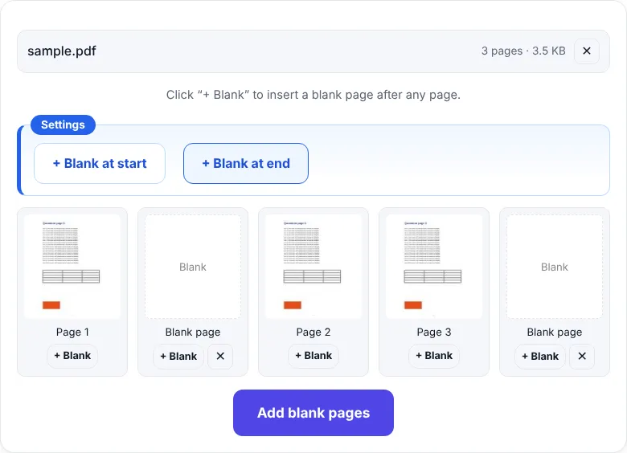

To add a blank page to a PDF, open **[Add Blank Page](/add-blank-page/)**, choose your file and click **+ Blank** under the page after which you want an empty page. Then click **Add blank pages** and download the new PDF. It takes less than a minute, and you do not need Adobe Acrobat or any app.

## Why people add blank pages to a PDF

| Reason | Where to add the blank page |
|---|---|
| Double sided printing, so each chapter starts on a new sheet | Before the first page of a chapter that would start on the back of a sheet |
| Space for handwritten notes or rough work | After the page you want to write about |
| Separating sections, like the main report and the annexures | Between the two sections |
| Making the page count even before printing a booklet | At the end |
| A cover sheet you will print or stamp later | At the start |

For double sided printing, a simple rule helps: page 1 is printed on the front of a sheet, page 2 on the back, page 3 on the front of the next sheet, and so on. If you want something to start on a front side, it must have an odd page number. Add one blank page before it when it does not.

## How to add a blank page to a PDF

1. Open **[Add Blank Page](/add-blank-page/)**.
2. Click **Choose PDF file** or drag your PDF into the box. Small previews of all pages appear.
3. Click **+ Blank** under any page. An empty page appears right after it, marked **Blank page**.
4. To add an empty page before everything else, click **+ Blank at start**. To add one after the last page, click **+ Blank at end**.
5. Added the wrong one? Click the **✕** button under that blank page to remove it.
6. Click **Add blank pages**, then **Download PDF**.

You can add as many blank pages as you need. The new file is saved with "with-blank-pages" at the end of the name, and your original PDF is not changed.

## What size is the blank page?

Each blank page takes the size of the page just before it. A blank page at the very start takes the size of the first page. This keeps the document even when you print it.

| Your PDF pages are | The blank page will be |
|---|---|
| All A4 | A4 |
| All US Letter | US Letter |
| Mixed sizes | The same size as the page before it |
| Landscape | The same landscape size as the page before it |

If your PDF has mixed page sizes and you want everything on one paper size, use [Change Page Size](/page-size/) after adding the blank pages.

## Tips for printing with blank pages

- **Check the printer settings.** For double sided printing, choose "Print on both sides" or "Duplex" in the print window. The exact name depends on your printer.
- **Do not let the printer skip blank pages.** Some printer drivers have an option like "Skip blank pages". If it is on, your empty pages will not be printed and the layout breaks.
- **Count the pages.** For double sided printing of a booklet or file, an even total page count makes the last sheet clean.
- **Want two pages on one sheet?** Use [Pages per Sheet](/pages-per-sheet/) after adding the blank pages.

## Other ways to change the pages of a PDF

Adding a blank page is often one part of a bigger job. These tools help with the rest:

| What you want to do | Tool |
|---|---|
| Move pages into a new order | [Reorder Pages](/reorder-pdf-pages/) |
| Delete pages you do not need | [Remove Pages](/remove-pages/) |
| Add another PDF, like a cover letter, at the start | [Merge PDF](/merge-pdf/) |
| Add page numbers after inserting pages | [Add Page Numbers](/add-page-numbers/) |

For more on deleting pages, see [how to remove pages from a PDF](/guides/how-to-remove-pages-from-pdf/). To join two files into one first, read [how to merge PDF files](/guides/how-to-merge-pdf-files/).

## Adding a page with content instead of a blank page

A blank page is empty. If you want a page with text, like a cover page or an index, you have two simple options:

1. Make the page in Word or Google Docs, save it as PDF and join it to your file with [Merge PDF](/merge-pdf/).
2. Add a blank page here, then open the file in [Edit PDF](/edit-pdf/) and use **Add text** to type on the empty page.

## Is it safe for private documents?

Your PDF is processed inside your browser on your own phone or computer. It is not uploaded to a server, so you can use it for office files, bills or exam documents. No sign up is needed, and no watermark is added.
