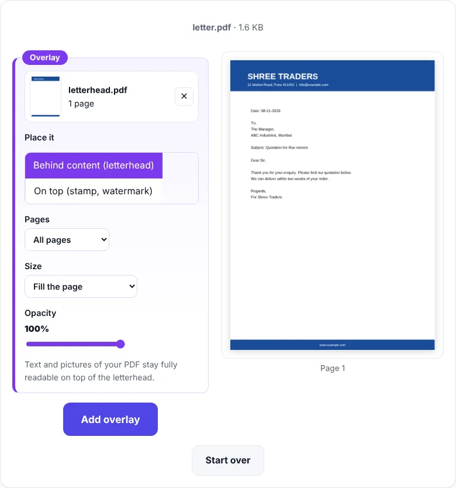

To add a letterhead to a PDF, open **[PDF Overlay](/pdf-overlay/)**, choose your letter or document PDF, then choose your letterhead as a PDF or an image. Keep **Behind content (letterhead)** selected and click **Add overlay**. Your company header and footer now sit behind the text on every page, and the text stays sharp and searchable.

This is useful for quotations, offer letters, invoices and certificates that were typed without a letterhead, or came out of software that cannot add one. Here is how to do it step by step.

## What you need

| File | What it is | Good formats |
|---|---|---|
| Your document | The letter, quotation or report, without a letterhead | PDF |
| Your letterhead | A page with only your logo, address and footer, and empty space in the middle | PDF (best), PNG or JPG |

**Tips for the letterhead file:**

- Make it the **same page size** as your document, usually A4.
- Keep the middle of the page **empty**, so it does not clash with the text.
- A **PDF letterhead** keeps the logo and text sharp at any zoom. If your letterhead is a Word file, save it as a PDF first, or convert it with [Word to PDF](/word-to-pdf/).
- If you only have a photo or scan of your printed letterhead, crop it to the page edges first so it lines up properly.

## How to add a letterhead to a PDF (step by step)

1. Open **[PDF Overlay](/pdf-overlay/)**.
2. Click **Choose PDF file** and select your letter or document.
3. Click **Choose letterhead or overlay** and select your letterhead PDF, PNG or JPG.
4. Under **Place it**, keep **Behind content (letterhead)** selected.
5. In **Pages**, choose where the letterhead goes (see the table below).
6. In **Size**, keep **Fill the page** for a full page letterhead.
7. Check the live preview on the right. It shows how your page will look.
8. Click **Add overlay** and then **Download PDF**.

Your original file is not changed. You get a new PDF with the letterhead added.

## Pages options explained

| Option in the Pages menu | What happens | Use it when |
|---|---|---|
| All pages | The same letterhead on every page | Most letters and quotations |
| First page only | Letterhead only on page 1, other pages plain | Long reports where only the cover needs a header |
| Page 1 on first page, page 2 on the rest | Page 1 of your letterhead PDF on the first page, page 2 on all others | A full header on the first page and a small one after |
| Page by page | Page 1 of the letterhead on page 1, page 2 on page 2, and so on | A ready made background for each page, like a form |

The last two options appear only when your letterhead PDF has more than one page.

## Size and opacity

The **Size** menu decides how the letterhead fits on your page:

- **Fill the page:** stretches the letterhead to the full page. Best when both files are the same size, such as A4.
- **Fit (keep proportions):** makes it as big as possible without changing its shape.
- **Original size, centred:** keeps the letterhead at its own size in the middle of the page.

The **Opacity** slider goes from 5% to 100%. For a letterhead behind the text, keep it at 100% so your colours look right. Lower it if you want a light, faded background.

## Letterhead on a scanned letter

If your document is a scan or a photo saved as PDF, the white paper in the scan could normally hide anything placed behind it. In **Behind content** mode, PDF Overlay blends the letterhead so the white paper of your scan does not hide it. Check the preview to be sure the result looks clean.

For the best result, scan the letter on plain white paper with good light. Our guide on [scanning documents to PDF with your phone](/guides/scan-documents-to-pdf-with-phone/) has tips.

## On top: stamps, seals and watermarks

The same tool can also put something **on top** of your pages. Choose **On top (stamp, watermark)** under **Place it**. When you switch, the opacity drops to 50% or less so the pages underneath stay visible.

| You want to add | Best tool |
|---|---|
| Company letterhead behind the text | [PDF Overlay](/pdf-overlay/), Behind content |
| A ready made stamp or seal image on every page | [PDF Overlay](/pdf-overlay/), On top |
| A text watermark like CONFIDENTIAL or DRAFT | [Add Watermark](/add-watermark/) |
| A stamp on one exact spot of one page | See [how to add a stamp to a PDF](/guides/how-to-add-stamp-to-pdf/) |
| Your signature | [Sign PDF](/sign-pdf/) |

## Common problems and fixes

| Problem | Fix |
|---|---|
| The text runs into the header or footer | Increase the top and bottom margins in your document and make the PDF again |
| The letterhead looks stretched | Your letterhead and document are different sizes. Use Fit (keep proportions), or make the letterhead the same size |
| The logo looks blurry | Use a PDF letterhead or a larger PNG instead of a small JPG |
| The letterhead hides part of the text | Choose Behind content (letterhead), not On top |
| You need the letter and annexures in one file | Add the letterhead to the letter first, then join them with [Merge PDF](/merge-pdf/) |

After adding the letterhead, you can sign the letter without printing it. See [how to sign a PDF without printing](/guides/how-to-sign-pdf-without-printing/).
