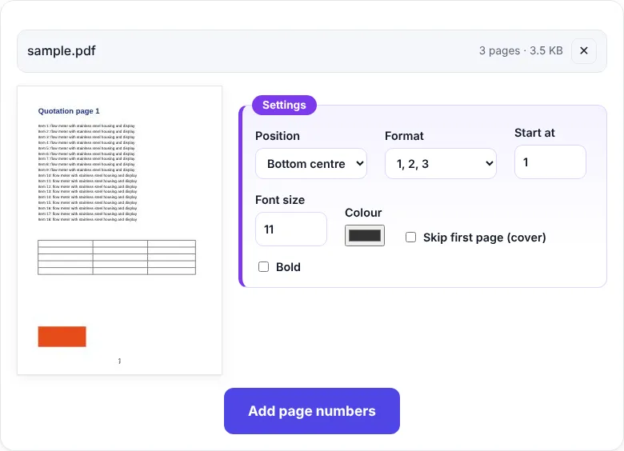

Need page numbers on a project report, a thesis, a tender file or a set of scanned documents? You can **add page numbers to a PDF** for free in your browser. Choose where the number goes, pick a style like **Page 1** or **1 of 10**, and download. No sign-up and no watermark.

## Why add page numbers to a PDF?

- **College projects and theses** often need numbered pages so the index matches.
- **Tender and office files** with many pages are easier to check when every page has a number.
- **Scanned documents** sent to a bank or office can be referred to by page ("see page 7").
- **Printed copies** can be put back in order if the pages get mixed up.

## How to add page numbers (step by step)

1. Open **[Add Page Numbers](/add-page-numbers/)**.
2. Click **Choose PDF file** or drag your PDF into the box. A preview of the first page appears.
3. Choose the **Position**, for example **Bottom centre**.
4. Choose the **Format**: **1, 2, 3**, **Page 1** or **1 of 10**.
5. Set **Start at**, **Font size** and **Colour** if you need to. Tick **Bold** for darker numbers.
6. Tick **Skip first page (cover)** if the first page is a cover or title page.
7. Click **Add page numbers**, then **Download PDF**.

The preview shows where the number will sit, so you can check the position before you save.

## All the options explained

| Option | Choices | When to use it |
|---|---|---|
| Position | Bottom centre, bottom right, bottom left, top centre, top right, top left | Bottom centre is the most common. Use a top position if the bottom of your pages has text or a stamp. |
| Format | 1, 2, 3 or Page 1 or 1 of 10 | 1 of 10 helps readers know no page is missing. |
| Start at | Any number | Start from 5 if the first four pages are in another file. |
| Font size | 6 to 48 | The default 11 suits most A4 documents. |
| Colour | Any colour | Dark grey or black prints best. |
| Skip first page (cover) | On or off | Keeps the cover page clean. |
| Bold | On or off | Makes numbers easier to see on scans. |

## Common situations

**Project report with a cover page.** Tick **Skip first page (cover)** and keep Start at as 1. The cover has no number and the next page shows 1.

**A file made of several parts.** If chapter 2 starts on page 21, type 21 in **Start at** when you number the chapter 2 file.

**Many separate PDFs that need one running number.** Join them first with [Merge PDF](/merge-pdf/), then add page numbers once. The [merge PDF guide](/guides/how-to-merge-pdf-files/) shows how to put the files in the right order.

**Pages in the wrong order.** Fix the order with [Reorder Pages](/reorder-pdf-pages/) before you add numbers. If you number first and reorder later, the numbers will be out of sequence. See [how to rearrange PDF pages](/guides/how-to-rearrange-pdf-pages/).

**Your college or office has a set format.** Some colleges, universities and offices have their own rules, for example Roman numbers on the first pages or numbers in a fixed corner. Check the official guidelines you were given and choose the closest options.

## Adding page numbers on a phone

The tool works in Chrome on Android and in Safari or Chrome on iPhone:

1. Open [zentapdf.com/add-page-numbers/](/add-page-numbers/).
2. Tap **Choose PDF file** and pick your PDF.
3. Scroll down to the settings, choose the position and format.
4. Tap **Add page numbers**, then **Download PDF**.

The PDF is saved to your Downloads (Android) or the place your browser saves files (iPhone).

## Will the numbers cover my text?

The numbers are placed about 1 cm from the edge of the page. Most documents have an empty margin there. If your pages have a footer, a signature or a stamp at the bottom, choose a top position or a smaller font size, and look at the preview before you click the button.

Adding numbers does not change anything else on the page. Your text, pictures and links stay as they are.

## If your document is still in Word

If you still have the Word file, you can also add page numbers in Word itself (Insert, then Page Number) before you make the PDF. If you only have the PDF, or the PDF was made by joining many files, adding numbers to the PDF is quicker.

## Other finishing touches

- Add **DRAFT** or **CONFIDENTIAL** across the pages with [Add Watermark](/add-watermark/).
- Need separate files again after numbering? Use [Split PDF](/split-pdf/).
- File too large for an upload portal? Shrink it with [Compress PDF](/compress-pdf/).
