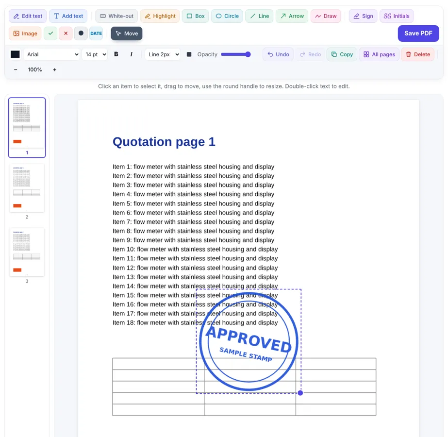

Invoices, quotations, offer letters and certificates often need a **company stamp or seal**. You do not have to print the PDF, stamp it with ink and scan it again. Make an image of your stamp once, then open **[Edit PDF](/edit-pdf/)**, click **Image**, place the stamp where you want it and click **Save PDF**. This guide shows how to do it, how to put the stamp on every page and how to make the stamp image look clean.

## Step 1: Make a stamp image

You need your stamp as a picture file. Do this once and reuse it.

1. Press your rubber stamp on clean **white paper**. Use fresh ink so the edges are sharp.
2. Scan it, or take a photo from straight above in good daylight. Avoid shadows.
3. Cut it close to the edges with [Crop Image](/crop-image/).
4. If you can, remove the white background in a photo editor and save it as a **PNG with a transparent background**. Then the text under the stamp stays visible, like real ink.

| Stamp file | How it looks on the PDF |
|---|---|
| PNG with transparent background | Best. Only the ink shows, the page shows through |
| JPG or PNG with white background | A white box around the stamp. Place it on an empty area |
| Phone photo, not cropped | Shadows and a grey box. Crop it first |

**Keep the stamp file safe.** Anyone who has it can put your stamp on any document.

## Step 2: Add the stamp to your PDF

1. Open **[Edit PDF](/edit-pdf/)** and choose your PDF.
2. Click the page where the stamp should go. Use the page thumbnails on the left to jump between pages.
3. Click **Image** in the toolbar and pick your stamp file. It appears on the page.
4. Drag it to the right place, for example near the signature line.
5. Drag the **round handle** to make it bigger or smaller.
6. Use the **Opacity** slider if you want the stamp lighter, so it looks more like ink.
7. Click **Save PDF**, then **Download PDF**.

Made a mistake? Press **Ctrl+Z** to undo, or select the stamp and click **Delete**.

## Put the stamp on every page

Some offices want the seal on every page of an agreement or a long quotation. You have two easy options:

| Method | How | Best for |
|---|---|---|
| Edit PDF, All pages | Select the placed stamp and click **All pages**. It is copied to every page in the same place | A stamp in a corner or near the signature line |
| [PDF Overlay](/pdf-overlay/) | Choose the PDF, then the stamp image. Pick **On top (stamp, watermark)**, choose **All pages** or **First page only**, then size and opacity | A large stamp in the middle of the page |
| [Add Watermark](/add-watermark/) | Choose **Image / logo** and pick the stamp. Set size, angle and opacity | A faint, large mark across every page |

PDF Overlay places an image in the centre of the page (fill the page, fit, or original size). If you need the stamp in a corner on every page, Edit PDF with **All pages** is the simpler choice.

## Add a text stamp like PAID or RECEIVED

You do not always need a rubber stamp. For a quick office stamp:

1. Open [Edit PDF](/edit-pdf/) and click **Add text**.
2. Type a word such as PAID, RECEIVED or APPROVED.
3. Make it bold, larger and red or blue.
4. Click **Box** to draw a border around it.
5. Click **DATE** to add today's date next to it.

For a big diagonal word like DRAFT or COPY across every page, use [Add Watermark](/add-watermark/) with **Text**.

## Stamp and signature together

Many documents need both a signature and a stamp. Add the stamp as shown above, then click **Sign** in the same editor to draw, type or upload your signature. You can also use [Sign PDF](/sign-pdf/). For more on signing, read [how to sign a PDF without printing](/guides/how-to-sign-pdf-without-printing/).

## Is a stamp image legally valid?

A stamp image on a PDF is accepted in many everyday cases, like a quotation sent to a customer. But rules depend on who receives the document.

- A stamp image is **not a digital signature**. Some filings and portals need a PDF signed with a **Digital Signature Certificate (DSC)**. A picture of a stamp or signature does not replace that.
- Banks, government offices and courts may ask for a physical stamp and wet signature on paper.
- Always check the instructions of the office or company that will receive the document.

## Before you send the stamped PDF

- **Open the saved file once.** Check every page to make sure the stamp is in the right place and does not hide any text.
- **Check the file size.** If the email or portal has a limit, use [Compress PDF](/compress-pdf/).
- **Need to change text before stamping?** See [how to edit text in a PDF](/guides/how-to-edit-text-in-pdf-free/).

Your PDF and stamp image are handled inside your browser and are not uploaded to a server. No sign up is needed.
