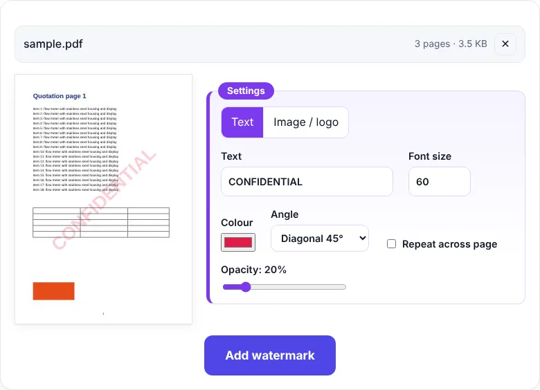

A watermark is light text or a faint logo printed across a page. It tells people the document is a **draft**, **confidential**, a **copy** or that it belongs to your business. You can add one to any PDF for free in your browser, without installing software.

> **Short answer:** open [Add Watermark](/add-watermark/), choose your PDF, type the text (for example CONFIDENTIAL), set the opacity, then click **Add watermark** and **Download PDF**.

## When to use a watermark

| Watermark | Good for |
|---|---|
| DRAFT | Reports, quotations or agreements that are not final yet |
| CONFIDENTIAL | Salary details, business plans, internal reports |
| COPY or SAMPLE | Sample work you send to a client before payment |
| Your company name or logo | Brochures, price lists, catalogues and proposals |
| A purpose line, such as "For bank KYC only" | Copies of your own ID or certificates that you share with one office |

The last one is a common habit in India. When you send a copy of a document to one place, writing the purpose and date across it makes the copy less useful if it is misused somewhere else. It does not replace any rule set by the office, so follow their instructions if they ask for a clean copy.

## How to add a text watermark to a PDF

1. Open **[Add Watermark](/add-watermark/)**.
2. Click **Choose PDF file**, or drag and drop the PDF into the box.
3. Keep **Text** selected and type your words in the **Text** box. It starts with CONFIDENTIAL.
4. Set the **Font size** (8 to 200) and pick a **Colour**.
5. Choose the **Angle**: Diagonal 45°, Horizontal, Diagonal −45° or Vertical.
6. Tick **Repeat across page** if you want the text many times on each page instead of once in the middle.
7. Move the **Opacity** slider. Around 15 to 30% keeps the page easy to read.
8. Watch the preview of the first page, then click **Add watermark**.
9. Click **Download PDF**. The new file has "watermarked" in its name.

The watermark is added to **every page** of the PDF. Your original file is not changed.

## How to add a logo watermark

1. Open **[Add Watermark](/add-watermark/)** and choose your PDF.
2. Click **Image / logo**.
3. Click **Choose image** and pick your logo. PNG, JPG and WEBP work. A PNG with a transparent background looks cleanest.
4. Use the **Size** slider (10 to 100%) to set how big the logo is on the page.
5. Lower the **Opacity** so the text under the logo stays readable.
6. Click **Add watermark** and then **Download PDF**.

The logo is placed in the centre of each page.

## Settings that look good

| Setting | Text watermark | Logo watermark |
|---|---|---|
| Opacity | 15 to 25% | 10 to 20% |
| Colour | Gray or light red | Keep the logo colours |
| Angle | Diagonal 45° | Not needed |
| Size | 50 to 80 for one large word | 40 to 60% of the page |
| Repeat across page | On for photos or ID copies | Not available |

A very dark watermark makes the document hard to read and hard to print. Start light, check the preview, then make it darker if needed.

## Watermark, stamp or letterhead?

These three are often confused. Pick the one that matches what you need:

- **Watermark:** faint text or logo across the page, on every page. Use [Add Watermark](/add-watermark/).
- **Stamp or seal:** a company stamp or "PAID" mark at one spot, on one or more pages. See [how to add a stamp to a PDF](/guides/how-to-add-stamp-to-pdf/).
- **Letterhead:** your header and footer design behind the text of every page. See [how to add a letterhead to a PDF](/guides/how-to-add-letterhead-to-pdf/), which uses [PDF Overlay](/pdf-overlay/).

## Tips for a safer document

- **Stop copying and editing too.** A watermark does not lock the file. Add a password with [Protect PDF](/protect-pdf/) if only certain people should open it.
- **Forms in the PDF?** If the PDF has fillable fields, lock them first with [Flatten PDF](/flatten-pdf/) so the answers cannot be changed.
- **Need text in Hindi?** Type it in any app, take a screenshot, crop it to just the words, and add that image as a logo watermark.
- **Check every page.** Open the downloaded PDF and scroll through it, especially pages with photos or dark backgrounds.
