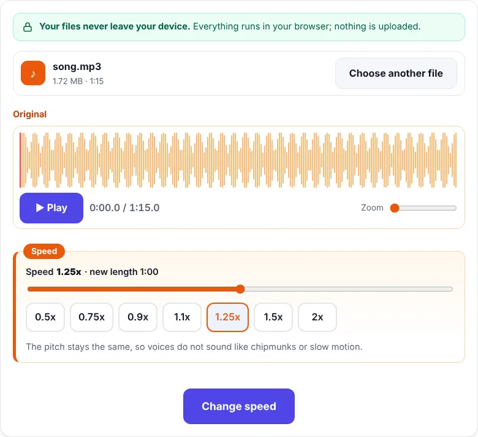

To change the speed of a song or any audio file, open **[Audio Speed Changer](/audio-speed-changer/)**, choose the file, pick a speed between 0.5x and 2x, click **Change speed**, listen to the result and download it as MP3, WAV or M4A. The pitch does not change, so a slowed song stays in the same key and a sped up lecture does not sound squeaky.

## When you would change the speed

People slow down or speed up audio for things like:

- Learning a song on guitar, keyboard or vocals. At 0.75x you can hear fast parts note by note.
- Practising dance steps or a workout routine at a slower pace first.
- Going through a recorded lecture or class faster before an exam.
- Making a long podcast or interview shorter to listen to on the way to work.
- Fitting a background track into a fixed time for a video or a school function.

## Speed and new length

The speed you choose changes how long the file plays. At 2x it plays in half the time, and at 0.5x it takes twice as long. The tool shows the new length next to the speed before you start.

| Speed | A 4 minute song becomes | A 60 minute lecture becomes | Good for |
|---|---|---|---|
| 0.5x | 8 minutes | 120 minutes | Very fast solos or tough lyrics |
| 0.75x | about 5 min 20 s | 80 minutes | Learning a song or dance |
| 0.9x | about 4 min 27 s | about 67 minutes | A gentle slow down |
| 1.25x | 3 min 12 s | 48 minutes | Podcasts and talks |
| 1.5x | 2 min 40 s | 40 minutes | Lectures you are revising |
| 2x | 2 minutes | 30 minutes | Quick skim of a recording |

The new length is simply the old length divided by the speed.

## How to change audio speed online

1. Open **[Audio Speed Changer](/audio-speed-changer/)** on your phone or computer.
2. Click **Choose audio file** and pick your song or recording. MP3, WAV, M4A, AAC, OGG, FLAC and WMA work, and so does the sound from many video files.
3. The file loads and you see its waveform. Tap **Play** to check it is the right file.
4. Move the **Speed** slider, or tap one of the buttons: 0.5x, 0.75x, 0.9x, 1.1x, 1.25x, 1.5x or 2x. The line above the slider shows the speed and the new length. 1.25x is selected at first.
5. Click **Change speed**. A long file can take some time, so keep the tab open.
6. Under **Result: listen before you download**, play the new version.
7. Pick a **Format** (MP3, WAV or M4A) and, for MP3 or M4A, a **Quality**. Then click the download button, for example **Download MP3**.

If the speed is not right, pick another one and click **Change speed** again. Your original file is not touched.

## Speed, pitch and tempo

Speed, or tempo, is how fast the music moves, and it is the only thing this tool changes.

Pitch is how high or low the sound is. On an old cassette player, playing a tape faster made voices high and thin. This tool does not do that. The note C stays C at any speed.

If you also want the song in a different key, for example to match your singing range, first save it here, then open the saved file in **[Pitch Changer](/pitch-changer/)**. Each tool does one job, so you run them one after the other.

To know the beats per minute of a track before you slow it, try **[BPM Finder](/bpm-finder/)**.

## Tips for good results

- Small changes sound the most natural. Between 0.75x and 1.5x most music and speech sounds clean. At 0.5x or 2x you may hear some wobble, mainly on music with many instruments.
- Cut first, then change speed. If you only need one part of a song, trim it with **[MP3 Cutter](/mp3-cutter/)**. A shorter file is quicker to process.
- Pick WAV if you will edit again. WAV does not lose quality when saved, so it is a good middle step if you will later change the pitch or cut it. Save the final copy as MP3.
- Large files need patience. For files over 100 MB the tool warns that it may take longer. A computer handles very large files better than a phone.

## Common problems

| Problem | What to try |
|---|---|
| The file does not open | Convert it to MP3 first with [Audio Converter](/audio-converter/), then try again |
| It sounds wobbly at 0.5x or 2x | Use a smaller change, such as 0.75x or 1.5x |
| Processing takes very long | Cut out only the part you need, or use a computer |
| I want a higher or lower voice too | Change the speed here, then use Pitch Changer on the saved file |
| The MP3 is too big to share | Make it smaller with [Audio Compressor](/audio-compressor/) |

## Related guides

- [How to compress an MP3 file for WhatsApp or email](/guides/how-to-compress-mp3-file/)
- [How to make a ringtone from a song](/guides/how-to-make-ringtone-from-song/)
