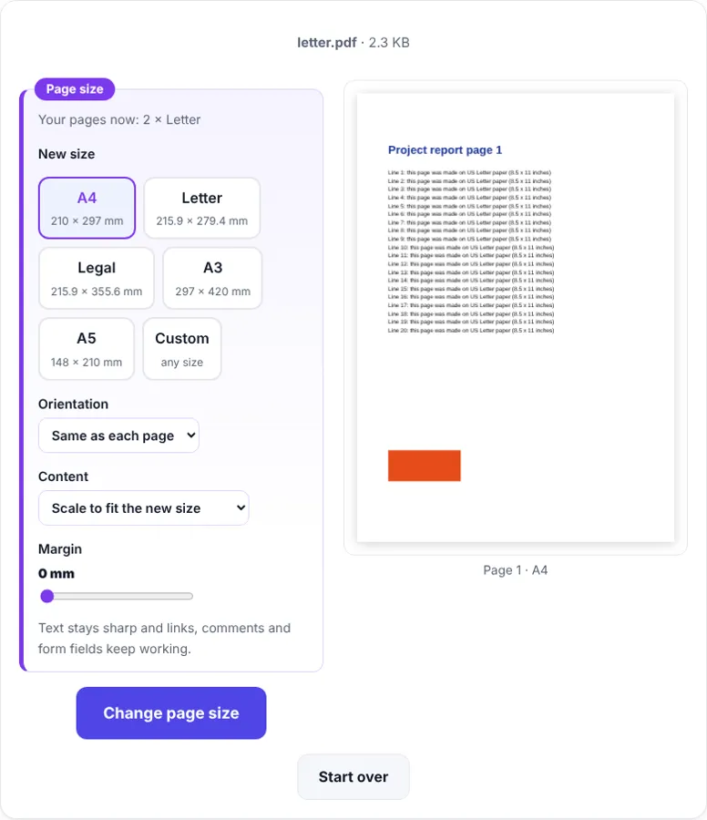

Many PDFs from American companies, online templates and some software are made in **US Letter** size. In India the normal paper size is **A4**. If you print a Letter PDF on A4 paper, the printer may cut the edges, shrink the page or show a "paper size mismatch" message. The fix is to change the page size of the PDF itself to A4 before you print or upload it.

> **Short answer:** open [Change Page Size](/page-size/), choose your PDF, click **A4**, keep **Scale to fit the new size**, then click **Change page size** and **Download PDF**.

## A4 vs Letter: what is the difference?

The two sizes look almost the same, but they are not. A4 is a little narrower and a little taller than Letter.

| Paper size | Millimetres | Inches | Where it is used |
|---|---|---|---|
| A4 | 210 × 297 mm | 8.27 × 11.69 in | India and most countries |
| Letter | 215.9 × 279.4 mm | 8.5 × 11 in | USA, Canada and some other countries |
| Legal | 215.9 × 355.6 mm | 8.5 × 14 in | Some legal papers in the USA |
| A3 | 297 × 420 mm | 11.69 × 16.54 in | Posters, drawings, large charts |
| A5 | 148 × 210 mm | 5.83 × 8.27 in | Booklets, small notes |

Because Letter is about 6 mm wider than A4, a Letter page printed on A4 paper at full size loses a few millimetres on the left and right. Because A4 is about 18 mm taller, the bottom of the A4 sheet has extra empty space.

## How to change PDF page size from Letter to A4

1. Open **[Change Page Size](/page-size/)**.
2. Click **Choose PDF file**, or drag and drop the PDF into the box.
3. Look at the line **Your pages now**. It tells you the current size, for example "2 × Letter".
4. Under **New size**, click **A4**.
5. Leave **Orientation** on **Same as each page**, so portrait pages stay portrait and landscape pages stay landscape.
6. Leave **Content** on **Scale to fit the new size**. This makes sure nothing is cut off.
7. If you want a white border, move the **Margin** slider (0 to 30 mm).
8. Check the preview of page 1 on the right.
9. Click **Change page size** and then **Download PDF**.

The new file has "resized" in its name. Your original PDF is not changed.

## What the options do

| Option | Choices | When to use it |
|---|---|---|
| New size | A4, Letter, Legal, A3, A5, Custom | Pick the paper the PDF must match. Custom takes width and height in mm |
| Orientation | Same as each page, Portrait, Landscape | Keep the default unless every page must face the same way |
| Content | Scale to fit the new size, Keep original size (centred) | Scale to fit is safe. Keep original size may cut a larger page at the edges |
| Margin | 0 to 30 mm | Adds white space on all sides, useful if your printer cannot print to the edge |

All pages of the PDF get the same new size, even if they were different sizes before. This is handy when a PDF has a mix of A4 and Letter pages, for example after merging files from different places.

## Will the content shrink?

Only a little. When you go from Letter to A4 with **Scale to fit**, the content is made about 3% smaller so the 215.9 mm wide page fits into 210 mm. The page is then centred, so you see a thin white band of about 12 to 13 mm at the top and bottom. Text size changes so little that most people will not notice it.

Going the other way, from A4 to Letter, the content is shrunk by about 6% to fit the shorter height, and you get thin white bands on the left and right.

If you choose **Keep original size (centred)**, nothing is scaled. The page is just placed in the middle of the new sheet, and anything outside the new size is cut off at the edges.

## Common reasons to change the page size

- **Printing in India.** Most printers and shops in India load A4 paper. Converting first gives you a clean print without cut edges.
- **Uploading to a portal.** Some government, exam and college portals ask for A4 documents. Rules differ from site to site, so read the upload instructions on the official website.
- **Mixed page sizes.** After you [merge PDF files](/guides/how-to-merge-pdf-files/) from different sources, one size for all pages looks neater.
- **Making a small booklet.** Choose A5, or use [Pages per Sheet](/pages-per-sheet/) to put 2 pages on one A4 sheet. See the guide on [printing multiple pages on one sheet](/guides/how-to-print-multiple-pages-on-one-sheet/).

## Tips before you print or upload

- **Print at 100%.** In the print window choose "Actual size" or 100%, not "Fit to page", so the page is not shrunk again.
- **Pages sideways?** Fix them first with [Rotate PDF](/rotate-pdf/).
- **Big white margins in the original?** Trim them with [Crop PDF](/crop-pdf/) before you change the size.
- **File too big for the portal?** Shrink it with [Compress PDF](/compress-pdf/) after resizing.
