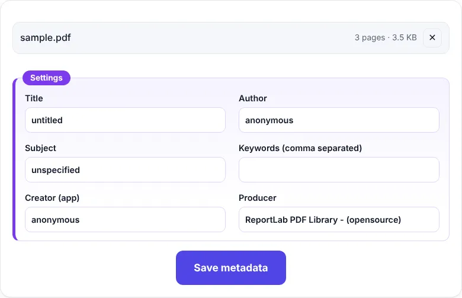

To change the title and author of a PDF, open **[Edit Metadata](/edit-pdf-metadata/)**, choose the file, type the new title and author in the boxes, click **Save metadata** and then **Download PDF**. You do not need Adobe Acrobat or any app, and the pages of the PDF stay exactly as they were.

## What PDF title and author are

Every PDF can carry a few details about itself, called metadata or document properties. They sit inside the file, not on the pages, so you never see them while reading.

| Field | What it holds | Example |
|---|---|---|
| Title | The name of the document | Rental Agreement, Flat 302 |
| Author | The person or office that made it | Priya Sharma |
| Subject | A short line about the topic | Rent agreement for 11 months |
| Keywords | Words that describe it, separated by commas | rent, agreement, Pune |
| Creator (app) | The app the PDF was made in | Microsoft Word |
| Producer | The program that wrote the PDF file | The PDF library or printer used |

In Adobe Acrobat Reader you can see these details under **File > Properties**, on the Description tab.

## Why you may want to change them

- Some browsers, including Chrome, show the PDF title in the tab instead of the file name. If you made your resume from an old template, the tab may still say "Template 3" or someone else's name.
- When you save a PDF from Word, the author is usually the name set in your Office account or on the computer. That could be an old employee, a cyber cafe login or a nickname.
- If you put a PDF on a website, search engines may use its title. "Fee Structure 2026-27" is better than "Document1".
- If you keep many PDFs, such as bills or office circulars, subject and keywords help you search for them later on your computer.

## How to change PDF title and author online

1. Open **[Edit Metadata](/edit-pdf-metadata/)** on your phone or computer.
2. Click **Choose PDF file** or drop the PDF into the box.
3. The tool reads the file and fills the boxes with what is already there: **Title**, **Author**, **Subject**, **Keywords (comma separated)**, **Creator (app)** and **Producer**. Empty boxes mean that field was not set.
4. Type a new value in any box, or clear a box to remove it.
5. Click **Save metadata**.
6. Click **Download PDF**. The new file is saved with "-edited" added to the name, so your original stays as it is.

To check the change, open the downloaded PDF in your browser or in Acrobat Reader and look at the tab name or the document properties.

## Remove personal details before sharing

Before you send a PDF to a client, a college or a government office, look at the author and creator fields.

1. Choose the PDF in **[Edit Metadata](/edit-pdf-metadata/)**.
2. Clear the **Author** box if you do not want your name in the file.
3. Look at **Creator (app)** and **Subject**. Some apps put a name, a company or a file path there.
4. Click **Save metadata** and download.

If you leave the Producer box empty, the tool writes "ZentaPDF" there. The tool also updates the modified date when it saves.

Clearing metadata does not touch what is printed on the pages. If a name or number is on the page itself, use **[Redact PDF](/redact-pdf/)** to black it out properly. For photos, the hidden details are called EXIF data, and our guide on [removing EXIF data from photos](/guides/how-to-remove-exif-data-from-photos/) explains how to clean those.

## Good titles for common documents

A title should say what the document is in a few words, for example:

- Resume: "Rahul Verma Resume, Data Analyst"
- Project report: "Final Year Project Report, Smart Irrigation"
- Office circular: "Circular 14, Diwali Holiday Schedule"
- Price list: "Price List, November 2026"

Keep it short and plain, and put extra words in the Keywords box instead of stuffing them into the title.

## Common problems

| Problem | What to try |
|---|---|
| The tab still shows the old name | Make sure you opened the downloaded "-edited" file, not the original |
| The PDF asks for a password | Remove the password first with [Unlock PDF](/unlock-pdf/) if you know it, then edit the metadata |
| The file will not open in the tool | It may be damaged. Try [Repair PDF](/repair-pdf/) first |
| I want to lock the file after editing | Add a password with [Protect PDF](/protect-pdf/) |

## Related guides

- [How to redact a PDF](/guides/how-to-redact-a-pdf/)
- [How to password protect a PDF](/guides/how-to-password-protect-pdf/)
