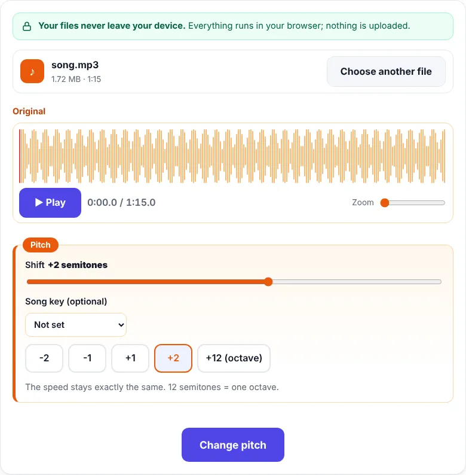

To change the pitch of a song, open **[Pitch Changer](/pitch-changer/)**, choose the song, move the slider up or down in semitones, click **Change pitch**, listen to the result and download it as MP3, WAV or M4A. The speed and length of the song stay the same, only the key moves.

## Why people change the key of a song

- For karaoke and singing practice. If a song is too high for you, lowering it by 1 to 3 semitones often makes it comfortable. If it is too low, raise it.
- A song sung by a male singer may sit too low for a female voice, and the other way round.
- You can move a track into a key that is easier to play along with on harmonium, keyboard or guitar.
- A choir, a school function or a bhajan group can rehearse with a backing track in the key the lead singer uses.

## Semitones in simple words

A semitone is the smallest step on a piano, from one key to the very next key, black or white. Twelve semitones make one octave, which is the same note but higher or lower.

| Shift | What it means | Example: song in C becomes |
|---|---|---|
| -2 | Down one whole tone | A# |
| -1 | Down a half step | B |
| +1 | Up a half step | C# |
| +2 | Up one whole tone | D |
| +5 | Up five half steps | F |
| +12 | Up one full octave | C (one octave higher) |

If you know the original key, set it in the tool and it shows the new key name for you.

On a guitar, each fret of a capo raises the pitch by one semitone. So if you play along with a capo on the 2nd fret, raising the track by +2 gives the same effect.

## How to change the pitch of a song online

1. Open **[Pitch Changer](/pitch-changer/)** on your phone or computer.
2. Click **Choose audio file** and pick the song. MP3, WAV, M4A, AAC, OGG, FLAC and WMA work, and so does the sound from many video files.
3. The file loads and you see its waveform. Tap **Play** to check it.
4. Move the **Shift** slider, or tap a quick button: -2, -1, +1, +2 or +12 (octave). The slider goes from -12 to +12 in half semitone steps.
5. If you know the key, choose it under **Song key (optional)**. The line above the slider then shows the change, for example C → D.
6. Click **Change pitch**. A long song can take a little time, so keep the tab open.
7. Under **Result: listen before you download**, play the new version.
8. Choose the **Format** (MP3, WAV or M4A) and, for MP3 or M4A, the **Quality**. Then click the download button, for example **Download MP3**. The file name ends with the shift, so a song moved down 2 semitones is saved as song-pitch-2.mp3.

If it is not right, move the slider and click **Change pitch** again. Your original file does not change.

## How much to shift

No rule fits every voice, so try a shift and listen.

- Start small. Try -1 or -2 first, sing along, then go further if needed.
- Changes of 1 to 3 semitones sound the most natural. Bigger jumps can make voices sound odd, a little like a cartoon when raised or heavy when lowered.
- If you only need the music for practice, an octave shift (+12 or -12) keeps the same key names, so chords and notes stay the same.
- To find a note to tune to, you can play a steady tone with our **[Tone Generator](/tone-generator/)**.

## Change speed and key together

Pitch Changer only changes the key. If you also want the song slower, for example to learn a hard part, use **[Audio Speed Changer](/audio-speed-changer/)** on the saved file. It keeps the pitch the same, so the two tools work well one after the other. Our guide on [changing audio speed](/guides/how-to-change-audio-speed/) shows how.

When you will edit the file twice, save the first step as WAV, which keeps full quality, and save the final copy as MP3.

To use only a part of the song, trim it first in **[MP3 Cutter](/mp3-cutter/)**. A shorter file also processes faster.

## Common problems

| Problem | What to try |
|---|---|
| The file does not open | Convert it to MP3 first with [Audio Converter](/audio-converter/), then try again |
| The voice sounds strange | Use a smaller shift, such as 1 or 2 semitones |
| It takes very long | Cut out only the part you need, or use a computer |
| I want a ringtone in the new key | Save the result, then follow our guide to [make a ringtone from a song](/guides/how-to-make-ringtone-from-song/) |

## Related guides

- [How to change the speed of a song](/guides/how-to-change-audio-speed/)
- [How to make a ringtone from a song](/guides/how-to-make-ringtone-from-song/)
