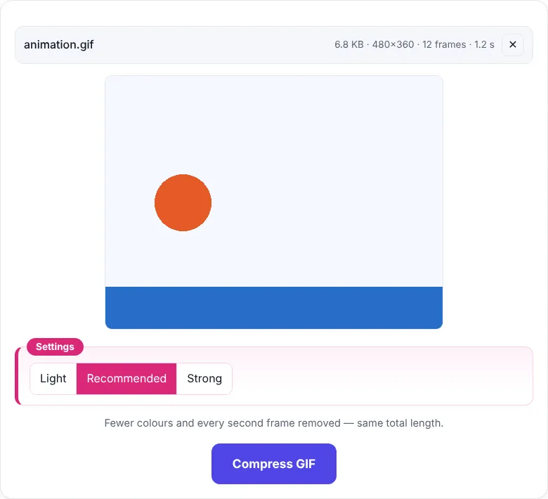

A GIF that is only a few seconds long can still be several MB, which is too heavy for many chat apps, email and web pages. You can shrink it a lot by cutting colours, dropping some frames and making it smaller in pixels, and it keeps moving after all three.

> **Short answer:** open [Compress GIF](/compress-gif/), choose your GIF, pick **Recommended**, click **Compress GIF** and download the smaller file. If it is still too big, try **Strong**.

## Why GIF files are so big

A GIF is a set of full pictures (frames) shown one after another. The format is old and its compression is weak next to modern video. Each frame can use at most 256 colours, and the file stores every frame. So a GIF gets heavy quickly.

| What makes a GIF heavy | Why it matters |
|---|---|
| Many frames | Every extra frame adds another picture to the file |
| Large width and height | More pixels in every frame |
| Lots of colours and gradients | Photos and smooth shading compress badly in GIF |
| Camera noise or grain | Small changes between frames stop the file from saving space |
| Long length | A 10 second GIF holds about twice as many frames as a 5 second one |

GIFs made from videos or phone screen recordings are usually the heaviest, as they are full of colour and movement.

## How to compress a GIF for free

1. Open **[Compress GIF](/compress-gif/)** on your phone or computer.
2. Click **Choose GIF file** and pick your animated GIF, or drag it into the box.
3. Below the file name you will see its size, width and height, number of frames and length in seconds.
4. Choose **Light**, **Recommended** or **Strong**.
5. Click **Compress GIF** and wait a few seconds.
6. Compare the new size. The tool shows how many percent you saved and a preview of the result.
7. Click **Download GIF**, or click **Change settings** to try another level.

The new file gets "-compressed" added to its name, so your original GIF stays as it is.

## What the three levels do

| Level | Colours | Frames | Width and height |
|---|---|---|---|
| Light | Up to 128 | All frames kept | Same as the original |
| Recommended | Up to 64 | Every second frame removed | Same as the original |
| Strong | Up to 48 | Every second frame removed | 30% smaller |

Recommended is selected when the GIF opens. Short GIFs with 4 frames or fewer keep all their frames.

Use **Light** for small graphics, logos and text animations where every frame counts. **Recommended** suits most memes, reaction GIFs and screen recordings. Go to **Strong** only when the GIF has to fit a strict size limit, because it also makes the picture smaller.

When frames are removed, each remaining frame is shown for longer, so the GIF still plays for the same total time. Very fast movement can look a little jumpy.

## Tips to make a GIF even smaller

- A GIF shown at 480 pixels wide does not need to be 1080 wide. Use [Resize GIF](/resize-gif/) first, then compress. The [resize animated GIF guide](/guides/how-to-resize-animated-gif/) explains how.
- Black bars, empty borders or a watermark corner can go with [Crop GIF](/crop-gif/).
- If you are making the GIF from a video, pick a shorter clip in [Video to GIF](/video-to-gif/). Our [video to GIF guide](/guides/how-to-convert-video-to-gif/) shows how.
- Many apps turn GIFs into short videos anyway. [GIF to MP4](/gif-to-mp4/) usually gives a much smaller file with better colours.
- Compressing the same GIF again and again lowers quality each time. Start from the original file if you want to try a different level.

## Size limits on apps and websites

Each app and website sets its own limit for GIFs and attachments, and these limits change from time to time. Some apps also convert GIFs into short videos when you send them. Before you start, check the current limit in the help pages of the app, forum, email service or job portal you are using, then compress until your file is under it.

For a GIF on your own website, smaller is better. A lighter GIF loads faster on mobile data.

## Common problems

**The size did not go down.** Some GIFs are already well optimised. The tool shows a message saying so. Try Strong or resize the GIF.

**Colours look patchy or banded.** This happens with photos and gradients when colours are cut. Use Light, or convert to MP4 instead.

**The file is not accepted.** The tool takes only GIF files. For JPG, PNG or WebP pictures, use [Compress Image](/compress-image/).
