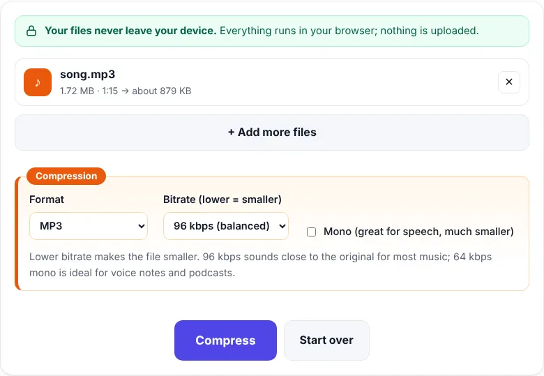

Your audio file is too big to attach, takes ages to send on WhatsApp or eats up your mobile data. The fix is to **lower its bitrate**. A lower bitrate means fewer bits for every second of sound, so the file becomes smaller while it still sounds fine for listening on a phone.

> **Short answer:** open [Audio Compressor](/audio-compressor/), choose your file, keep **96 kbps (balanced)** for music or pick **64 kbps (voice)** for speech, click **Compress** and download the smaller file.

## Why audio files are big

The size of a compressed audio file depends on two things: its **bitrate** and its **length**. Bitrate is shown in kbps (kilobits per second). A song saved at 320 kbps uses more than three times the space of the same song at 96 kbps. A WAV file is even bigger, because WAV usually stores sound with no compression at all.

So a long recording, a WAV file, or a high bitrate MP3 can easily run into tens of MB.

## How much space each bitrate uses

You can work out the size yourself: bitrate in kbps x seconds / 8 gives the size in KB. Here is what that means for one minute of audio:

| Bitrate | About 1 minute | About 5 minutes | Good for |
|---|---|---|---|
| 32 kbps | 240 KB | 1.2 MB | Very long talks where size matters most |
| 48 kbps | 360 KB | 1.8 MB | Lectures and meetings |
| 64 kbps | 480 KB | 2.4 MB | Voice notes, podcasts, interviews |
| 96 kbps | 720 KB | 3.6 MB | Most music (default setting) |
| 128 kbps | 960 KB | 4.8 MB | Music with better quality |
| 192 kbps | 1.4 MB | 7.2 MB | When quality matters more than size |

These are close estimates. The real file can be a little bigger or smaller.

## How to compress an MP3 or audio file

1. Open **[Audio Compressor](/audio-compressor/)**.
2. Click **Choose audio files** and pick one or more files. MP3, WAV, M4A, AAC, OGG, FLAC and WMA all work.
3. Under **Format**, keep **MP3** so the file plays on every phone. You can also pick M4A or OGG.
4. Under **Bitrate (lower = smaller)**, choose a value. The line under each file name now shows its size and **about** how big it will be.
5. Tick **Mono** for speech recordings if you like (see below).
6. Click **Compress**. The tool shows the new size and how many percent smaller it is. With one file the download starts by itself. With several files, click **Download** next to each one or **Download all (ZIP)**.

To try another bitrate, change it and click **Compress** again. Your original file is never changed.

## Choosing the right settings

**For songs:** 96 kbps is a good balance. Most people cannot hear a big difference on phone speakers or normal earphones. If the original is a high quality file and you want to keep more detail, use 128 kbps.

**For voice notes, lectures and podcasts:** 64 kbps is usually clear. For very long recordings, try 48 kbps and listen before you send it.

**Mono or stereo:** Mono mixes the left and right sides into one channel. Speech does not need two channels, and with mono the whole bitrate goes into one channel, so voice stays clearer at low bitrates. Mono on its own does not shrink the file much, because the size is set mainly by the bitrate you pick.

**MP3 or M4A:** The tool's own help says M4A (AAC) sounds better than MP3 at low bitrates like 64 or 96 kbps, while MP3 plays on more old devices. If the person you send it to has a modern phone, M4A is a good choice.

## Sending the file on WhatsApp or by email

| Where | Official limit | Tip |
|---|---|---|
| WhatsApp (sent as a document) | 2 GB per document, as per WhatsApp Help Center | Smaller files still send faster and use less data for both people |
| Gmail (personal account) | 25 MB of attachments per email | Above this, Gmail turns the file into a Google Drive link |
| Office or college email | Set by your organisation | Ask your IT team, or keep files well under 10 MB to be safe |

Limits can change, so check the official help page of the app if a file will not send. For a long song, a 5 minute track at 96 kbps comes to about 3.6 MB, which fits easily in an email.

## Common problems and fixes

| Problem | Why it happens | Fix |
|---|---|---|
| File did not get smaller | The original already has a low bitrate | Pick a bitrate lower than the original, for example 64 kbps instead of 128 kbps |
| Sound is watery or tinny | The bitrate is too low for music | Go back to 96 or 128 kbps |
| Only part of the song is needed | Compressing keeps the full length | Cut it first with [MP3 Cutter](/mp3-cutter/), then compress |
| Recording is too quiet | Compression does not change loudness | Make it louder with [Volume Booster](/volume-booster/) |
| Need a different format, not a smaller one | Compressing and converting are different jobs | Use [Audio Converter](/audio-converter/) or [WAV to MP3](/wav-to-mp3/) |

## Related guides

- [How to increase the volume of an audio file](/guides/how-to-increase-audio-volume/)
- [How to convert M4A to MP3](/guides/how-to-convert-m4a-to-mp3/)
