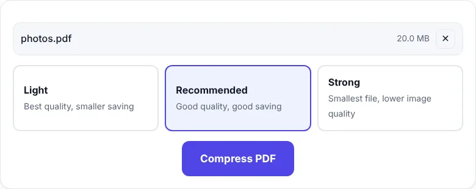

You try to attach a PDF to an email, and you get the message *"File too large"*. Or a job portal, college website or government form only accepts PDFs **under 1 MB** — sometimes even under 200 KB. The good news: most PDFs can be made much smaller in a few seconds, for free.

This guide explains why PDFs get big, how to compress one step by step, and what to do if it is still too large.

## Why are some PDFs so large?

A PDF's size depends mostly on what is inside it:

- **Scanned pages** — every page is a photo, often at very high resolution.
- **Photos and images** — pictures from phones and cameras are several megabytes each.
- **Embedded fonts** — usually small, but they add up in long documents.
- **Text and lines** — take very little space.

So a 10-page report with only text might be 200 KB, while 10 scanned pages can easily be 20 MB. Compression works by shrinking the **images** inside the PDF, which is where almost all the size comes from.

## Email and upload size limits

| Where you are sending it | Typical limit |
|---|---|
| Gmail attachment | 25 MB |
| Outlook attachment | about 20 MB |
| Job portals and online applications | often 1–2 MB |
| Government and exam forms | often 100 KB – 1 MB |

Even when an email service allows 20–25 MB, smaller files send faster, open faster on phones and are less likely to be blocked by the receiver's mailbox.

## How to compress a PDF (step by step)

1. Open **[Compress PDF](/compress-pdf/)** on ZentaPDF.
2. Click **Choose PDF file** or drag your PDF into the box.
3. Choose a level:
   - **Light** – best quality, smaller saving. Good for printing.
   - **Recommended** – good quality and a big saving. Best for email.
   - **Strong** – the smallest file. Good for strict upload limits.
4. Click **Compress PDF**. You will see the old and new size, for example *20 MB → 520 KB (-97%)*.
5. Click **Download PDF** and attach it to your email.

That's it. No sign-up, no watermark.

## What if the PDF is still too big?

Try these in order:

1. **Use the Strong level.** It reduces photos the most.
2. **Remove pages you don't need.** Blank pages, cover pages or extra copies add size. Use [Remove Pages](/remove-pages/) and compress again.
3. **Split the PDF.** If you must send everything, split it into two or three parts with [Split PDF](/split-pdf/) and send them in separate emails.
4. **Compress images before making the PDF.** If you create the PDF from phone photos, first shrink the photos with [Compress Image](/compress-image/), then turn them into a PDF with [JPG to PDF](/jpg-to-pdf/).

> **Tip:** When you scan documents on your phone, choose a lower quality or "document" mode. A scan at 150–200 DPI is perfectly readable and much smaller than 600 DPI.

## Will compression reduce quality?

ZentaPDF's compression only touches **pictures** inside the PDF. Text, tables, lines and logos drawn as vectors stay exactly as sharp as before. On the Recommended level, photos still look good on screen and when printed on normal office paper.

If your PDF has fine details — such as engineering drawings saved as images or small print on a scan — use **Light** and zoom in to check before sending.

## Compressing a PDF on a phone

1. Open [zentapdf.com/compress-pdf/](/compress-pdf/) in Chrome (Android) or Safari (iPhone).
2. Tap **Choose PDF file** and pick the file from Downloads or Files.
3. Choose **Recommended** and tap **Compress PDF**.
4. Download the result and attach it to your email or upload it to the form.

Very large PDFs (100+ MB) may be slow on older phones; use a computer for those.

## Quick checklist before you hit send

- Is the file under the limit? (Check the size shown after compressing.)
- Open the compressed PDF once and scroll through it — are all pages readable?
- Give it a clear name, for example `Santosh-Resume-2026.pdf`, instead of `scan0034.pdf`.

Compressing a PDF takes less than a minute, and it saves you and the person you are emailing a lot of time.
