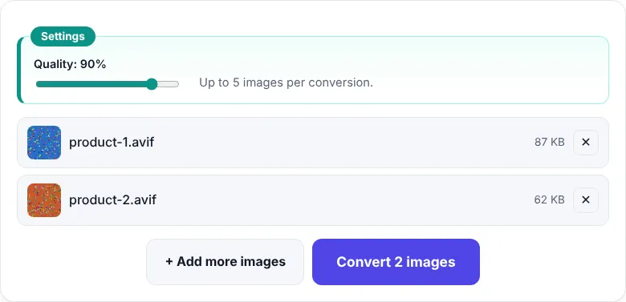

To convert AVIF to JPG, open **[AVIF to JPG](/avif-to-jpg/)**, click **Choose images** and pick up to 5 AVIF files, set the **Quality** if you want, click **Convert** and download the JPG files. It runs in the browser on Android, iPhone and computers, it is free, and you do not need to sign up.

## What is an AVIF file?

AVIF (AV1 Image File Format) is an image format from the Alliance for Open Media. It is based on the AV1 video codec and is open and royalty free. In tests by Netflix in 2020, AVIF compressed images better than JPEG, so the same picture takes fewer bytes. That is why many websites now send AVIF images to your browser.

You usually find AVIF files when you save an image from a website. But some older photo apps, editing software, photo printing shops and upload forms do not accept AVIF. JPG works almost everywhere.

Most modern browsers can show AVIF. Chrome supports it from version 85, Firefox from 93, Edge from 121, and Safari from iOS 16 on iPhone and 16.4 on Mac. ZentaPDF uses your browser to read the AVIF file, so the converter works in those browsers too.

## AVIF vs JPG at a glance

| | AVIF | JPG |
|---|---|---|
| Made for | Websites and small files | Photos everywhere |
| File size | Usually smaller | Bigger for the same picture |
| Transparent background | Yes | No (becomes white) |
| Opens in older apps and printers | Not always | Almost always |
| Accepted by upload forms | Not always | Very often |

For a comparison of JPG, PNG and WebP, see [JPG vs PNG vs WebP](/guides/jpg-vs-png-vs-webp/).

## How to convert AVIF to JPG

1. Open **[AVIF to JPG](/avif-to-jpg/)** in Chrome, Edge, Firefox or Safari.
2. Click **Choose images**, or drag the files into the box. You can add up to **5 images** at a time.
3. Each file shows in a list with a small preview. Click the **cross** next to a file to remove it, or **Add more images** to add another.
4. Under **Settings**, leave **Quality** at **90%**, or move the slider anywhere from 40% to 100%.
5. Click **Convert**. The button shows how many images it will convert, for example **Convert 2 images**.
6. Click **Download** next to a file to save it alone, or **Download all (ZIP)** to save them together. With one image, the button says **Download image**.
7. To convert more, click **Start over** and add the next files.

The new file keeps its name with a new ending, so product.avif becomes product.jpg. The width and height in pixels stay the same.

## Which quality should you choose?

| Quality | File size | Good for |
|---|---|---|
| 95 to 100% | Largest | Printing and photos you will edit again |
| 85 to 90% | Medium | Most uses, sharing and documents |
| 70 to 80% | Smaller | Email and WhatsApp |
| 40 to 60% | Smallest | Only when size matters more than quality |

The JPG is often **bigger** than the AVIF it came from, because AVIF packs the same picture into fewer bytes. That is normal. If the JPG is too big for a form, lower the quality, or use **[Reduce Image Size in KB](/reduce-image-size-in-kb/)** to reach an exact size such as 50 KB or 100 KB. Our guide on [how to reduce image size in KB](/guides/how-to-reduce-image-size-in-kb/) has the steps.

## Convert on a phone

The same page works on a phone, so you do not need an app.

**On Android**

1. Open the AVIF to JPG page in Chrome.
2. Tap **Choose images** and pick the files from your gallery or the **Files** app. Images saved from websites are often in the Download folder.
3. Tap **Convert**, then **Download**. The JPG goes to your Downloads folder.

**On iPhone**

1. Open the page in Safari. You need iOS 16 or later for AVIF.
2. Tap **Choose images** and choose **Photo Library** or **Choose File**.
3. Tap **Convert**, then **Download**. Safari saves the file in the **Files** app, usually in Downloads, and you can share it or save it to Photos from there.

Menu names can be a little different on some phones and versions.

## Transparent AVIF images

Logos, stickers and product cut outs can be AVIF files with a **transparent background**. JPG cannot store transparency, so ZentaPDF fills those parts with **white**. That looks fine on white pages and forms.

To keep the transparent background, for example to put a logo on a coloured design, use **[AVIF to PNG](/avif-to-png/)** instead. PNG keeps transparency.

## Common problems

| Problem | What to do |
|---|---|
| The image will not load in the tool | Update your browser, or open the page in the latest Chrome or Edge |
| Only 5 of your images were added | Convert those 5, click Start over, then add the next ones |
| Upload form says the file is too big | Lower the quality, or use Reduce Image Size in KB |
| Form wants a PDF, not an image | Put the JPG into a PDF with [JPG to PDF](/jpg-to-pdf/) |
| You have WebP files too | Use [WebP to JPG](/webp-to-jpg/), explained in our [WebP to JPG guide](/guides/how-to-convert-webp-to-jpg/) |
| You want PNG, WebP or another format | Use [Convert Image](/convert-image/) to pick the output format |

Each exam, bank and government portal sets its own upload rules for format, size in KB and pixel size, so check the official instructions before you upload.
