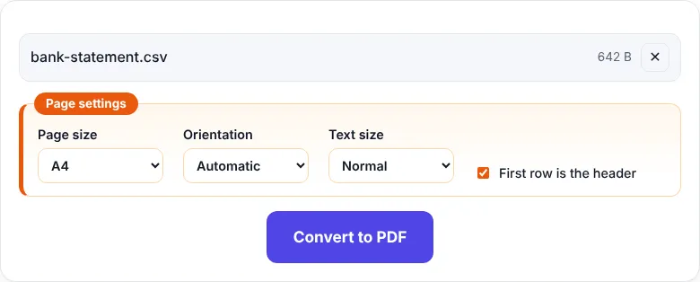

A CSV file is a plain text file where each line is a row and commas split the columns. Banks, accounting software, school portals and Google Forms often give you data in this format. It opens fine in Excel, but it is hard to print or to share with someone who only wants to read it. A PDF table solves both.

> **Short answer:** open [CSV to PDF](/csv-to-pdf/), choose your .csv file, keep **Automatic** orientation, click **Convert to PDF** and then **Download PDF**. The header row repeats at the top of every page.

## How to convert CSV to PDF

1. Open **[CSV to PDF](/csv-to-pdf/)** on your phone or computer.
2. Click **Choose CSV file** and pick your .csv or .tsv file, or drag it into the box.
3. Under **Page settings**, choose:
   - **Page size:** A4 or US Letter.
   - **Orientation:** Automatic, Portrait or Landscape.
   - **Text size:** Small, Normal or Large.
4. Keep **First row is the header** ticked if the first line holds column names like Date, Name or Amount.
5. Click **Convert to PDF**.
6. Check the preview of the first page and the number of pages.
7. Click **Download PDF**. Use **Change settings** if the table looks too crowded.

The PDF gets the same name as your CSV file. The file is read and turned into a PDF inside your browser, so it stays on your device.

## What each setting does

| Setting | Options | When to change it |
|---|---|---|
| Page size | A4, US Letter | A4 is the normal paper size in India. Pick Letter only if someone asks for it |
| Orientation | Automatic, Portrait, Landscape | Automatic uses landscape when the table has more than 6 columns |
| Text size | Small, Normal, Large | Small fits more columns, Large is easier to read on paper |
| First row is the header | Ticked or not | Untick it if your file starts directly with data |

The header row is printed in bold on a light shaded background and is repeated at the top of each new page. Column widths follow the length of the content, and long text wraps inside its cell instead of being cut off. If a table has many columns, the text gets smaller on its own so everything fits across the page.

## How to get a CSV file

| Starting point | How to save as CSV |
|---|---|
| Excel on Windows | File, Save As, then choose **CSV UTF-8 (Comma delimited)** in Save as type |
| Google Sheets | File, Download, then **Comma separated values (.csv)** |
| Google Forms responses | Open the responses in Sheets, then download as CSV |
| Bank or accounting software | Look for Export or Download and choose CSV, if offered |

A CSV saves only one sheet and only the values. Colours, merged cells and formulas are not kept. If you need those in the PDF, use [Excel to PDF](/excel-to-pdf/) with the original .xlsx file instead. Our guide on [fitting an Excel sheet on one PDF page](/guides/how-to-convert-excel-to-pdf-on-one-page/) has more tips for wide sheets.

Export menus differ between banks and apps, so check the help page of your bank or software if you cannot find the CSV option.

## Common problems and fixes

**The table is too wide and the text is tiny.** Choose Landscape and Small text, or remove columns you do not need before converting.

**Hindi or Marathi words show as question marks.** Indian scripts and emoji are not supported inside table cells in this tool. For a table in an Indian language, print or download the sheet as PDF from Excel or Google Sheets instead.

**Long numbers look like 1.23E+15.** The CSV was saved that way by Excel. In Excel, format the column as Text, type or paste the numbers again and save the CSV once more. Then convert it.

**All data is in one column.** The file may use an unusual separator. The tool detects commas, semicolons, tabs and pipes from the first row, so check that the first row is split the same way as the rest of the file.

**Strange symbols in place of letters.** The file was probably saved in an old encoding. Save it again from Excel as **CSV UTF-8** and convert again.

## After converting

- Need one file with a cover letter or other pages? Join them with [Merge PDF](/merge-pdf/). The [merge PDF guide](/guides/how-to-merge-pdf-files/) shows how.
- PDF too large to email or upload? Shrink it with [Compress PDF](/compress-pdf/).
- Have plain notes instead of a table? Use [TXT to PDF](/txt-to-pdf/).
- Received a PDF table and need it back in a spreadsheet? Use [PDF to Excel](/pdf-to-excel/).
