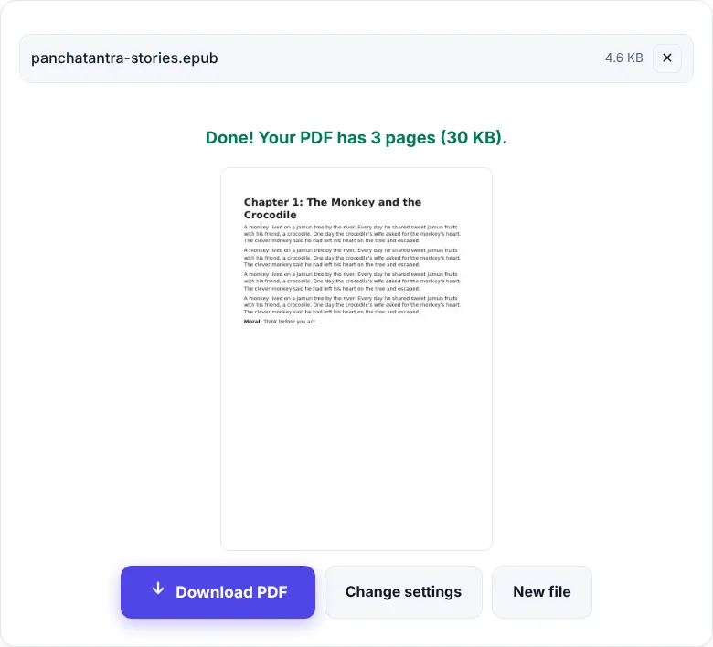

To convert EPUB to PDF, open **[EPUB to PDF](/epub-to-pdf/)**, click **Choose EPUB e-book**, select your **.epub** file, pick the **Page size** and **Text size**, click **Convert to PDF** and then **Download PDF**. It is free, works on phone and computer, and the book is not uploaded. It works for e-books that are not copy protected (DRM-free).

> **Short answer:** Choose the .epub file, keep A4 and Normal text, click Convert to PDF, check the preview and click Download PDF.

## Why convert an EPUB to PDF?

EPUB is the common format for e-books. It reflows text to fit the screen, which is great in an e-book app but less handy in other places. A PDF is often easier when you want to:

- **Print** a book, novel or study material on A4 paper.
- **Read on a laptop or phone** that has no e-book app, since every device can open a PDF.
- **Highlight, add notes or sign** pages with PDF tools.
- **Share or upload** the book where only PDF files are accepted.
- Keep the same pages, so everyone in a class or study group can refer to "page 12".

## How to convert EPUB to PDF

1. Open **[EPUB to PDF](/epub-to-pdf/)**.
2. Click **Choose EPUB e-book** and select a file ending in **.epub**. You can also drop it on the box.
3. Under **Page settings**, choose the **Page size**: **A4** (normal in India) or **US Letter**.
4. Choose the **Orientation**: **Portrait** for normal reading, or **Landscape**.
5. Choose the **Text size**: Small, Normal, Large or Extra large.
6. Click **Convert to PDF**. A progress bar shows the chapters being read.
7. When it says **Done!**, check the page count and the preview of the first page.
8. Click **Download PDF**. The PDF gets the same name as the e-book.
9. Want a different size? Click **Change settings** and convert again. Click **New file** for another book.

## What stays in the PDF

| Part of the e-book | In the PDF |
|---|---|
| Chapters | Kept in reading order, each chapter starts on a new page |
| Headings | Kept as headings |
| Bold and italic text | Kept |
| Pictures inside the book | Placed at the right spot in the text |
| Tables | Kept |
| Page layout of the e-book app | Not copied. The text is laid out fresh on A4 or Letter pages |

Because EPUB has no fixed pages, the number of pages in your PDF depends on the page size and text size you choose. Larger text gives more pages.

## Which text size to choose

| You want to | Page size | Text size |
|---|---|---|
| Print and read on paper | A4 | Normal |
| Print and save paper | A4 | Small |
| Read on a phone screen | A4 | Large or Extra large |
| Read for older family members | A4 | Extra large |

To save even more paper when printing, you can put two pages on one sheet with **[Pages per Sheet](/pages-per-sheet/)**. Our guide on [how to print multiple pages on one sheet](/guides/how-to-print-multiple-pages-on-one-sheet/) shows how.

## EPUB files that cannot be converted

Not every e-book file can be turned into a PDF:

- **Books with DRM (copy protection).** Many bought e-books are locked to one app or account. No converter can open them, and you should not try to break the lock.
- **Kindle books.** Amazon Kindle books use their own formats, not normal EPUB, and are usually protected.
- **ACSM files.** Some stores give you a small .acsm file instead of the book. This is only a link that needs Adobe Digital Editions to download the real book. It is not an EPUB.

**Where to get DRM-free EPUB files:** Google Play Books lets you export some books with **Download EPUB** if the publisher allows it. Project Gutenberg offers thousands of older, out of copyright books as free EPUB downloads. Your own e-books made with writing software are also usually DRM-free. Please convert only books you have the right to use.

## After converting

- **PDF too big to email or upload?** Make it smaller with **[Compress PDF](/compress-pdf/)**. See [how to compress a PDF for email](/guides/how-to-compress-pdf-for-email/) for tips.
- **Want to read it right away?** Open it in **[PDF Reader](/pdf-reader/)**.
- **Have a web page instead of an e-book?** Use **[HTML to PDF](/html-to-pdf/)**.

## Converting on a phone

EPUB to PDF works in Chrome on Android and Safari on iPhone. Tap **Choose EPUB e-book** and pick the file from your file manager or the **Files** app. Downloaded e-books are usually in the Download folder. Most books convert in a few seconds. Large books with many pictures can take longer on a phone, so keep the tab open until you see **Done!**.

If your e-book uses Hindi, Marathi, Tamil or another Indian language, check the preview before you download, and open the full PDF to make sure the text looks right.
