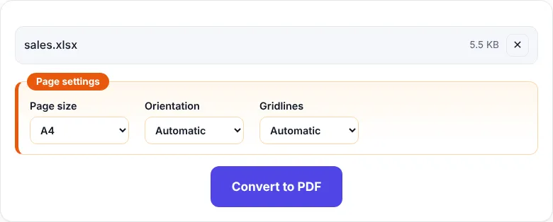

To convert Excel to PDF on one page, the columns must fit the page width and the rows must fit the page height. In **[Excel to PDF](/excel-to-pdf/)** the sheet is fitted to the page width for you. For a long sheet, use Excel's **Fit Sheet on One Page** setting, or join the PDF pages later with **[Pages per Sheet](/pages-per-sheet/)**.

> **Short answer:** keep only the rows and columns you need, choose Landscape, convert, and if the PDF still has more than one page, put 2 or 4 pages on one sheet.

## Why Excel sheets break into many pages

A PDF page is a fixed size, such as A4. A spreadsheet can be as wide and as long as you like. When the sheet is bigger than the page, it is split.

| Problem in the PDF | Usual cause |
|---|---|
| Last columns are on a separate page | The sheet is wider than the page |
| Only a few rows on the last page | The sheet is a little longer than one page |
| Every sheet starts on a new page | The file has more than one sheet |
| Text is too tiny to read | A very large sheet was squeezed onto one page |
| Empty pages | Formatting or cells used far below the real data |

## How to convert Excel to PDF with ZentaPDF

1. Open **[Excel to PDF](/excel-to-pdf/)**.
2. Click **Choose Excel file** and pick your .xlsx, .xls, .ods or .csv file.
3. Under **Page settings**, choose the **Page size** (A4 or US Letter).
4. Set **Orientation**. **Automatic** turns wide sheets to landscape. Choose **Landscape** yourself if you want more columns on the page.
5. Set **Gridlines** to Show or Hide, or leave it on Automatic.
6. Click **Convert to PDF**. The tool shows how many pages your PDF has and a preview of the first page.
7. Click **Download PDF**, or **Change settings** to try another orientation.

For .xlsx files the PDF keeps fonts, cell colours, borders, merged cells and column widths, and the sheet is scaled to fit the page width. Charts and pictures inside the sheet are not included yet.

## Get the PDF down to one page

If the tool says your PDF has more than one page, try these in order:

1. **Hide what you do not need.** In Excel, hide extra columns and rows (right click the column letter or row number and choose Hide). In .xlsx files, hidden rows, columns and sheets are left out of the PDF.
2. **Keep one sheet.** Every sheet with data starts on its own page. Hide or delete the other sheets if you only need one.
3. **Use Landscape.** A landscape A4 page is wider, so more columns fit at a readable size.
4. **Delete empty rows at the bottom.** Cells with formatting but no data can still count as part of the sheet.
5. **Join the pages.** If you still get 2 or 4 pages, open [Pages per Sheet](/pages-per-sheet/), choose 2 or 4 pages per sheet, and download. All pages now sit on one sheet of paper.

Our guide on [printing multiple pages on one sheet](/guides/how-to-print-multiple-pages-on-one-sheet/) explains the Pages per Sheet options in detail.

## Fit to one page in Microsoft Excel

If you have Excel on a computer, you can set the scaling before you save:

1. Go to the **Page Layout** tab.
2. In the **Scale to Fit** group, set **Width** to **1 page** and **Height** to **1 page**.
3. Or press **Ctrl + P** and, under Settings, choose **Fit Sheet on One Page**.
4. Check the print preview.
5. Go to **File**, then **Save As** (or **Export**), and choose **PDF** as the file type.

Microsoft notes that squeezing a big sheet onto one page can make it hard to read. If the scale number is very low, try landscape or a larger paper size instead. Setting **Height** to **Automatic** keeps all columns on one page width while the rows go on to more pages.

## Fit to one page in Google Sheets

1. Open the sheet and go to **File**, then **Download**, then **PDF**.
2. In the settings that open, look for **Scale** and choose **Fit to page** for one page, or **Fit to width** to keep all columns together.
3. Pick the paper size and orientation, then click **Export**.

Menu names in Google Sheets can change over time, so look for the scale option if it is in a different place.

## Which method to use

| Your situation | Best method |
|---|---|
| No Excel installed, or you are on a phone | ZentaPDF [Excel to PDF](/excel-to-pdf/) |
| Sheet must be exactly one page | Excel's Fit Sheet on One Page, or Pages per Sheet after converting |
| The file is in Google Drive | Google Sheets download as PDF |
| Simple list saved as CSV | [CSV to PDF](/csv-to-pdf/) |
| Several sheets to send as one file | Convert, then join with [Merge PDF](/merge-pdf/) if needed |

## Tips for a readable one page PDF

- **Do not shrink too far.** A sheet with hundreds of rows will not be readable on one A4 page. Two pages that people can read are better than one page they cannot.
- **Shorten long text.** Wrap text in narrow columns instead of making columns very wide.
- **Check the preview.** The first page preview in the tool shows you at once if the text looks too small.
- **Need the data back in Excel later?** See [how to convert PDF to Excel](/guides/how-to-convert-pdf-to-excel/).
