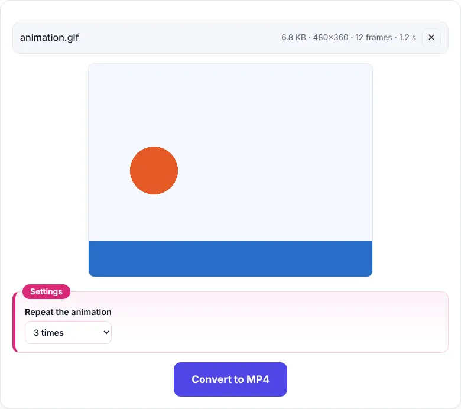

To convert a GIF to MP4, open **[GIF to MP4](/gif-to-mp4/)**, click **Choose GIF file**, choose how many times the animation repeats, click **Convert to MP4** and then **Download MP4**. The video plays on any phone and you can post it on Instagram, WhatsApp status and other apps that want a video instead of a GIF. It is free and the GIF never leaves your device.

## Why change a GIF into a video

A GIF is a picture format with animation added. It was never made for long clips:

- Only 256 colours per frame. Photos and smooth colour changes look grainy.
- Big files for real footage. Every frame is stored more or less on its own, so a few seconds of video saved as GIF can run into several MB.
- Not accepted everywhere. Instagram, many video players and some chat apps expect a photo or a video, not a GIF file.

MP4 is the video format almost every phone, computer and social app plays. Video compression mostly stores what changes from one frame to the next, so for most clips the MP4 ends up lighter than the GIF and looks smoother too.

## GIF or MP4: quick comparison

| | GIF | MP4 |
|---|---|---|
| Colours | Up to 256 per frame | Full colour |
| Plays by itself on a loop | Yes, in most apps | Only if the app loops videos |
| Sound | Never | Can have sound (the converted file has none) |
| Transparent background | Yes | No, clear areas become white |
| Instagram feed post | Not as a moving post | Yes |
| File size for real footage | Usually large | Usually much smaller |

## How to convert a GIF to MP4

1. Open **[GIF to MP4](/gif-to-mp4/)** in Chrome, Edge or Safari. Use the latest version, because older browsers may not be able to create MP4 videos.
2. Click **Choose GIF file**, or drop the GIF on the box.
3. Check the line with the file name. It shows the size, width and height, number of frames and how many seconds the GIF lasts.
4. Under **Repeat the animation**, choose **Once**, **2 times**, **3 times**, **5 times** or **10 times**. 3 times is chosen at first.
5. Click **Convert to MP4** and wait for the progress bar.
6. The tool shows **Done!** with the video size in pixels and in KB or MB, and the video plays as a preview.
7. Click **Download MP4**. To try another repeat count, click **Change settings**. To start with another file, click **New GIF**.

## How many repeats to choose

A GIF loops forever by itself. An MP4 plays once and stops, unless the app loops it. So a 1 second GIF becomes a 1 second video, which ends before anyone notices it. The repeat option copies the animation several times into the video to make it longer.

| Your GIF lasts | Once | 3 times | 5 times | 10 times |
|---|---|---|---|---|
| 1 second | 1 s | 3 s | 5 s | 10 s |
| 2 seconds | 2 s | 6 s | 10 s | 20 s |
| 4 seconds | 4 s | 12 s | 20 s | 40 s |

For a WhatsApp status or an Instagram story, 5 or 10 repeats of a short GIF usually work well. For a website or a slide, **Once** is enough if the player loops the video. Each app has its own rules on video length, so check the app if a video is rejected.

## Things to know before you convert

- No sound. A GIF has no audio, so the MP4 is silent too. You can add music later in your phone's video editor or in the app you post to.
- Transparent parts turn white. Videos have no see through areas.
- Width and height become even numbers. If your GIF is 481 pixels wide, the video is 480 wide. The video encoder needs even sizes, so you lose at most one pixel on a side.
- Small simple GIFs may grow. In our own test, a 6.8 KB GIF of a few flat colour shapes, repeated 3 times, came out as a 16 KB MP4. MP4 usually saves the most on GIFs made from real video or photos, not on tiny icons.

## Fix the GIF first if you need to

If the GIF needs a change first, do it before converting:

| You want to | Use |
|---|---|
| Cut off empty edges or make it square | [Crop GIF](/crop-gif/) |
| Make the animation faster or slower | [Change GIF Speed](/gif-speed/) |
| Keep it as a GIF but make the file lighter | [Compress GIF](/compress-gif/) |
| Go the other way and make a GIF from a video | [Video to GIF](/video-to-gif/) |

## Common problems

| Problem | What to try |
|---|---|
| Message says your browser cannot create MP4 videos | Update Chrome, Edge or Safari, or try another of these browsers |
| "Please choose a GIF file" | The tool takes only .gif files. For a video file, share it directly |
| The video is too short | Pick 5 or 10 repeats |
| Background turned white | This is normal. Crop the GIF to remove empty edges first |

## Related guides

- [How to convert a video to GIF](/guides/how-to-convert-video-to-gif/)
- [How to resize an animated GIF](/guides/how-to-resize-animated-gif/)
