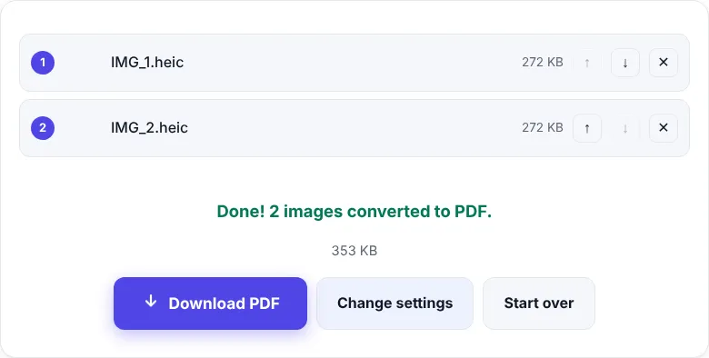

To convert HEIC photos to PDF, open **[JPG to PDF](/jpg-to-pdf/)**, choose your HEIC photos, put them in order, pick the page size and click **Convert to PDF**, then **Download PDF**. The tool reads iPhone HEIC photos directly, so you do not need to change them to JPG first. All photos go into one PDF, one photo per page.

> **Short answer:** HEIC photos in, one PDF out. Free, works in Chrome or Edge on a phone or computer, no sign up.

## What is a HEIC file

HEIC is the photo format iPhones and iPads use when the camera is set to **High Efficiency**. These photos usually take less space than JPG photos of the same quality. The problem is that many places do not accept HEIC:

- Many online forms and portals accept only JPG or PDF
- Older Windows PCs may not open HEIC without an extra add on
- Offices and colleges often ask for documents as one PDF file

So if you photographed a certificate, bill or ID with an iPhone, you may need to turn those photos into a PDF before you can send or upload them.

## How to convert HEIC to PDF

1. Open **[JPG to PDF](/jpg-to-pdf/)** in Chrome or Edge.
2. Click **Choose images** and select your HEIC photos, or drop them into the box. You can mix HEIC with JPG, PNG and WebP.
3. Check the order. Use the up and down arrows to move a photo, or the cross to remove it.
4. Choose the **Page size**: A4, US Letter or Same as image.
5. For A4 or Letter, choose the **Orientation**: Automatic, Portrait or Landscape.
6. Choose the **Margin**: None, Small or Large.
7. Click **Convert to PDF**. The first HEIC photo can take a few seconds while the converter loads.
8. Click **Download PDF**.

Need more photos? Click **Add more images** before you convert. After converting, **Change settings** lets you try another page size, and **Start over** clears the list.

## Which page size to choose

| Page size | What you get | Good for |
|---|---|---|
| A4 | Every photo fitted on an A4 page | Documents, certificates and forms in India |
| US Letter | Every photo fitted on a Letter page | Documents for the US and Canada |
| Same as image | Each page is the size of its photo | Photo albums and sharing pictures |

With **Automatic** orientation, a wide photo gets a landscape page and a tall photo gets a portrait page. A small margin gives a clean white border when the PDF is printed.

## Other ways to make a PDF from HEIC

**On the iPhone itself**

- **Files app:** Save the photos to Files, tap the **More (...)** button, tap **Select**, choose the photos, tap **More (...)** again and tap **Create PDF**. For one photo, long press it, tap **Quick Actions** and **Create PDF**.
- **Photos app:** Select the photos, tap **Share**, scroll down and tap **Print**. Pinch out on the preview to open it as a PDF, tap **Share** and choose **Save to Files**.

The names and steps can change a little with each iOS version.

**Change HEIC to JPG first**

If a form asks for JPG photos, not a PDF, use **[HEIC to JPG](/heic-to-jpg/)** instead. Our [HEIC to JPG guide](/guides/how-to-convert-heic-to-jpg/) shows the steps.

## How to stop HEIC photos on iPhone

| Setting | Where | What it does |
|---|---|---|
| Most Compatible | Settings, Camera, Formats | New photos are saved as JPG, not HEIC |
| High Efficiency | Settings, Camera, Formats | New photos are saved as HEIC (smaller files) |
| Automatic | Settings, Photos, Transfer to Mac or PC | Photos copied to a computer by cable are changed to a compatible format |
| Keep Originals | Settings, Photos, Transfer to Mac or PC | Photos are copied as HEIC |

These settings only change new photos or new transfers. Photos already saved as HEIC stay HEIC, so you still need a converter for them.

## Tips for uploading the PDF

- **Too big?** Shrink it with [Compress PDF](/compress-pdf/). For a strict limit, see [how to compress a PDF to 100 KB](/guides/compress-pdf-to-100kb/).
- **Two PDFs to join?** Use [Merge PDF](/merge-pdf/).
- **Form wants a photo in KB?** Use [Reduce Image Size in KB](/reduce-image-size-in-kb/) on the JPG, not the PDF.
- **Check the rules.** Exam, bank and government portals set their own file type and size limits. Always follow the official instructions of the portal you are using.
- **Check every page.** Open the downloaded PDF and make sure each photo is the right way up and easy to read.

## Common problems and fixes

| Problem | Fix |
|---|---|
| The HEIC photo does not show a thumbnail in the list | Some browsers cannot show HEIC previews. The photo is still converted, so check the downloaded PDF |
| "could not be read as an image" | The file may be damaged or not a real photo. Try exporting it again from the iPhone |
| Photo is sideways in the PDF | Rotate the page with [Rotate PDF](/rotate-pdf/) |
| The page is slow on a phone | Convert fewer photos at a time, or use a computer for very large batches |

Once your iPhone photos are in one PDF, they open on any phone or computer, and most portals and email apps accept them without trouble.
