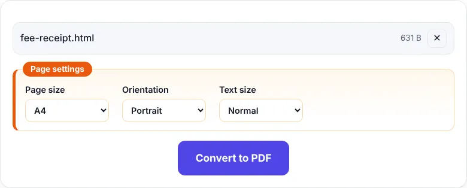

To convert an HTML file to PDF, open **[HTML to PDF](/html-to-pdf/)**, click **Choose HTML file**, pick your .html or .htm file, choose the page settings, click **Convert to PDF** and then **Download PDF**. If the page is open in your browser and you do not have the file, use the browser's own **Save as PDF** option, explained further down.

## Which method should you use?

| What you have | Best way | What you get |
|---|---|---|
| An .html or .htm file (saved page, email template, report exported from software) | [HTML to PDF](/html-to-pdf/) on ZentaPDF | A clean, readable PDF with searchable text |
| A web page open in Chrome or Edge on a computer | Ctrl+P, then Save as PDF | The page as the browser prints it |
| A web page open in Chrome on Android | Three dots, Share, Print, Save as PDF | The page as the browser prints it |

The ZentaPDF tool is good for HTML files you already have, such as a fee receipt or bill saved from a portal, an exported report, or a newsletter template. It puts the content into a plain document layout, which is easier to read and print than a busy web page.

## How to convert an HTML file to PDF

1. Open **[HTML to PDF](/html-to-pdf/)** on your computer or phone.
2. Click **Choose HTML file**, or drop the file into the box. It must end in **.html** or **.htm**.
3. The file name and size show at the top. Click the **cross** if you picked the wrong file.
4. Under **Page settings**, choose:
   - **Page size:** A4 or US Letter. A4 is the normal size in India.
   - **Orientation:** Portrait or Landscape. Landscape helps with wide tables.
   - **Text size:** Small, Normal, Large or Extra large.
5. Click **Convert to PDF**.
6. You see a message like "Done! Your PDF has 2 pages" with a preview of the first page.
7. Click **Download PDF**. The PDF gets the same name as your HTML file.

To try other settings, click **Change settings**. To convert another file, click **New file**.

## What is kept and what is left out

| Kept in the PDF | Left out or simplified |
|---|---|
| Headings, paragraphs, bold and italic text | Website colours, fonts and columns |
| Bullet and numbered lists | Menus (nav), buttons and form boxes |
| Tables | Scripts, videos and embedded frames |
| Links | Images saved as separate files on your computer |
| Images inside the file, and images from public web addresses that allow it | Hidden parts of the page |

The text in the PDF is real text, so you can search it and copy from it.

## Images are missing in the PDF

When you save a page from Chrome as "Webpage, Complete", you get an .html file and a separate folder of images. The tool reads only the HTML file, so images in that folder are not added. Images that point to a public web address are added when the website allows it, but some sites block this.

If the images matter, open the page in your browser and use the browser's Save as PDF option. That keeps the page as you see it on screen.

## Save a live web page as PDF in your browser

**On a computer (Chrome or Edge)**

1. Open the web page.
2. Press **Ctrl+P** (Cmd+P on Mac).
3. Set the destination to **Save as PDF**.
4. Click **Save** and choose a folder.

**In Chrome on Android**

1. Open the web page and tap the **three dots** at the top right.
2. Tap **Share**, then **Print**.
3. Tap the small **down arrow** at the top and choose **Save as PDF**.
4. Tap the **Print** button to save. The file goes to your Downloads folder.

Menu names can be a little different between browser and phone versions.

## After you make the PDF

| Need | Tool |
|---|---|
| File too big to email or upload | [Compress PDF](/compress-pdf/) |
| Join several receipts into one file | [Merge PDF](/merge-pdf/) |
| Plain notes in a .txt file | [TXT to PDF](/txt-to-pdf/) |
| A Markdown (.md) file | [Markdown to PDF](/markdown-to-pdf/) |

Our guide on [how to compress a PDF for email](/guides/how-to-compress-pdf-for-email/) shows how to bring the size down, and [how to merge PDF files](/guides/how-to-merge-pdf-files/) explains joining them.

If you keep a receipt or certificate as a PDF for official use, check what the office or portal accepts. Some ask for the original document downloaded from their own site, not a converted copy.
