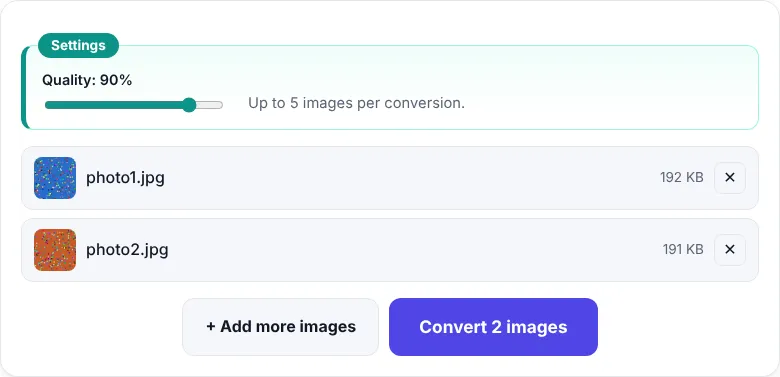

To convert JPG to WebP, open **[JPG to WebP](/jpg-to-webp/)**, click **Choose images**, pick up to 5 JPG photos, set the **Quality** (90% is the default), click **Convert** and download your WebP files. WebP files are usually smaller than JPG at the same quality, so your pages load faster. It's free, and your photos are not uploaded.

## Why convert JPG to WebP

WebP is an image format Google made for the web. Google says lossy WebP images are 25 to 34 percent smaller than comparable JPG images at equal quality. For a website, blog or online shop that means pages load faster, especially on mobile data, and use less storage and bandwidth on your hosting plan. Google PageSpeed Insights also often suggests serving images in modern formats like WebP.

WebP can hold transparency and animation too, but a JPG has neither, so the WebP looks the same as the photo you started with.

## How to convert JPG to WebP

1. Open **[JPG to WebP](/jpg-to-webp/)**.
2. Click **Choose images** and select up to 5 JPG files. You can also drop them on the box.
3. Each photo shows with a small preview and its size. Click the **cross** to remove one, or **Add more images** if you have fewer than 5.
4. Under **Settings**, move the **Quality** slider if you want. It goes from 40% to 100% and starts at **90%**.
5. Click **Convert** (the button shows how many images, for example **Convert 2 images**).
6. Next to each photo you now see the new size and the width and height in pixels. Click **Download** next to any image to save it.
7. Click **Download all (ZIP)** to get all of them together, or **Download image** if you converted one.
8. Click **Start over** for the next 5 photos.

The WebP keeps the original name, so **photo1.jpg** becomes **photo1.webp**. The width and height stay the same.

## Which quality to choose

The slider trades file size against sharpness.

| Quality | What you get | Good for |
|---|---|---|
| 90 to 100% | Very sharp, biggest WebP files | Photography portfolios, product zoom images |
| 75 to 85% | Small files that still look clean | Blog posts, website banners, most product photos |
| 60 to 70% | Much smaller, some softness up close | Thumbnails and small images |
| 40 to 55% | Smallest, visible blur and blocks | Only when size matters more than looks |

A JPG that was already heavily compressed won't get sharper. If the WebP is not much smaller than the JPG, lower the quality by 10, convert again and compare.

## Make the image smaller still

Most of a photo's size comes from its width and height, and a 4000 pixel wide phone photo is far bigger than a website needs.

1. First use **[Resize Image](/resize-image/)** to bring the width down to what your page shows, such as 1200 or 1600 pixels.
2. Then convert the resized JPG with **[JPG to WebP](/jpg-to-webp/)**.

If you need a JPG under a fixed size in KB for a form instead, see [how to reduce image size in KB](/guides/how-to-reduce-image-size-in-kb/).

## When to keep JPG instead

| Situation | Best format |
|---|---|
| Website, blog or online store images | WebP |
| PNG logos and screenshots for the web | WebP (use [PNG to WebP](/png-to-webp/)) |
| Exam, job or government form uploads | JPG, as the form asks |
| Printing at a shop or sending to older software | JPG |
| Someone sent you a WebP that will not open | Convert back with [WebP to JPG](/webp-to-jpg/) |

Keep your original JPG files after converting. Our [JPG vs PNG vs WebP](/guides/jpg-vs-png-vs-webp/) guide explains how the three formats differ.

## Converting on a phone

JPG to WebP works in Chrome on Android and on a computer. Some browsers, including some versions of Safari, can show WebP images but cannot create them. If yours cannot, the tool shows a message asking you to use Chrome or Edge. The conversion happens on your own device, so your photos never leave it.
