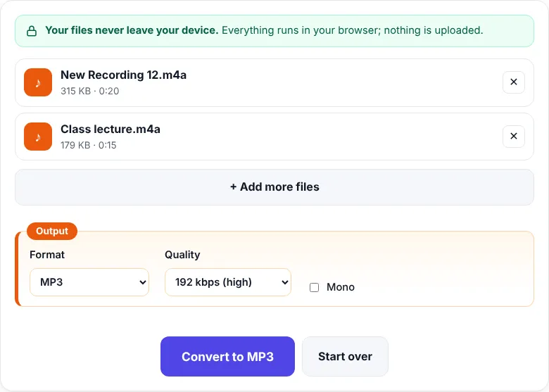

To convert M4A to MP3, open **[M4A to MP3](/m4a-to-mp3/)**, click **Choose audio files** and pick one or more M4A files, keep **MP3** as the **Format**, choose the **Quality**, click **Convert to MP3** and download your files. It is free, works on phone and computer, and your files are not uploaded.

> **Short answer:** Choose the M4A files, keep MP3 at 192 kbps (high), click Convert to MP3, then click Download or Download all (ZIP).

## What is an M4A file?

M4A is an audio file that usually holds AAC sound. It sounds good at a small size, and Apple uses it a lot. You will often get M4A files from:

- **iPhone Voice Memos.** Every recording made with the Voice Memos app is saved as M4A.
- **Some Android voice recorder and call recording apps.**
- **Songs bought or ripped with iTunes or Apple Music** on a computer.
- **Audio saved from some video and lecture apps.**

The problem is that some places still expect MP3. Older car stereos, cheap speakers, some music players, school and office upload forms and some editing apps may not open M4A. MP3 plays almost everywhere, so converting removes the trouble.

## How to convert M4A to MP3

1. Open **[M4A to MP3](/m4a-to-mp3/)**.
2. Click **Choose audio files** and select one or more M4A files. You can also drop them on the box.
3. Each file appears in a list with its size and length. Click **Add more files** to add more, or the **cross** to remove one.
4. Under **Output**, keep **Format** set to **MP3**.
5. Choose the **Quality**. **192 kbps (high)** is the default.
6. Tick **Mono** only if you want a smaller file for speech.
7. Click **Convert to MP3**.
8. When a file is ready, its new size appears and a **Download** button shows next to it.
9. With two or more files, click **Download all (ZIP)** to get them together.
10. Click **Start over** to convert a new set.

The MP3 keeps the original name, so **New Recording 12.m4a** becomes **New Recording 12.mp3**.

## Which quality (kbps) to choose

The kbps number decides the sound quality and the file size. An MP3's size depends on its length and kbps, not on the M4A you started with.

| Quality | Size for 1 minute (about) | Best for |
|---|---|---|
| 64 kbps | 0.5 MB | Long lectures and voice notes where size matters most |
| 128 kbps (good) | 1 MB | Speech, meetings, interviews |
| 192 kbps (high) | 1.4 MB | Most music, the safe default |
| 320 kbps (best) | 2.4 MB | Music when you want the highest MP3 setting |

Converting from M4A to MP3 cannot make the sound better than the original. If your M4A is a 128 kbps voice memo, choosing 320 kbps only gives you a bigger file. For voice, 128 kbps with **Mono** ticked keeps files small and clear.

## Getting your M4A files

**On iPhone:** Open **Voice Memos**, tap the recording, tap the **three dots** and use the share option to **Save to Files**. Then open the converter in Safari, tap **Choose audio files** and pick the memo from the **Files** app. The MP3 is saved in Files, usually in Downloads.

**On Android:** Open the converter in Chrome and tap **Choose audio files**. Recordings are often in the Recordings, Music or Download folder in your file manager.

**On a computer:** Copy the files from your phone, or use the M4A files from your music folder.

Songs with copy protection (DRM) cannot be read by any converter. Normal M4A files and your own recordings work fine.

## Other formats and next steps

| You want to | Use |
|---|---|
| Convert WAV, OGG, FLAC or other formats | [Audio Converter](/audio-converter/) |
| Make the MP3 smaller for WhatsApp or email | [Audio Compressor](/audio-compressor/) |
| Cut out only the useful part | [MP3 Cutter](/mp3-cutter/) |
| Make a soft recording louder | [Volume Booster](/volume-booster/) |
| Make an iPhone ringtone (M4R) | [Ringtone Maker](/ringtone-maker/) |

If your recording is too quiet after converting, our guide on [how to increase the volume of an audio file](/guides/how-to-increase-audio-volume/) explains the right dB boost. To put several recordings into one file, see [how to join audio files](/guides/how-to-join-audio-files/).

## Converting on a phone

The converter works in Chrome on Android and Safari on iPhone. The work is done by your own device, so long recordings take a little more time. For files over 100 MB, keep the tab open until each file shows its **Download** button. A computer is faster for very long recordings, such as a full day of lectures.
