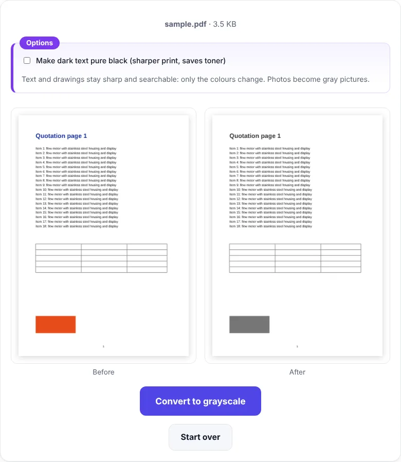

Colour printing costs more than black and white, at home and at the print shop. If your PDF has coloured slides, photos or a coloured background, you can **convert the PDF to black and white** (grayscale) before printing. The file is changed for free in your browser, the text stays sharp and searchable, and you can make dark text pure black so it prints crisp.

## Grayscale or black and white: what is the difference?

People say "black and white" for both, but they are not the same.

| Type | What it looks like | Best for |
|---|---|---|
| Colour | Every colour as it is | Photos, brochures, certificates in colour |
| Grayscale | Colours become shades of gray, from white to black | Notes, slides, reports with photos or charts |
| Pure black and white (1-bit) | Only black or white, no gray | Plain text scans and fax style copies |

ZentaPDF's Grayscale PDF makes a **grayscale** PDF. Photos and coloured charts keep their light and dark parts, so they are still easy to read on paper. If you tick the pure black option, dark text is printed solid black.

## How to convert a PDF to black and white (step by step)

1. Open **[Grayscale PDF](/pdf-to-grayscale/)**.
2. Click **Choose PDF file** or drag the PDF into the box.
3. Look at the **Before** and **After** preview of the first page.
4. Tick **Make dark text pure black (sharper print, saves toner)** if your PDF is mostly text.
5. Click **Convert to grayscale**.
6. Click **Download PDF** and print the new file.

Your original PDF is not changed, so you still have the colour version.

## Why "Make dark text pure black" helps

Text in many PDFs is not really black. It may be a very dark gray or dark blue. When a printer prints a dark gray, it uses a pattern of tiny dots, so letters can look slightly fuzzy. Pure black prints as solid ink.

Tick this option for notes, question papers, forms and reports. For a PDF full of photos it makes little difference, so you can leave it off.

## Is converting better than the printer setting?

Most print windows have a colour setting. In Adobe Acrobat Reader there is a **Print in grayscale (black and white)** box, and in Chrome you may see a **Colour** setting with a **Black and white** choice. Whether these appear depends on your printer and its driver.

Converting the file itself is better when:

- **You send it to a print shop or cyber cafe.** They print what they get. A grayscale file means you are not charged for colour pages by mistake. Ask the shop how they charge, as rates and rules differ.
- **An office printer always prints in colour** and you cannot change its settings.
- **A college, exam or job portal asks for a black and white PDF.** Rules differ from portal to portal, so always read the official instructions for size and format.
- **You want to see the result before printing.** The before and after preview shows exactly how the page will look.

## Tips to save more paper and ink

| Tip | How |
|---|---|
| Put 2 or 4 slides on one sheet | Use [Pages per Sheet](/pages-per-sheet/). See [how to print multiple pages on one sheet](/guides/how-to-print-multiple-pages-on-one-sheet/). |
| Change Letter size PDFs to A4 | Use [Change Page Size](/page-size/) so nothing gets cut off on A4 paper |
| Make the file smaller to email | Use [Compress PDF](/compress-pdf/) after converting |
| Print only the pages you need | Type the page numbers in your print window, for example 1-3, 7 |

Dark slide backgrounds use a lot of toner even in grayscale, because the background turns dark gray. If you have the original PowerPoint file, switching to a white background design before saving as PDF saves even more ink.

## Does it work on phone?

Yes. Open the tool in Chrome or Safari on your phone, choose the PDF from your files, convert and download. The file is processed in your browser and is not uploaded to a server.

## Something looks wrong?

- **A photo looks too dark or too light.** That is how its colours look in gray. Light colours like yellow become very light gray, and some colours that look different in colour can look the same in gray.
- **Charts are hard to read.** Two bar colours may turn into the same shade of gray. Check the preview before printing, and if the chart matters, print that page in colour.
- **Want the page as an image instead?** Use [PDF to JPG](/pdf-to-jpg/).
