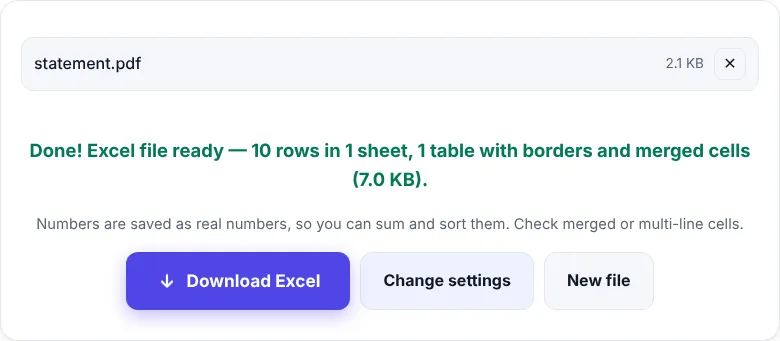

To convert a PDF to Excel, open **[PDF to Excel](/pdf-to-excel/)**, choose your PDF, pick one sheet per page or all pages in one sheet, and click **Convert to Excel**. You get an XLSX file where the tables from your PDF are rows and columns, and the amounts are real numbers you can add up.

It works best for PDFs made by software, such as bank statements, invoices and reports.

## Which PDFs convert well

| Type of PDF | Result | Tip |
|---|---|---|
| Bank statement downloaded from net banking | Very good | Use "All in one sheet" so all months are in one list |
| Invoice or quotation made in billing software | Very good | Check the total row after converting |
| Price list or report with table lines | Very good | Borders, merged cells and bold headers are kept |
| Table without lines (only spaces between columns) | Good | Columns are found from the gaps, so check them once |
| Scanned page or photo of a statement | Does not work yet | There is no text inside a scan; OCR is coming soon |
| Password protected statement | Unlock first | Use [Unlock PDF](/unlock-pdf/) with your password |

A quick test: open the PDF and try to select a word with your mouse. If you can select the text, the PDF can be converted. If the whole page selects like one picture, it is a scan.

## How to convert PDF to Excel (step by step)

1. Open **[PDF to Excel](/pdf-to-excel/)** on your phone or computer.
2. Click **Choose PDF file**, or drag and drop the PDF into the box.
3. Choose how the sheets should be made:
   - **One sheet per page:** each PDF page goes to its own sheet (Page 1, Page 2 and so on).
   - **All in one sheet:** all pages come one after another in a single sheet. This is best for long statements.
4. Click **Convert to Excel** and wait a few seconds while each page is read.
5. Click **Download Excel**. The file has the same name as your PDF, ending in .xlsx.
6. Open it in Excel, Google Sheets or WPS Office and check the numbers.

The file is converted in your browser, so your statement is not uploaded to a server. If you want different settings, click **Change settings** and convert again.

## Converting a bank statement for ITR or accounts

Bank statements are the most common reason people search for PDF to Excel in India. You may want to total your interest, find all UPI payments to one shop, or share the data with your CA.

1. **Remove the password.** Many banks send e-statements as password protected PDFs. The password format is different for every bank and is usually given in the email or on the bank's website. Once you know it, unlock the file with [Unlock PDF](/unlock-pdf/). Our guide on [how to remove a password from a PDF](/guides/how-to-unlock-pdf/) explains this step.
2. **Convert with "All in one sheet".** This keeps every transaction in one long list, which is easier to filter.
3. **Check the rows.** Long descriptions sometimes go over two lines in the PDF. Look at a few rows and make sure the date, description and amount are in the right row.
4. **Use Excel tools.** Turn on Filter to see only debits or credits, or use SUM on the amount column to get totals.

Always compare the final balance in Excel with the closing balance printed on the statement. If they match, your data is complete.

## Numbers in Indian format

PDF to Excel understands amounts the way they are printed in Indian documents:

| In the PDF | In Excel |
|---|---|
| 1,23,456.50 | 123456.5 (a number) |
| ₹500 | 500 (a number) |
| (250) | -250 (a negative number) |
| 18% | 0.18 (a number) |
| 001234 (a code) | stays as text, so the zeros are kept |

So you can sort, total or chart the amounts without retyping anything.

## Other ways to convert PDF to Excel

- **Excel's own import.** Excel for Microsoft 365 and Excel 2024 on Windows can import tables from a PDF through Data, then Get Data, then From File, then From PDF. It is useful if you already have that version, but it does not exist in every version of Excel.
- **Ask for a CSV or Excel file.** Some net banking sites let you download the statement as Excel or CSV directly. Check your bank's download options first.

If you only need the text and not the table layout, [PDF to Text](/pdf-to-text/) is quicker. To fix wording in a letter or report, [PDF to Word](/pdf-to-word/) is the better choice.

## If the result does not look right

| Problem | What to do |
|---|---|
| "No text was found in this PDF" | The PDF is a scan. Ask for a downloaded copy instead of a scanned one |
| It asks for a password | Unlock the PDF first with the password from your bank |
| Two columns joined into one | The table had no lines and very small gaps. Check and split that column in Excel |
| A description is split over two rows | Join the text of those two cells by hand in Excel |
| Only part of the file was converted | Only the first 300 pages are converted. Split the PDF and convert the rest |

When your data is ready in Excel and you need to send it back as a PDF, use [Excel to PDF](/excel-to-pdf/). To keep a scanned bill or receipt as a PDF in the first place, see [how to scan documents to PDF with your phone](/guides/scan-documents-to-pdf-with-phone/).
