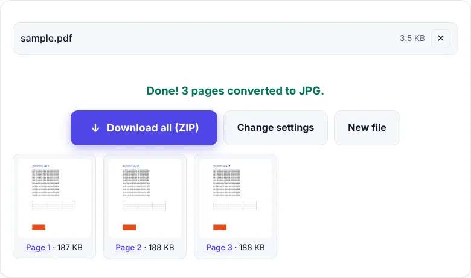

Many online forms, apps and chat groups want an **image**, not a PDF. You may need a certificate as a JPG for a job portal, or one page of a bill to post on WhatsApp status. You can turn every page of a PDF into a JPG image for free in your browser, on a phone or a computer, with no app and no watermark.

> **Short answer:** open [PDF to JPG](/pdf-to-jpg/), choose the PDF, click **Convert to images**, then download all pages as a ZIP or one page at a time.

## How to convert PDF to JPG

1. Open **[PDF to JPG](/pdf-to-jpg/)** in Chrome, Safari or any modern browser.
2. Tap **Choose PDF file** or drag the PDF into the box.
3. Keep **JPG** selected. Choose **PNG** instead if you want lossless images (see the table below).
4. Pick the **Quality**: Normal (100 DPI), High (150 DPI) or Very high (300 DPI). High is selected at the start.
5. Click **Convert to images** and wait while each page is converted. With many pages you can click **Stop** at any time.
6. Click **Download all (ZIP)** to save every page, or tap a page link such as **Page 1** to save only that image. A one page PDF gives a **Download image** button.

The images are named after your PDF with the page number, for example result-page-1.jpg. The conversion happens inside your browser, so your PDF is not uploaded.

## Which quality to choose

DPI means dots per inch. More dots give a sharper image and a bigger file. Here is roughly what you get for an A4 page:

| Quality | Image size of an A4 page | Best for |
|---|---|---|
| Normal (100 DPI) | about 830 x 1170 pixels | WhatsApp, email, viewing on screen |
| High (150 DPI) | about 1240 x 1750 pixels | Most online forms and documents |
| Very high (300 DPI) | about 2480 x 3510 pixels | Printing and small text |

If a portal says the image must be under a certain size in KB, start with Normal or High. If the file is still too big, use [Reduce Image Size in KB](/reduce-image-size-in-kb/) to hit the exact limit. Upload rules differ between exam, bank and government portals, so always follow the size and format given in the official instructions.

## JPG or PNG?

| | JPG | PNG |
|---|---|---|
| File size | Smaller | Bigger |
| Best for | Photos and scanned pages | Text, tables and line drawings |
| Quality | Very slight loss | No loss |
| Accepted by most forms | Yes | Often, but check |

When in doubt, choose JPG, because most upload forms ask for JPG or JPEG. If you want PNG for every page, you can also open [PDF to PNG](/pdf-to-png/) directly.

## Convert PDF to JPG on Android or iPhone

The same steps work on a phone. A few tips make it easier:

1. If the PDF came on WhatsApp, open it and use **Save** or **Share** to keep it in your Downloads or Files first.
2. Open PDF to JPG in your browser and tap **Choose PDF file**. Pick the file from Downloads (Android) or Files (iPhone).
3. For long PDFs, use **Normal** or **High** quality. Very high quality on many pages needs a lot of memory and works better on a computer.
4. After download, a ZIP opens in the Files app on most phones. Tap it to extract the images, or save single pages instead.

Very large pages, such as posters or maps, are scaled down a little so that phones do not run out of memory.

## Common problems and fixes

| Problem | Fix |
|---|---|
| "This PDF is password-protected" | Unlock it first with [Unlock PDF](/unlock-pdf/). For e-Aadhaar, see the [Aadhaar PDF password guide](/guides/aadhaar-card-pdf-password/). |
| Image is blurry | Click **Change settings** and convert again at High or Very high |
| Image file too big | Use Normal quality, or shrink it with [Reduce Image Size in KB](/reduce-image-size-in-kb/) |
| Need only the photos inside the PDF | Follow our guide on [extracting images from a PDF](/guides/how-to-extract-images-from-pdf/) |
| Phone gets slow on a big PDF | Use Normal quality or convert on a computer |

## Other useful tools

- **Turn images back into a PDF:** [JPG to PDF](/jpg-to-pdf/) joins your images into one PDF.
- **PDF too big for a portal?** See [how to compress a PDF to 100 KB](/guides/compress-pdf-to-100kb/).
- **Only need some pages?** Convert the whole PDF and keep just the page images you need.
