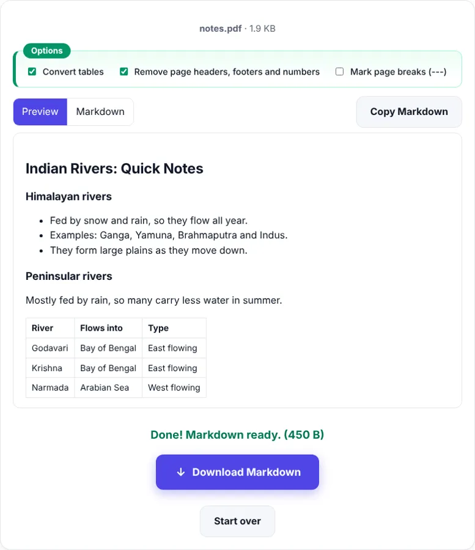

To convert a PDF to Markdown, open **[PDF to Markdown](/pdf-to-markdown/)**, choose your PDF and click **Copy Markdown**. You get clean text with headings, bullet points and tables marked in Markdown, ready to paste into ChatGPT, Claude or any notes app. It is free and needs no sign up.

## What is Markdown and why AI tools like it

Markdown is ordinary text with a few simple marks. A line starting with `#` is a heading, a line starting with `-` is a bullet point and a table is drawn with `|` signs. Any app can open it, and both people and AI tools can read it easily.

| In the PDF | In Markdown |
|---|---|
| Big bold heading | `# Heading` |
| Smaller heading | `## Sub heading` |
| Bullet list | `- item` |
| Bold word | `**word**` |
| Table | rows with `\|` between columns |
| Page number and header on every page | removed |

Why this helps with ChatGPT and Claude:

- **You see exactly what the AI reads.** If a table came out wrong, you notice it before you ask your question.
- **You can paste only the part you need.** Copy one chapter or one section instead of uploading the whole file.
- **Less noise.** Repeated page headers, footers and page numbers are removed, so they do not get mixed into the text.
- **It works everywhere.** You can paste Markdown into a chat box, even where file upload is not available.

## How to convert a PDF to Markdown

1. Open **[PDF to Markdown](/pdf-to-markdown/)**.
2. Click **Choose PDF file** or drag your PDF into the box.
3. Wait a few seconds. The Markdown is created by itself and shown in the **Preview** tab.
4. Check the options: **Convert tables**, **Remove page headers, footers and numbers** and **Mark page breaks (---)**. The result updates when you change them.
5. Click the **Markdown** tab to see the raw text.
6. Click **Copy Markdown** to copy it, or **Download Markdown** to save a .md file.

## How to use the Markdown in ChatGPT or Claude

1. Copy the Markdown with **Copy Markdown**.
2. Open a new chat in ChatGPT or Claude.
3. Type your request first, for example: "Summarise these notes in 10 points" or "Make 15 MCQs from this chapter".
4. Paste the Markdown below your request and send it.

You can also attach the downloaded .md file instead of pasting, if the app allows file uploads.

**Good prompts to try**

- "Explain this section in simple English with examples."
- "Turn this table into a short comparison in plain words."
- "List all dates, amounts and deadlines in this document."
- "Make revision notes from this chapter for an exam."

Always check important answers against the original PDF. AI tools can make mistakes, especially with numbers.

## Which option to use when

| Option | Turn it on when | Turn it off when |
|---|---|---|
| Convert tables | The PDF has tables you need | Tables look broken and you only need the text |
| Remove page headers, footers and numbers | Every page repeats a title, date or page number | The header has text you want to keep |
| Mark page breaks (---) | You want to ask about a page number later | You want one smooth block of text |

## Tips for long PDFs

ChatGPT and Claude both have limits on file size, number of pages and how much text one chat can handle. These limits change from time to time and depend on your plan, so check the help pages of the app you use.

If a PDF is very long:

- **Split it first.** Use **[Split PDF](/split-pdf/)** to make one file per chapter, then convert and paste one chapter at a time. See [how to split a PDF into separate pages](/guides/how-to-split-pdf-into-separate-pages/).
- **Paste only what you need.** Delete pages like the index, references or blank forms from the Markdown before you paste it.
- **Ask in steps.** First ask for a summary of part 1, then part 2, then ask for one final summary.

## When Markdown is not the right choice

| Your PDF | Better tool |
|---|---|
| Scanned pages or photos of pages | Markdown will find no text. Type or retake the text first |
| You want to edit the layout in Word | [PDF to Word](/pdf-to-word/) |
| You only need plain text with no marks | [PDF to Text](/pdf-to-text/) |
| A table you want to work with in Excel | [PDF to Excel](/pdf-to-excel/), see [how to convert PDF to Excel](/guides/how-to-convert-pdf-to-excel/) |
| You wrote Markdown and want a PDF | [Markdown to PDF](/markdown-to-pdf/) |

OpenAI's help page also says ChatGPT does not support PDFs that have only images and no text, so a scanned PDF is a problem there too.

## Privacy tips before you paste

Remember that pasting text into an AI chat sends it to that company. Before you paste:

- Remove names, phone numbers, account numbers and addresses you do not need. You can redact them in the PDF first with **[Redact PDF](/redact-pdf/)**.
- Do not paste passwords, OTPs or full Aadhaar or PAN numbers.
- Follow your office or college rules about sharing documents with AI tools.
