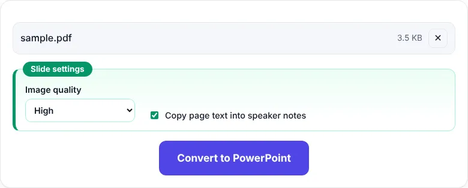

You have a report, brochure or old presentation as a PDF, and now you need to show it as slides in class or in a meeting. PowerPoint cannot simply open a PDF as a slide deck. A **PDF to PPT** converter turns each page into a slide so you can present it, add your own notes and use PowerPoint features.

> **Short answer:** open [PDF to PPT](/pdf-to-ppt/), choose your PDF, keep **High** quality, click **Convert to PowerPoint** and click **Download PPTX**.

## How to convert PDF to PowerPoint

1. Open **[PDF to PPT](/pdf-to-ppt/)**.
2. Click **Choose PDF file** or drop your PDF into the box.
3. Under **Slide settings**, pick an **Image quality**: Normal (smaller file), High or Very high.
4. Keep **Copy page text into speaker notes** ticked if you want each page's text under its slide.
5. Click **Convert to PowerPoint**. You can watch "Converting page 1 of ..." as it works.
6. When it says **Done!** with the number of slides and the file size, click **Download PPTX**.
7. Open the file in PowerPoint, Google Slides, WPS Office or Keynote.

Want a smaller file or different settings? Click **Change settings** and convert again. Click **New file** to start with another PDF.

## What the slides look like

Each PDF page becomes **one full slide** that looks exactly like the page, because the page is placed on the slide as a high quality picture. The slide size is set from the shape of your first page, so a landscape PDF gives wide slides and a portrait A4 PDF gives tall slides. If a later page has a different shape, it is centred on its slide.

| Part of the PDF | In the PowerPoint file |
|---|---|
| Page look, fonts, colours, charts | Exactly the same, shown as a picture |
| Text on the page | Not editable on the slide, but copied into the speaker notes |
| Page order | Same order, one slide per page |
| Links and form fields | Not clickable on the slide |
| Animations and transitions | None at first, add your own in PowerPoint |
| Pages | Up to 200 per conversion |

This approach is good for **presenting** a PDF. It is not the right choice if you want to rewrite the content, because the words on each slide are part of the picture.

## Choosing the image quality

| Setting | Best for | File size |
|---|---|---|
| Normal (smaller file) | Sending by email or WhatsApp, simple text pages | Smallest |
| High | Most decks, projector and laptop screens | Medium |
| Very high | Large screens, pages with small text or detailed charts | Largest |

If the PPTX is too big to share, convert again with **Normal**. If small text looks soft on a big screen, use **Very high**.

## How to edit the slides after converting

You cannot click on the original words and retype them, but you can still change a lot:

- **Add a text box** on top of the slide for a new heading, label or comment.
- **Cover old text** with a white shape and type the new text on top of it.
- **Add animations** to the new boxes and **transitions** between slides.
- **Copy text from the notes.** In PowerPoint, the notes pane under each slide holds that page's text, ready to paste into a new text box.
- **Delete or reorder slides** as usual.

## Other ways to put a PDF into PowerPoint

Microsoft's own help page lists two built in options in the desktop version of PowerPoint:

| Method | How it works | Limitation |
|---|---|---|
| Insert > Screenshot > Screen Clipping | Captures part of an open PDF as a picture | One clip at a time, PDF must be open on screen |
| Insert > Object > Create from file | Puts the whole PDF in the slide as an object | Shows as an image with reduced quality, not editable |

Microsoft also says inserting PDF content is not possible in PowerPoint for the web. For a full deck with one slide per page, converting with a PDF to PPT tool is quicker.

## Common problems and fixes

| Problem | Fix |
|---|---|
| "This PDF is password-protected" or it will not open | Remove the password first with [Unlock PDF](/unlock-pdf/) if you know it |
| PDF has more than 200 pages | Split it with [Split PDF](/split-pdf/) and convert each part |
| Only a few pages are needed | Keep just those pages with [Extract Pages](/extract-pages/) first |
| Speaker notes are empty | The PDF is a scan, so there is no text to copy |
| You only need the text, not slides | Use [PDF to Text](/pdf-to-text/) |
| You need slide pictures for WhatsApp or a website | Use [PDF to JPG](/pdf-to-jpg/) |

## Going the other way

After editing, you may need to send the deck as a PDF again, for example to a college portal. See [how to convert PPT to PDF](/guides/how-to-convert-ppt-to-pdf/). To pull pictures out of a PDF for your own slides, read [how to extract images from a PDF](/guides/how-to-extract-images-from-pdf/).
