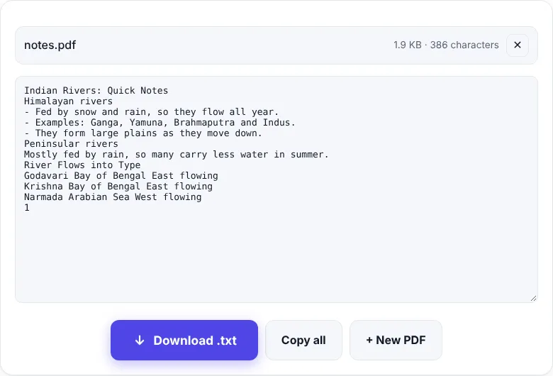

You want the words from a PDF, not the PDF itself. Maybe you need to paste a paragraph into an email, reuse notes in a document or search a long report. Selecting text inside a PDF viewer works for a line or two, but it often breaks across columns and pages. A **PDF to Text** tool copies everything in one go.

> **Short answer:** open [PDF to Text](/pdf-to-text/), choose your PDF, check the text that appears and click **Copy all** or **Download .txt**.

## How to convert a PDF to text

1. Open **[PDF to Text](/pdf-to-text/)**.
2. Click **Choose PDF file** or drop your PDF into the box. Reading starts straight away and you see "Reading page 1 of ..." while it works.
3. The text of every page appears in a box. For PDFs with more than one page, each page starts with a line like **--- Page 2 ---** so you know where you are.
4. Click **Copy all** to copy the full text, then paste it anywhere with Ctrl+V (or long press and Paste on a phone).
5. Or click **Download .txt** to save a plain text file with the same name as your PDF.

Next to the file name you can also see how many characters were found. To do another file, click **New PDF**.

## What you get and what you lose

Plain text has no fonts, colours or page layout. The tool rebuilds lines in reading order, page by page, but anything visual is dropped.

| In the PDF | In the text |
|---|---|
| Paragraphs and headings | Kept as lines of text |
| Reading order on a simple page | Kept, top to bottom |
| Bold, italic, font size, colour | Lost (plain text has no styling) |
| Columns side by side | Lines from both columns may join on one line |
| Tables | Become rows of words with spaces, no grid |
| Pictures, logos, signatures | Not included |
| Scanned pages (photos of paper) | No text found |

If you need to keep headings, bold text and tables in a form you can still edit, use [PDF to Word](/pdf-to-word/) or [PDF to Markdown](/pdf-to-markdown/) instead.

## Why some PDFs give no text

A PDF made from Word, Excel, a website or a billing system stores real text. A PDF made by a scanner or a phone camera usually stores only a picture of each page. There are no letters inside for any text tool to copy.

When this happens, ZentaPDF shows the message that no text was found and that the PDF is probably a scan. To check yourself, open the PDF and try to select a single word. If you can only select the whole page like a photo, it is a scan.

**What to do with a scanned PDF:** you need OCR (optical character recognition), which reads letters from an image. ZentaPDF does not do OCR yet. One free option is Google Drive: as per Google's own help page, on a computer you right click the PDF in Drive and choose **Open with > Google Docs**. Google suggests keeping the file at 2 MB or smaller, with sharp, straight pages and text that is not too small. Check the result carefully, because OCR can misread letters and numbers.

## Problems and fixes

| Problem | Why it happens | Fix |
|---|---|---|
| "This PDF is password-protected" | The file is locked | Unlock it first with [Unlock PDF](/unlock-pdf/) if you know the password |
| No text was found | The PDF is a scan | Use OCR, for example Google Drive as explained above |
| Words from two columns are mixed | Both columns sit at the same height on the page | Copy one part at a time, or convert with [PDF to Word](/pdf-to-word/) |
| Hindi or Marathi text looks like random symbols | The PDF uses an old non-Unicode font | Retype it, or use OCR on that page |
| Only a few pages are needed | The tool reads the whole file | Keep only those pages with [Extract Pages](/extract-pages/) first |
| Extra page lines in the text | Multi page PDFs get a "--- Page N ---" marker | Delete the marker lines in your text editor if you do not need them |

## Copy text from a PDF on a phone

PDF to Text works in the browser on Android phones and iPhones too. Open the tool page in Chrome or Safari, tap **Choose PDF file**, pick the PDF from your Files or Downloads, and tap **Copy all**. Then paste it into WhatsApp, Notes, Gmail or Google Docs.

## When you want to change the PDF, not copy from it

If you only need to fix a name, a date or an amount in the PDF and send the PDF again, you do not need to pull the text out at all. Use [Edit PDF](/edit-pdf/) and follow our guide on [how to edit text in a PDF for free](/guides/how-to-edit-text-in-pdf-free/). To turn the whole document into an editable Word file, see [how to convert PDF to Word](/guides/how-to-convert-pdf-to-word/).
