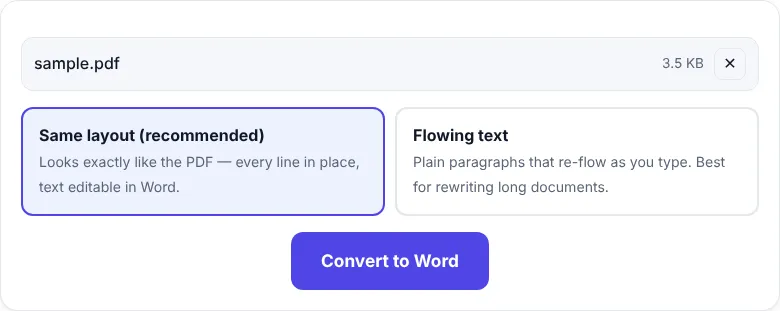

You have a PDF of a resume, a letter or an application and you need to change some text. When you convert it to Word with many tools, the result is a mess: lines jump around, tables break and pictures move to the wrong page. This guide shows how to **convert a PDF to Word and keep the formatting**, for free, and what to do when something still looks wrong.

> **Short answer:** open [PDF to Word](/pdf-to-word/), choose your PDF, keep **Same layout (recommended)** selected, click **Convert to Word** and download the DOCX.

## Why formatting breaks when you convert PDF to Word

A PDF and a Word file are built in different ways. A PDF stores the exact position of every letter on the page. A Word document stores paragraphs that flow from one line to the next and from page to page. When a converter tries to turn exact positions into flowing paragraphs, it has to guess where each paragraph starts and ends. Wrong guesses cause the mess.

Microsoft's own help page for opening PDFs in Word says the converted file may not look exactly like the original, that line and page breaks may fall in different places, and that it works best with PDFs that are mostly text.

## Two ways to convert: Same layout or Flowing text

ZentaPDF gives you a choice, because the best result depends on what you want to do with the file.

| | Same layout (recommended) | Flowing text |
|---|---|---|
| Looks like the PDF | Yes, every line stays in place | No, it becomes plain paragraphs |
| Text editable in Word | Yes, line by line | Yes, as normal paragraphs |
| Fonts, sizes, bold, italic | Kept | Kept for headings and paragraphs |
| Text colour | Kept | Black |
| Pictures, logos, table lines, backgrounds | Kept in place behind the text | Not included |
| Best for | Resumes, forms, letters, certificates, small edits | Long reports you want to rewrite |

## How to convert PDF to Word for free

1. Open **[PDF to Word](/pdf-to-word/)**.
2. Click **Choose PDF file** or drop your PDF into the box.
3. Keep **Same layout (recommended)** selected. Choose **Flowing text** only if you want to rewrite a long document.
4. Click **Convert to Word** and wait while each page is read.
5. Click **Download Word** to save the DOCX file.
6. Open it in Microsoft Word, WPS Office or LibreOffice and click on any line to edit it.

If you want to try the other mode, click **Change settings** and convert again.

## How to edit the Word file after converting

In **Same layout** mode, each line of text sits in its own small text frame at its exact place on the page. This is what keeps the formatting, and it changes how you edit:

- **Click on a line and type.** The rest of the page does not move.
- **Keep changes short.** If you add many words, the line can run past the edge of its frame. Make the text a little smaller, or split it into two lines.
- **Pictures and table lines are in the background**, behind the text. Your edits stay on top of them.

If you need to add whole new paragraphs, use **Flowing text** instead, because the text there wraps from line to line like any normal Word document.

## Common problems and fixes

| Problem | Why it happens | Fix |
|---|---|---|
| Font looks a little different | That font is not installed on your computer | Install the font, or pick a similar one in Word |
| Text is still a picture, nothing to edit | The PDF is a scan (photo of paper) | Use Edit PDF on the PDF, or wait for OCR support |
| Hindi or other Indian script text cannot be edited | Complex scripts are kept as part of the page picture | Edit that part in the PDF or retype it in Word |
| "This PDF is password-protected" | The file is locked | Unlock it first with [Unlock PDF](/unlock-pdf/) if you know the password |
| Table numbers needed in a spreadsheet | Table lines are kept as a picture, not a Word table | Use [PDF to Excel](/pdf-to-excel/) for tables |
| Very long PDF stops early | Up to 300 pages are converted at a time | Split the PDF with [Split PDF](/split-pdf/) and convert each part |

## When you do not need Word at all

Converting is not always the fastest way. Pick the tool that matches your job:

- **Change a few words, a date or an amount:** edit the PDF directly with [Edit PDF](/edit-pdf/). See [how to edit text in a PDF for free](/guides/how-to-edit-text-in-pdf-free/).
- **Copy all the text into an email or notes:** use [PDF to Text](/pdf-to-text/).
- **Get tables into rows and columns:** use [PDF to Excel](/pdf-to-excel/).
- **Fill or sign a form:** use [Sign PDF](/sign-pdf/) or Edit PDF instead of retyping it in Word.

## After editing: save it back as PDF

Most portals and offices want a PDF, not a Word file. When your edits are done:

1. In Word, use **File, Save As** and pick PDF, or convert the DOCX with [Word to PDF](/word-to-pdf/).
2. If the portal has a size limit, shrink the file with [Compress PDF](/compress-pdf/). Each portal sets its own limit, so check the official instructions.
3. Open the final PDF and check every page before you upload or send it. For email, see [how to compress a PDF for email](/guides/how-to-compress-pdf-for-email/).
