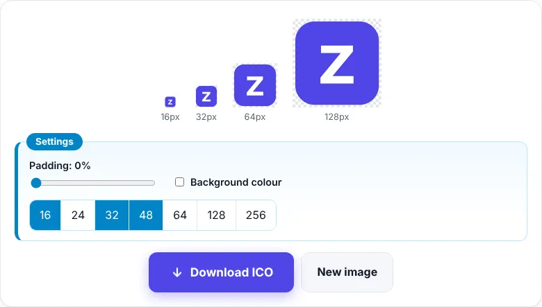

A favicon is the small icon you see in the browser tab, in bookmarks and next to your site name in Google search results. The classic file for it is **favicon.ico**. To make one from your logo, open **[PNG to ICO](/png-to-ico/)**, choose your PNG, keep the 16, 32 and 48 px sizes selected and click **Download ICO**. Then rename the file to favicon.ico and upload it to your website.

## What is an ICO file?

An ICO file is an icon file that can hold **several sizes of the same image** in one file. The browser or Windows picks the size that fits best. A PNG file holds only one size.

| | PNG | ICO |
|---|---|---|
| Sizes in one file | One | Many (for example 16, 32 and 48 px) |
| Transparent background | Yes | Yes |
| Used for | Photos, logos, graphics | Favicons, Windows app and shortcut icons |
| Typical file name for websites | favicon-32x32.png | favicon.ico |

Simply renaming logo.png to favicon.ico does not convert it. The file inside is still a PNG, and some software will not read it.

## How to convert PNG to ICO



1. Open **[PNG to ICO](/png-to-ico/)**.
2. Click **Choose image** and pick your logo. PNG, JPG, SVG and WebP work. A square logo works best.
3. Look at the previews at 16, 32, 64 and 128 px. Check that the logo is still clear at 16 px.
4. Use the **Padding** slider if the logo touches the edges.
5. Tick **Background colour** if you want a filled square behind a transparent logo. You can choose the colour and turn **Rounded corners** on or off.
6. Choose the sizes to include. **16, 32 and 48** are selected by default, which is right for websites.
7. Click **Download ICO**.

The image is converted inside your browser, so your logo is not uploaded anywhere.

## Which sizes should you include?

| Use | Sizes to select |
|---|---|
| Website favicon (favicon.ico) | 16, 32, 48 |
| Windows desktop shortcut or app icon | 16, 32, 48, 64, 128, 256 |
| Both | All of the above |

More sizes make the file bigger, so for a website keep it to 16, 32 and 48.

## Make your logo work at small sizes

At 16 px your whole logo is just 16 by 16 dots. Long names and thin lines turn into a blur. Some simple fixes:

- **Use only the symbol or first letter** of your logo, not the full name.
- **Make it square.** If your logo is wide, cut out the symbol first with [Crop Image](/crop-image/).
- **Start big.** A source image of 512 by 512 px or larger gives sharp results. Your logo is an SVG? Convert it with [SVG to PNG](/svg-to-png/) or pick the SVG directly.
- **Use strong contrast.** A light logo on a light tab is hard to see. Turn on Background colour to fix this.

## How to add favicon.ico to your website

1. Rename the downloaded file to **favicon.ico**.
2. Upload it to the **root folder** of your website, so it opens at yoursite.com/favicon.ico. On Hostinger and cPanel hosting this is usually the public_html folder.
3. Add this line inside the head section of your pages:

```html
<link rel="icon" href="/favicon.ico" sizes="48x48">
```

4. Clear your browser cache or open the site in a private window to see the new icon. Browsers keep old favicons for a while.

**WordPress:** you do not need an ICO file. Go to Appearance, Customize, Site Identity, Site Icon and upload a square PNG. WordPress asks for an image of at least 512 by 512 px.

**Want the full set?** The [Favicon Generator](/favicon-generator/) makes favicon.ico plus PNG icons for Apple and Android phones, a web manifest and the HTML code, all in one ZIP file.

## Getting your favicon in Google search results

Google shows favicons next to results, but it has its own rules. According to Google Search Central:

| Google guideline | What it means for you |
|---|---|
| The favicon must be square (1:1) and at least 8 by 8 px | Do not use a wide logo |
| Larger than 48 by 48 px is recommended | Include 48 px or use a bigger PNG icon too |
| Supported formats include ICO, PNG, JPEG, GIF, BMP, PPM and TIFF | favicon.ico is fine |
| Only one favicon per hostname | Use the same icon across the site |
| Googlebot and Googlebot-Image must be able to crawl the home page and the icon | Do not block them in robots.txt |

Google says crawling can take from several days to several weeks, and a favicon is not guaranteed to appear. You can ask Google to recrawl your home page with the URL Inspection tool in Search Console. Google may change these rules, so check its [favicon guidelines](https://developers.google.com/search/docs/appearance/favicon-in-search) for the latest version.

Want to learn more about image formats? Read [JPG vs PNG vs WebP](/guides/jpg-vs-png-vs-webp/).
