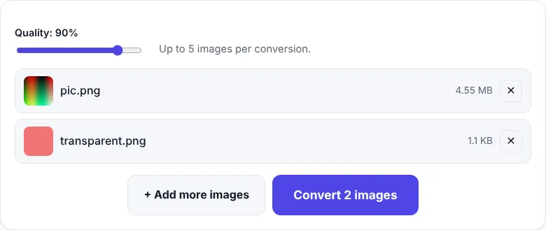

PNG and JPG are the two most common image formats, but they are good at different things. Many upload forms, printers and apps accept only JPG — and JPG files are usually much smaller. Here's how to convert PNG to JPG, and when you should (or shouldn't).

## PNG vs JPG in one minute

| | PNG | JPG |
|---|---|---|
| Compression | Lossless – every pixel kept | Lossy – tiny details simplified |
| File size for photos | Large | Small (often 5–10× smaller) |
| Transparency | Yes | No (becomes white) |
| Best for | Logos, icons, screenshots, graphics | Photos, scans, social media, forms |

**Convert PNG → JPG when:** the image is a photo, the file is too big, or a form/app only accepts JPG.
**Keep PNG when:** you need a transparent background (like a logo) or the image is a sharp graphic with text.

## How to convert PNG to JPG

1. Open **[PNG to JPG](/png-to-jpg/)**.
2. Click **Choose images** and select up to **5 PNG files**.
3. Set **quality** — 90% is a great default. Lower = smaller file.
4. Click **Convert**.
5. Download each JPG, or all of them as a ZIP.

The conversion runs inside your browser. Your images are not uploaded.

## Choosing the right quality

| Quality | Use it for |
|---|---|
| 90–95% | Printing, photos you want to keep |
| 75–85% | Websites, email, WhatsApp, social media |
| 60–70% | Strict upload limits |

Need an exact size like **50 KB** for a form? Use [Reduce Image Size in KB](/reduce-image-size-in-kb/) instead — it finds the best quality automatically.

## What about transparency?

JPG can't store transparent pixels. When you convert a PNG with a transparent background (for example a logo), the transparent part becomes **white**. If you need to keep transparency but want a smaller file, convert to **WebP** with [PNG to WebP](/png-to-webp/) instead.

## Other conversions you might need

- [JPG to PNG](/jpg-to-png/) — when an app needs PNG.
- [WebP to JPG](/webp-to-jpg/) — images saved from websites are often WebP; convert them so they open everywhere.
- [Compress Image](/compress-image/) — make JPGs even smaller without changing the format.

## Converting on a phone

Open [zentapdf.com/png-to-jpg/](/png-to-jpg/) in your phone browser, tap **Choose images**, pick screenshots or photos from your gallery and convert. The JPGs are saved to your downloads.

## Converting screenshots

Screenshots are saved as PNG on most phones and computers. They look sharp, but they can be **2–5 MB each**. Converting to JPG at 85–90% usually makes them 70–90% smaller while text stays readable. If the text looks fuzzy, raise the quality to 95% or keep the screenshot as PNG.

## Converting many images

You can convert up to **5 images at a time**. After converting, click **Download all (ZIP)**, then **Start over** for the next batch. Tip: sort your files into folders of five before you start if you have many.

## Common problems and fixes

| Problem | Why it happens | Fix |
|---|---|---|
| Transparent logo now has a white box | JPG can't store transparency | Use [PNG to WebP](/png-to-webp/) or keep PNG |
| JPG is bigger than the PNG | Simple graphics compress well as PNG | Lower the quality, or keep PNG |
| Image looks blurry | Quality too low | Use 90–95% |
| Form still rejects the image | File is above the KB limit | Use [Reduce Image Size in KB](/reduce-image-size-in-kb/) |
| Colours look slightly different | JPG compression of solid colour areas | Use higher quality for graphics |

## Does converting remove photo data?

Yes. Hidden information such as camera model and **GPS location (EXIF data)** is not copied into the new JPG. That's a nice privacy bonus when you share photos online.

## PNG to JPG on Windows and Mac without tools

- **Windows:** open the PNG in Paint → *File → Save as → JPEG picture*.
- **Mac:** open in Preview → *File → Export → Format: JPEG*.

These work for single images. ZentaPDF is faster when you have several images or want to control quality and size.

## Why convert in the browser?

Online converters often upload your pictures to a server. With ZentaPDF, **the conversion happens on your device** — useful for personal photos, ID scans and documents.

PNG and JPG each have their place. Now you know when to switch, and how to do it in seconds.
