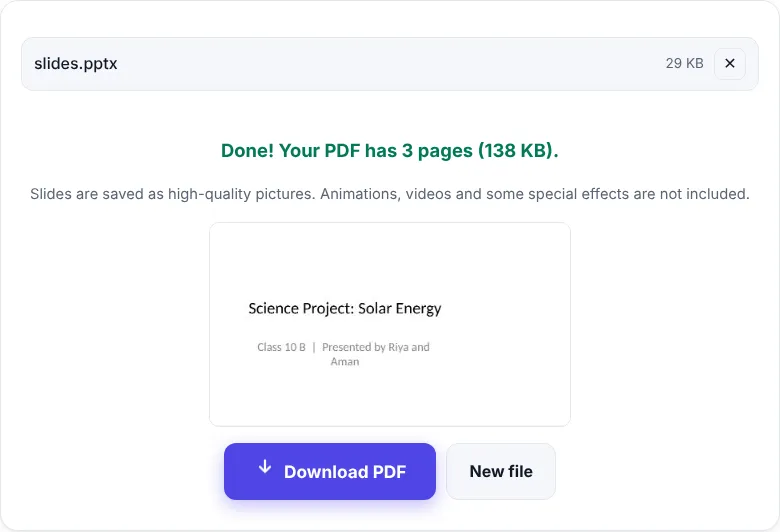

To convert PPT to PDF, open **[PPT to PDF](/ppt-to-pdf/)**, choose your .pptx file, click **Convert to PDF** and then **Download PDF**. Each slide becomes one page. The PDF opens on any phone or computer, even where PowerPoint is not installed, which makes it easy to share on email or WhatsApp.

> **Short answer:** PowerPoint file in, one PDF page per slide out. No app or sign-up needed.

## Why convert PowerPoint to PDF

- **Anyone can open it.** Not everyone has PowerPoint, but every phone can open a PDF.
- **The layout stays fixed.** Fonts and spacing do not move around on another computer.
- **Portals ask for it.** College assignments, project reports and job applications often accept PDF only.
- **Easy to print.** A print shop can print a PDF without any surprises.
- **Harder to change.** People can read your slides without editing them by mistake.

## How to convert PPT to PDF with ZentaPDF

1. Open **[PPT to PDF](/ppt-to-pdf/)**.
2. Click **Choose PowerPoint file** and pick your .pptx file.
3. Click **Convert to PDF**. A progress bar shows each slide being drawn.
4. Check the preview of the first slide and the page count.
5. Click **Download PDF**. The PDF has the same name as your presentation.

Each slide keeps its text, pictures, shapes, tables and theme colours. The slides are saved as high quality pictures, so they look sharp on screen and in print, but the text cannot be selected or copied.

## What is kept and what is not

| Part of the slide | In the PDF |
|---|---|
| Text, pictures, shapes and tables | Yes |
| Theme colours and backgrounds | Yes |
| Charts, SmartArt, special effects | May look simpler |
| Unusual fonts | May be replaced |
| Animations and transitions | No |
| Videos and sound | No |
| Selectable text | No, slides are pictures |

If your slides use many charts or special fonts and you have PowerPoint, its own **Save as PDF** gives the closest copy. The steps are below.

## Convert PPT to PDF on your phone

You do not need the PowerPoint app.

1. Open zentapdf.com/ppt-to-pdf/ in Chrome on Android or Safari on iPhone.
2. Tap **Choose PowerPoint file** and pick the .pptx from Files, Downloads or WhatsApp documents.
3. Tap **Convert to PDF**, then **Download PDF**.

The file is converted on your own device. It is not uploaded to a server. A big presentation with many photos can take a little longer on an older phone.

## Save as PDF in PowerPoint

If PowerPoint is installed on your Windows computer:

1. Open the presentation and click **File**, then **Export**.
2. Choose **Create PDF/XPS**.
3. Choose a folder and check that the file type is PDF.
4. Pick **Standard** for printing or **Minimum size** for a smaller file for email.
5. Click **Options** to choose which slides to export and what to publish, such as slides or handouts.
6. Click **OK**, then **Publish**.

Menu names can differ a little between PowerPoint versions, and between Windows and Mac.

## Save as PDF in Google Slides

1. Open the presentation in Google Slides.
2. Click **File**, then **Download**, then **PDF Document (.pdf)**.
3. The PDF is saved to your Downloads.

Google Slides can also open a .pptx you upload to Google Drive, so this works for PowerPoint files too.

## Print handouts with many slides per page

For revision notes or a printed handout, one slide per page wastes paper. After converting:

1. Open **[Pages per Sheet](/pages-per-sheet/)** and choose the slides PDF.
2. Pick 2, 4 or 6 pages per sheet.
3. Download the new PDF and print it.

Our guide on [printing multiple pages on one sheet](/guides/how-to-print-multiple-pages-on-one-sheet/) shows each layout and when to use it.

## Problems and fixes

| Problem | Fix |
|---|---|
| "Old .ppt files are not supported" | Save the file as .pptx in PowerPoint or Google Slides first |
| The file will not open | Make sure it is a real .pptx and not password protected |
| PDF is too big to email or upload | Make it smaller with [Compress PDF](/compress-pdf/) |
| Some slides are not needed | Delete them with [Remove Pages](/remove-pages/) after converting |
| Need to join slides from two presentations | Convert both, then use [Merge PDF](/merge-pdf/) |
| Need to edit the slides again | Go back to the .pptx, or try [PDF to PPT](/pdf-to-ppt/) |

Upload portals for colleges and exams have their own size and format limits. Check the official instructions on the portal before you upload. For Word documents, see [how to convert Word to PDF on your phone](/guides/how-to-convert-word-to-pdf-on-phone/).
