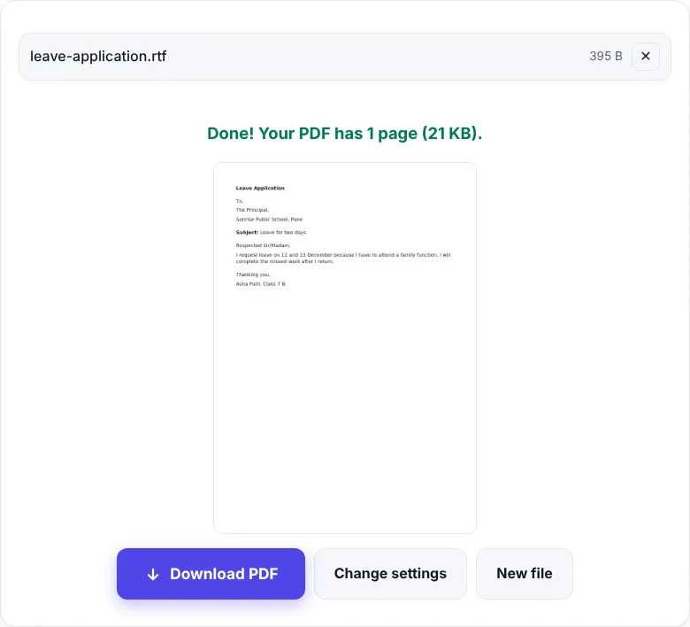

RTF (Rich Text Format) files are simple documents with bold, italic and paragraphs. WordPad, TextEdit, older versions of Word and many business programs save letters and reports as .rtf. They do not open neatly on most phones, and many upload forms want a PDF. To convert one, open [RTF to PDF](/rtf-to-pdf/), choose the .rtf file, click **Convert to PDF** and then **Download PDF**.

## How to convert RTF to PDF

1. Open **[RTF to PDF](/rtf-to-pdf/)** on your phone or computer.
2. Click **Choose RTF document** and pick your .rtf file, or drag it into the box.
3. Under **Page settings**, choose:
   - **Page size:** A4 or US Letter.
   - **Orientation:** Portrait or Landscape.
   - **Text size:** Small, Normal, Large or Extra large.
4. Click **Convert to PDF**.
5. Check the preview of the first page and the number of pages.
6. Click **Download PDF**. If the text looks too small or too big, click **Change settings**, pick another text size and convert again.

The PDF gets the same name as your RTF file. The conversion runs inside your browser, so the document stays on your device.

## What is kept and what changes

The tool reads the text and basic styling from the RTF and lays it out again on clean pages. It does not copy the exact design.

| In your RTF file | In the PDF |
|---|---|
| Paragraphs and line breaks | Kept |
| Bold and italic text | Kept |
| Page breaks | Kept, a new page starts at the same place |
| Bullet points and most special characters | Kept |
| Tabs | Shown as a few spaces |
| Font name, font size and colour | Replaced by one clean font in the text size you choose |
| Centre or right aligned text | Shown left aligned |
| Tables | The cell text is kept, but without borders or columns |
| Pictures, headers and footers | Left out |

The text in the PDF is real text, so you can search it and copy it. Hindi, Marathi and other Indian language text in a Unicode RTF file is shown, but those lines are drawn as pictures of the text, so they cannot be searched or copied in the PDF.

## When to use Word to PDF instead

If the layout matters, for example a letterhead with a logo, a table with borders or text in the centre, convert the original Word file instead of the RTF. [Word to PDF](/word-to-pdf/) keeps much more of the design. You can also open the RTF in Word and save it as a .docx first. Our guide on [converting Word to PDF on a phone](/guides/how-to-convert-word-to-pdf-on-phone/) covers the steps.

| Your file | Best tool |
|---|---|
| Plain letter, notes or report in .rtf | [RTF to PDF](/rtf-to-pdf/) |
| .docx with logo, tables or special layout | [Word to PDF](/word-to-pdf/) |
| Plain .txt file | [TXT to PDF](/txt-to-pdf/) |
| Markdown .md file | [Markdown to PDF](/markdown-to-pdf/) |

## How to save a document as RTF

| Program | How to save as RTF |
|---|---|
| Microsoft Word | File, Save As, then choose Rich Text Format (*.rtf) in the file type list |
| Google Docs | File, Download, then Rich Text Format (.rtf) |
| LibreOffice Writer | File, Save As, then choose Rich Text (.rtf) in the file type list |
| TextEdit on Mac | New documents are rich text by default and save as .rtf |

WordPad, the old free Windows program for RTF files, was removed in Windows 11 version 24H2. On newer computers, use one of the programs above to open or edit RTF files.

## Common problems and fixes

**"This file is not a valid RTF document."** The file has an .rtf name but is not really RTF inside. It may be a Word file or a plain text file that was renamed. Try [Word to PDF](/word-to-pdf/) or [TXT to PDF](/txt-to-pdf/), or open it in Word and save it as PDF from there.

**The PDF is blank or says "No text was found in this file."** The RTF may contain only a picture, such as a scanned page pasted into the document. Pictures are not carried over, so open the file in Word or LibreOffice and save it as PDF from there.

**Strange letters in place of some words.** Some older RTF files store text in an old encoding that this tool cannot read correctly. Open the file in Word, check that the text looks right there, then save it as a .docx and convert it with [Word to PDF](/word-to-pdf/).

**The PDF is too big to upload.** RTF to PDF files are usually small. If you joined it with scans and the size grew, shrink it with [Compress PDF](/compress-pdf/).

## After converting

- Need to add your RTF letter to other documents? Join the PDFs with [Merge PDF](/merge-pdf/). The [merge PDF guide](/guides/how-to-merge-pdf-files/) shows how.
- Have to sign it? Add your signature with [Sign PDF](/sign-pdf/).
- Need it in Word again later? Use [PDF to Word](/pdf-to-word/).
