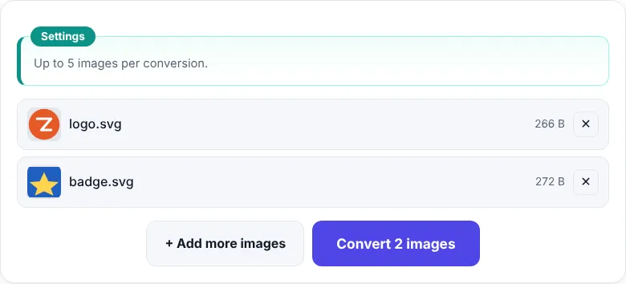

To convert SVG to PNG, open **[SVG to PNG](/svg-to-png/)**, click **Choose images**, pick up to 5 SVG files and click **Convert**. Each PNG keeps its transparent background and you can download the files one by one or as a ZIP. It is free, works on a phone or computer and nothing is uploaded.

## What SVG is and why you need PNG

An SVG file does not store pixels. It stores shapes, lines and text as instructions, a bit like "draw a circle here in orange". That is why an SVG logo stays sharp at any size, on a visiting card or on a hoarding.

The trouble is that many places do not take SVG files:

- Chat apps like WhatsApp usually send it as a document, not as a picture you can see in the chat.
- Many online forms and job portals ask for JPG or PNG only.
- Some older versions of Word, PowerPoint and photo editors cannot open SVG.
- Social media sites ask for normal image formats for posts and profile pictures.

PNG is a pixel image that almost every app opens. It is lossless, so the converted image has no blurry compression marks, and it can keep a transparent background. That makes it the usual choice for logos and icons.

## SVG, PNG and JPG compared

| | SVG | PNG | JPG |
|---|---|---|---|
| Made of | Shapes and paths | Pixels | Pixels |
| Sharp when made bigger | Yes, always | Only up to its own size | Only up to its own size |
| Transparent background | Yes | Yes | No |
| Opens in almost every app | No | Yes | Yes |
| Best for | Editing and printing logos | Logos, icons, screenshots | Photos |

For help choosing between pixel formats, see [JPG vs PNG vs WebP](/guides/jpg-vs-png-vs-webp/).

## How to convert SVG to PNG

1. Open **[SVG to PNG](/svg-to-png/)**.
2. Click **Choose images**, or drag and drop the SVG files on the box. You can add up to 5 at a time.
3. Each file appears in a list with its size. To remove one, click the **✕** next to it. To add another, use **Add more images**.
4. Click **Convert**. The button also shows the number of files, for example **Convert 2 images**. PNG is lossless, so there is no quality slider to set.
5. Next to each file you now see the new PNG size and its width and height in pixels.
6. Click **Download** next to a file, or click **Download all (ZIP)** when there are several. With a single file the button says **Download image**.
7. To convert the next batch, click **Start over**.

## How big will the PNG be?

The tool draws the PNG at the size written in the SVG file itself. A file with `width="240" height="240"` becomes a 240 x 240 pixel PNG. Many icon sets save icons at 24 or 48 pixels, so the PNG comes out very small.

The good part is that an SVG can be drawn at any size without losing sharpness. To get a bigger PNG:

1. Open a copy of the SVG in a plain text editor such as Notepad (Windows) or TextEdit in plain text mode (Mac).
2. Find the first tag, which starts with `<svg`.
3. Change the `width` and `height` numbers, for example to `1024`. Keep the same ratio, so if both were 24, make both 1024.
4. If there is no `width` or `height` at all, add them inside the tag, like `<svg width="1024" height="1024" ...`.
5. Save the file and convert it again.

Do not make a small PNG bigger later with an image resizer. That stretches the pixels and the edges turn soft. Changing the size in the SVG gives a sharp result.

## Common problems

| Problem | Why it happens | Fix |
|---|---|---|
| Error message about "natural dimensions" | The SVG has no width and height, and the browser does not know what size to draw | Add width and height to the `<svg` tag as shown above |
| PNG is tiny | The SVG is saved at icon size | Raise the width and height in the SVG |
| Text looks different | The SVG uses a font your device does not have | Ask the designer to export with text turned into outlines |
| Need a white background, not transparent | PNG keeps transparency | Use [SVG to JPG](/svg-to-jpg/), which fills the background |
| PNG file is too heavy for a form | Large size in pixels | Shrink it with [Compress Image](/compress-image/) |

## After converting

- To make a website icon from the PNG, use [PNG to ICO](/png-to-ico/). The steps are in [how to make a favicon from a PNG](/guides/how-to-convert-png-to-ico-favicon/).
- To put the logo on a document, the PNG works in Word, Google Docs and Canva.
