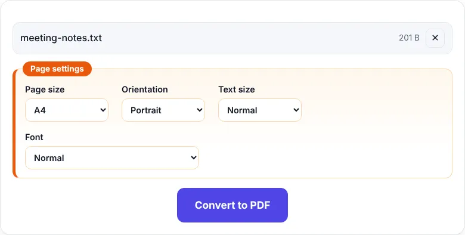

To convert a TXT file to PDF, open **[TXT to PDF](/txt-to-pdf/)**, click **Choose text file**, pick the .txt file, choose the page size, text size and font, click **Convert to PDF** and then **Download PDF**. It works on phones and computers, and long lines wrap automatically.

## Why turn a text file into a PDF?

A .txt file is plain text with no formatting. Notepad on Windows saves files like this, and so do many phone note apps and software logs. A PDF looks the same on every device and is easier to share, print and attach to a form.

| | TXT file | PDF |
|---|---|---|
| Opens on every phone and computer | Yes, but layout depends on the app | Yes, and it looks the same everywhere |
| Page size and margins | None | A4 or Letter with margins |
| Good for printing | Not really | Yes |
| Easy to edit | Yes | Not easily |

## How to convert TXT to PDF

1. Open **[TXT to PDF](/txt-to-pdf/)** on your phone or computer.
2. Click **Choose text file**, or drop the file into the box. Files ending in .txt, .text and .log work.
3. The file name and size show at the top. Click the **cross** to pick a different file.
4. Under **Page settings**, choose:
   - **Page size:** A4 or US Letter. A4 is the normal size in India.
   - **Orientation:** Portrait or Landscape.
   - **Text size:** Small, Normal, Large or Extra large.
   - **Font:** Normal, or Typewriter (keeps columns aligned).
5. Click **Convert to PDF**.
6. A message tells you how many pages the PDF has, with a preview of the first page.
7. Click **Download PDF**. The PDF gets the same name as your text file.

Click **Change settings** to try a different size or font, or **New file** to convert another text file.

## Normal or Typewriter font?

| Font | Best for |
|---|---|
| Normal | Letters, notes, essays, lists |
| Typewriter (keeps columns aligned) | Tables made with spaces, logs, code, bank style statements in plain text |

In the Typewriter font every letter has the same width, so text you lined up with spaces stays in neat columns.

## Hindi, Marathi and other languages

Text in Hindi, Marathi and other Indian languages shows correctly in the PDF. The tool draws those lines exactly as your browser shows them and places them in the PDF as images, so they look right in every PDF reader, but you cannot search or copy those lines.

If the PDF shows strange symbols in place of your text, the file was probably saved in an old encoding. Open it in Notepad, choose **File > Save as**, set **Encoding** to **UTF-8**, save, and convert it again.

## Convert on a phone

1. Open the TXT to PDF page in Chrome (Android) or Safari (iPhone).
2. Tap **Choose text file** and pick the file from the **Files** app or your Downloads folder.
3. Pick the settings and tap **Convert to PDF**.
4. Tap **Download PDF**. On Android it goes to Downloads. On iPhone, Safari saves it in the **Files** app, usually in Downloads.

Folder and menu names can be a little different on some phones.

## Other ways on a Windows computer

Windows has a built in printer called **Microsoft Print to PDF**. In Notepad, go to **File > Print**, choose **Microsoft Print to PDF** as the printer, click **Print**, then pick a folder and file name and click **Save**.

That works, but it gives you no choice of font or text size. If **Microsoft Print to PDF** is not in the printer list, you can turn it on under Windows optional features, or use the online tool.

## After you make the PDF

| Need | Tool |
|---|---|
| Join the PDF with other files | [Merge PDF](/merge-pdf/) |
| Make a PDF from a saved web page | [HTML to PDF](/html-to-pdf/) |
| Make a PDF from a Markdown (.md) file | [Markdown to PDF](/markdown-to-pdf/) |
| Get the text back out of a PDF | [PDF to Text](/pdf-to-text/) |

For more, see our guides on [how to convert an HTML file to PDF](/guides/how-to-convert-html-to-pdf/) and [how to merge PDF files](/guides/how-to-merge-pdf-files/).

If you are uploading the PDF to an exam, bank or government portal, check their official instructions for the allowed file type and size first.
