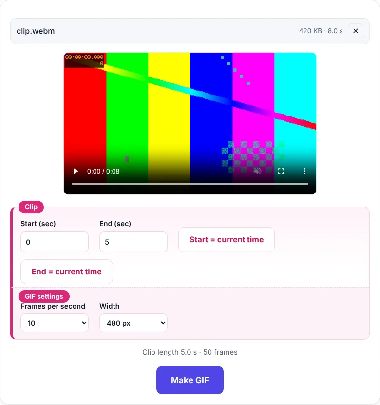

To convert a video to GIF, open **[Video to GIF](/video-to-gif/)**, choose your MP4, WebM or MOV video, set the **Start** and **End** time of the part you want, pick the **Frames per second** and **Width**, then click **Make GIF** and **Download GIF**. It is free, needs no sign up and works on a phone or computer.

> **Short answer:** Choose the video, mark a short part, click Make GIF. Keep it short and small for a light file.

## Why turn a video into a GIF

A GIF is a small moving picture that plays on its own, again and again, without a play button. People use GIFs for:

- **Reactions and memes** in chats and on social media
- **Quick how to clips** that show a few clicks in an app
- **Product demos** on a website or in an online shop
- **Emails and presentations**, where a video may not play inside the message or slide

A GIF has no sound, and it can show at most 256 colours in each frame. So it is best for short clips, not for full videos.

## How to convert a video to GIF

1. Open **[Video to GIF](/video-to-gif/)**.
2. Click **Choose video** and pick an MP4, WebM or MOV file, or drop it into the box.
3. The video appears with play controls. The tool sets the clip to the first 5 seconds to start with.
4. Play the video and pause at the moment the GIF should begin. Click **Start = current time**.
5. Play on to where it should end, pause and click **End = current time**. You can also type the seconds in the **Start (sec)** and **End (sec)** boxes.
6. Choose **Frames per second** (5 to 25) and **Width** (240 to 800 px).
7. Check the line under the settings. It shows the clip length and the number of frames.
8. Click **Make GIF** and wait while the frames are captured and the GIF is created.
9. Look at the preview, then click **Download GIF**.

Want a different result? Click **Change settings** to adjust the clip and make it again, or **New video** to start with another file.

## Choosing frames per second and width

Every frame is a full picture inside the GIF, so more frames and a bigger width mean a bigger file. The tool allows up to 300 frames in one GIF.

| Frames per second | Look | Longest clip (300 frames) |
|---|---|---|
| 5 | Choppy, like a slideshow | 60 seconds |
| 10 | Smooth enough for most clips | 30 seconds |
| 15 | Smooth | 20 seconds |
| 25 | Very smooth, like the video | 12 seconds |

| Width | Good for |
|---|---|
| 240 to 320 px | Chats, reactions and very light files |
| 400 to 480 px | Most uses, the default is 480 px |
| 640 to 800 px | Screen recordings where text must be readable |

The height follows the shape of your video, so a vertical phone video gives a tall GIF. If your video is narrower than the width you pick, the GIF keeps the video's own width.

**Tip:** Start with 10 frames per second and 480 px. If the file is too big, lower the width first, then the frames per second, or make the clip shorter.

## Making the GIF smaller after you convert

GIF files grow fast. A few seconds of video can make a GIF of several MB. These tools help:

- **[Compress GIF](/compress-gif/)** to cut the file size.
- **[Resize GIF](/resize-gif/)** to make it smaller in pixels. See [how to resize an animated GIF](/guides/how-to-resize-animated-gif/) for the steps.
- **[Crop GIF](/crop-gif/)** to cut away the edges and keep only the part that matters.
- **[GIF to MP4](/gif-to-mp4/)** if a site asks for a video file instead.

Some websites and apps set their own limits on GIF size. Check the rules of the site where you will upload it.

## Common problems and fixes

| Problem | Fix |
|---|---|
| "This video format cannot be played in your browser" | Try an MP4 file or another browser. Some MOV videos cannot be played in every browser |
| "End time must be after start time" | Make the End number bigger than the Start number |
| The frame limit message appears | The clip has more than 300 frames. Make it shorter or pick fewer frames per second |
| The GIF looks grainy | GIFs have at most 256 colours per frame. Clips with flat colours look better than sunsets or skin tones |
| The GIF file is too big | Lower the width or frames per second, shorten the clip or use Compress GIF |
| There is no sound | GIFs never have sound. Share the video as MP4 when sound matters |

## Video to GIF on a phone

The steps are the same on a phone. Open the tool in Chrome, tap **Choose video** and pick a video from your gallery. Recording a short clip of the exact moment you want is easier than cutting a long video on a small screen. After you download the GIF, you can send it in chats or post it where GIFs are allowed.

If you want a GIF from photos instead of a video, use [GIF Maker](/gif-maker/), which joins still images into an animation.
