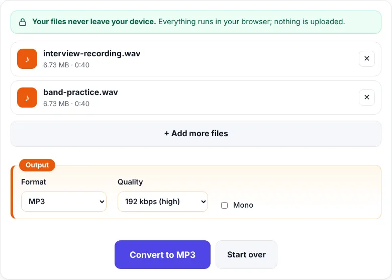

To convert WAV to MP3, open **[WAV to MP3](/wav-to-mp3/)**, click **Choose audio files**, pick one or more WAV files, keep **MP3** as the **Format**, choose the **Quality** and click **Convert to MP3**. The MP3 is usually many times smaller than the WAV, small enough to send on WhatsApp or email. It's free, and your files are not uploaded.

## Why WAV files are so big

WAV stores sound without compression. A normal CD quality stereo WAV (44.1 kHz, 16 bit) uses 1,411 kbps, which is about 10 MB for every minute. A one hour class recording can easily cross 600 MB.

MP3 uses lossy compression: it drops sound details most people don't notice, and the file shrinks a lot. WAV files usually come from:

- voice recorders and some phone recording apps that save in WAV for the best quality
- music software and audio editors, when you export a song
- Zoom recorders, mixers and USB microphones used for podcasts, interviews and band practice
- sound effects and old CD rips

Keep WAV while you are still editing. For sharing, uploading or keeping lots of recordings on your phone, MP3 is far more practical.

## How to convert WAV to MP3

1. Open **[WAV to MP3](/wav-to-mp3/)**.
2. Click **Choose audio files** and select one or more WAV files. You can also drop them on the box.
3. Each file shows in a list with its size and length. Click **Add more files** to add more, or the **cross** to remove one.
4. Under **Output**, **Format** is already set to **MP3**.
5. Choose the **Quality**. **192 kbps (high)** is the default.
6. Tick **Mono** if the recording is only speech and you want a smaller file.
7. Click **Convert to MP3**.
8. When a file is done, its new size and how much smaller it got appear next to it, with a **Download** button. With only one file, the download starts by itself.
9. With two or more files, click **Download all (ZIP)** to get them together.
10. Click **Start over** for a new set.

The MP3 keeps the WAV's name, so **interview-recording.wav** becomes **interview-recording.mp3**.

## Which quality (kbps) to choose

MP3 size depends only on the kbps and the length of the recording. Roughly, one minute takes:

| Format | Size for 1 minute (about) | Best for |
|---|---|---|
| WAV (CD quality stereo) | 10 MB | Editing and keeping a master copy |
| MP3 320 kbps (best) | 2.4 MB | Music when you want the top MP3 setting |
| MP3 192 kbps (high) | 1.4 MB | Most music, the safe default |
| MP3 128 kbps (good) | 1 MB | Speech, meetings, interviews |
| MP3 64 kbps (voice) | 0.5 MB | Long lectures where size matters most |

For songs, 192 kbps sounds very close to the WAV for most people. For speech, 128 kbps with **Mono** ticked gives small, clear files. If an upload form has a size limit, check its rules first and then pick a lower kbps if needed.

## Making the MP3 even smaller

If the MP3 is still too big for WhatsApp, email or a portal, either lower the bitrate or cut what you don't need. **[Audio Compressor](/audio-compressor/)** goes down to 32 kbps and shows the expected size before you start. **[MP3 Cutter](/mp3-cutter/)** removes silence at the start and end, or keeps only the part you need.

Our guide on [how to compress an MP3 file](/guides/how-to-compress-mp3-file/) explains which bitrate works for voice and for music.

## Other audio conversions

| You want to | Use |
|---|---|
| Convert M4A, OGG, FLAC or other formats | [Audio Converter](/audio-converter/) |
| Turn an MP3 back into WAV for an editor | [MP3 to WAV](/mp3-to-wav/) |
| Make a soft recording louder | [Volume Booster](/volume-booster/) |
| Join several recordings into one | [Audio Joiner](/audio-joiner/) |

If your files are iPhone voice memos, see [how to convert M4A to MP3](/guides/how-to-convert-m4a-to-mp3/).

## Converting on a phone

The converter works in Chrome on Android and Safari on iPhone. Your own device does the work, so long WAV files take a bit longer on a phone. With very large files the tool shows a note asking you to keep the tab open until each file shows its **Download** button. If you have many hours of recordings, a computer is faster.
