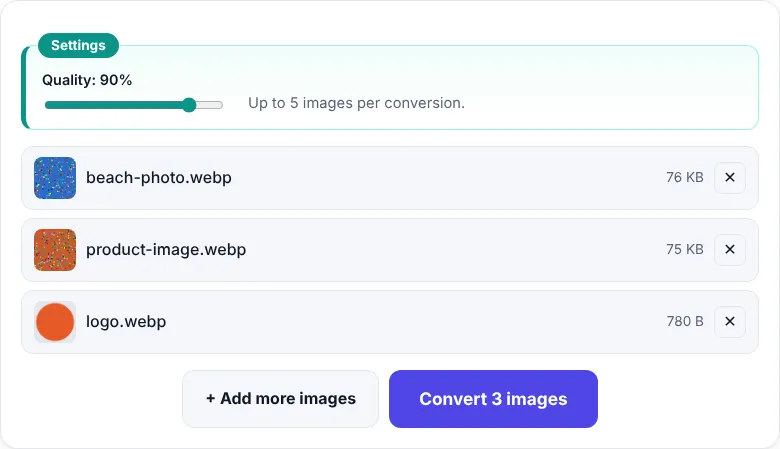

To convert WebP to JPG, open **[WebP to JPG](/webp-to-jpg/)**, click **Choose images** and pick up to 5 WebP files, set the **Quality** if you want, click **Convert** and download your JPG files. It works in the browser on Android, iPhone and computers, is free and needs no sign up.

> **Short answer:** Choose the WebP files, keep quality at 90%, click Convert, then Download. Transparent parts become white in the JPG.

## What is a WebP file?

WebP is an image format made by Google for websites. Google says lossy WebP images are **25 to 34% smaller** than JPG images of the same quality. That is why many shopping sites, news sites and blogs now send WebP images to your browser.

The problem comes when you save one of these images. Some older photo apps, editing software, photo printing shops and upload forms do not accept WebP. JPG works almost everywhere, so converting is the easy fix.

## WebP vs JPG at a glance

| | WebP | JPG |
|---|---|---|
| Made for | Websites and fast loading | Photos everywhere |
| File size | Usually smaller | A little bigger |
| Transparent background | Yes | No (becomes white) |
| Opens in older apps and printers | Not always | Almost always |
| Accepted by upload forms | Sometimes | Very often |

For a longer comparison with PNG too, see our guide [JPG vs PNG vs WebP](/guides/jpg-vs-png-vs-webp/).

## How to convert WebP to JPG

1. Open **[WebP to JPG](/webp-to-jpg/)** in Chrome, Edge, Safari or any modern browser.
2. Click **Choose images**, or drag and drop the files into the box. You can add up to **5 images** at a time.
3. Each file appears in a list with a small preview. Click the **cross** next to a file to remove it, or **Add more images** to add another.
4. Under **Settings**, leave **Quality** at **90%**, or move the slider between 40% and 100%.
5. Click **Convert**. The button shows how many images will be converted, for example **Convert 3 images**.
6. Click **Download** next to any file to save it alone, or **Download all (ZIP)** to save them all together. With one image, the button says **Download image**.
7. To convert more images, click **Start over** and add the next files.

The new files keep the same name with a new ending, so beach-photo.webp becomes beach-photo.jpg. The width and height in pixels stay the same.

## Which quality should you choose?

| Quality | File size | Good for |
|---|---|---|
| 95 to 100% | Largest | Printing and photos you will edit again |
| 85 to 90% | Medium | Most uses, sharing and documents |
| 70 to 80% | Smaller | Email and WhatsApp, where small size matters |
| 40 to 60% | Smallest | Only when size matters more than quality |

A JPG is often **bigger** than the WebP it came from, because WebP packs the same picture into fewer bytes. That is normal. If the JPG is too big for a form, lower the quality, or use **[Reduce Image Size in KB](/reduce-image-size-in-kb/)** to hit an exact size such as 50 KB or 100 KB. Our guide on [how to reduce image size in KB](/guides/how-to-reduce-image-size-in-kb/) explains the steps.

## Convert on a phone

The same page works on a phone, so you do not need an app.

**On Android**

1. Open the WebP to JPG page in Chrome.
2. Tap **Choose images**. Pick the files from your gallery or the **Files** app (saved images are often in the Download folder).
3. Tap **Convert**, then **Download**. The JPG goes to your Downloads folder.

**On iPhone**

1. Open the page in Safari.
2. Tap **Choose images** and choose **Photo Library** or **Choose File**.
3. Tap **Convert**, then **Download**. Safari saves the file in the **Files** app, usually in Downloads. From there you can share it or save it to Photos.

The menu names can differ a little between phone brands and versions.

## Transparent WebP images

Logos, stickers and product cut outs are often WebP files with a **transparent background**. JPG cannot store transparency, so ZentaPDF fills those parts with **white**. This looks fine on white pages and forms.

If you need to keep the transparent background, for example to put a logo on a coloured design, convert it with **[WebP to PNG](/webp-to-png/)** instead. PNG keeps transparency.

## Common problems

| Problem | What to do |
|---|---|
| A message says this browser cannot create JPG files | Open the page in the latest Chrome or Edge and try again |
| Only 5 of your images were added | Convert those 5, click Start over, then add the next ones |
| Upload form says the file is too big | Lower the quality, or use Reduce Image Size in KB |
| Form wants a PDF, not an image | Put the JPG into a PDF with [JPG to PDF](/jpg-to-pdf/) |
| You want PNG, AVIF or another format | Use [Convert Image](/convert-image/) to choose the output format |

Always check the upload rules of the portal you are using, such as the allowed format, size in KB and pixel size, because each exam, bank and government site sets its own.
