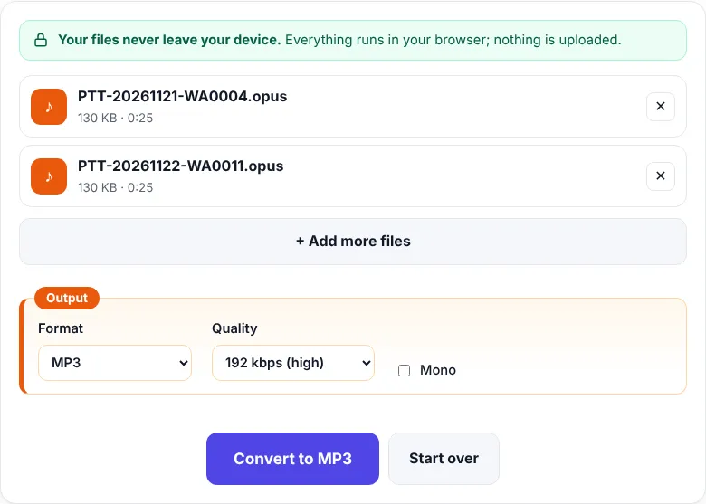

To convert WhatsApp audio to MP3, save the voice note from WhatsApp, open **[Audio Converter](/audio-converter/)**, click **Choose audio files** and pick the OPUS file, keep **MP3** as the **Format** and click **Convert to MP3**. You can do many voice notes at once. It's free, and nothing is uploaded.

## Why WhatsApp audio does not open everywhere

WhatsApp saves voice notes as **OPUS** files, with names like **PTT-20261121-WA0004.opus**. OPUS keeps speech clear at a very small size, which is why WhatsApp uses it. Outside WhatsApp, though:

- Some music players and car stereos do not play OPUS.
- Many audio editors and video editors will not import it.
- Office, school and other upload forms often accept only MP3 or WAV.
- Older computers may not know what to do with the file.

MP3 plays almost everywhere.

## Step 1: Get the voice note out of WhatsApp

**On Android:** WhatsApp keeps voice notes in a folder on your phone. Open your file manager and go to **Android > media > com.whatsapp > WhatsApp > Media > WhatsApp Voice Notes** on newer phones, or **WhatsApp > Media > WhatsApp Voice Notes** in the main storage on older ones. Inside, notes are sorted into folders by date. You can also search for **WhatsApp Voice Notes** in the file manager. Another way is to long press the voice note in the chat, tap the share icon and send it to Google Drive or email.

**On iPhone:** Open the chat and long press the voice note. Tap **Forward**, then tap the share icon at the bottom right and choose **Save to Files**. Pick a place such as **On My iPhone** and tap **Save**.

Recordings made with the mic button are voice notes. Songs or recordings that someone sent as a file are kept in a separate **WhatsApp Audio** folder and may already be MP3 or another format. The converter accepts those too.

## Step 2: Convert OPUS to MP3

1. Open **[Audio Converter](/audio-converter/)**.
2. Click **Choose audio files** and select one or more OPUS files. You can also drop them on the box.
3. Each voice note appears with its size and length. Click **Add more files** for more, or the **cross** to remove one.
4. Under **Output**, keep **Format** set to **MP3**.
5. Choose the **Quality**. For voice, **64 kbps (voice)** or **128 kbps (good)** is enough.
6. Tick **Mono**. Voice notes come from one microphone, so mono keeps the file smaller.
7. Click **Convert to MP3**.
8. When a file is ready, a **Download** button appears next to it. With one file, the download starts by itself.
9. With two or more files, click **Download all (ZIP)**.

The MP3 keeps the original name, so **PTT-20261121-WA0004.opus** becomes **PTT-20261121-WA0004.mp3**. You may want to rename it with the date and the person's name.

## Which quality to pick for voice notes

Voice notes are recorded for speech at a low quality, so a high MP3 setting won't make them sound better, only bigger.

| Use | Quality | Mono |
|---|---|---|
| Keeping or sharing a normal voice note | 64 kbps (voice) | Yes |
| Clearer copy for transcription or an editor | 128 kbps (good) | Yes |
| A song someone sent as a voice note | 128 or 192 kbps | No |
| Uploading to a form with a size limit | 64 kbps, then check the size | Yes |

The MP3 will usually be bigger than the OPUS file, because MP3 needs more space for the same speech. If a portal has a strict size limit, use **[Audio Compressor](/audio-compressor/)** after converting. Rules for uploads differ between portals, so check the format and size the official page asks for.

## Fixing common voice note problems

| Problem | What to do |
|---|---|
| Voice note is too quiet | Use [Volume Booster](/volume-booster/) after converting |
| Many short notes on one topic | Join them with [Audio Joiner](/audio-joiner/) |
| Only one part is needed | Trim it with [MP3 Cutter](/mp3-cutter/) |
| File shows an error | Play the note in WhatsApp first so it downloads fully, then save it again |

Our guide on [how to increase audio volume](/guides/how-to-increase-audio-volume/) explains how much to boost a soft recording. To merge a set of notes into one file, see [how to join audio files](/guides/how-to-join-audio-files/).

## Converting on a phone

Audio Converter works in Chrome on Android and Safari on iPhone. If your browser cannot read the OPUS file by itself, the tool loads its own audio engine (about 10 MB, once) and continues. Most voice notes are short and convert in a few seconds.
