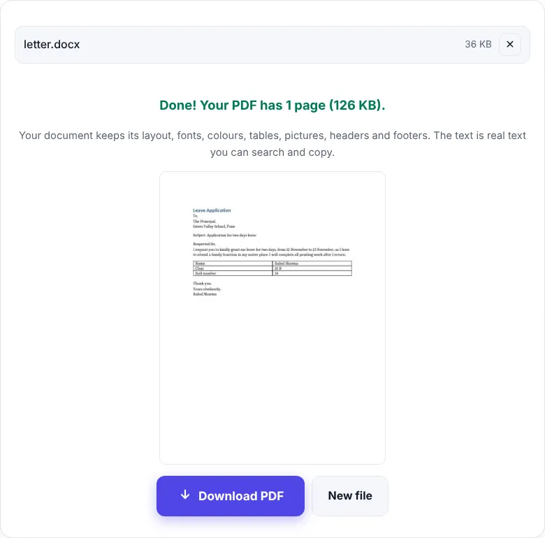

Got a resume, an application or an assignment in Word, but the form asks for a PDF? You can **convert Word to PDF on your phone** in under a minute, without installing an app. Open the tool in your browser, choose the .docx file and download the PDF.

## Why convert Word to PDF?

- **Job and college portals** often accept only PDF files.
- **A PDF looks the same on every phone and computer.** A Word file can look different when the other person does not have the same fonts.
- **A PDF is harder to change by mistake** when you send it to an office or a client.
- **PDFs are easy to join** with other documents into one file.

## How to convert Word to PDF on Android or iPhone

1. Open **[Word to PDF](/word-to-pdf/)** in Chrome (Android) or Safari or Chrome (iPhone).
2. Tap **Choose Word document**.
3. Pick your .docx file. Look in Downloads, Documents or Recent in the file picker.
4. Tap **Convert to PDF**. The page size and margins are taken from your document, so there is nothing to set.
5. Wait a few seconds. You will see how many pages the PDF has and a preview of the first page.
6. Tap **Download PDF**.

The PDF gets the same name as your Word file. On Android it usually goes to Downloads. On iPhone, Safari saves it to the Downloads folder in the Files app by default.

## Three ways to do it on a phone

| Method | Install an app? | Good for |
|---|---|---|
| ZentaPDF [Word to PDF](/word-to-pdf/) | No, works in the browser | Any .docx file you received or downloaded |
| Google Docs app | Yes (Google Docs) | Files you already edit in Google Docs |
| Microsoft Word app | Yes (Microsoft Word) | Files you edit in the Word app |

### Using the Google Docs app

1. Open the document in the Google Docs app.
2. Tap the three dots menu at the top right.
3. Tap **Share & export**, then **Save as**.
4. Choose **PDF Document (.pdf)** and tap **OK**.

### Using the Microsoft Word app on Android

1. Open the document and tap the three dots menu.
2. Tap **File**, then **Print**.
3. Choose **Save as PDF** as the printer.
4. Tap the PDF button, choose where to save it and tap **Save**.

App menus change with updates, so the names on your phone can be a little different.

## What stays the same in the PDF

ZentaPDF draws each page the way Word lays it out:

- Pages break where Word breaks them.
- Fonts, colours, bold and italic text are kept.
- Tables, pictures, headers and footers stay in place.
- The text stays real text, so it can be searched and copied.

Common fonts like **Calibri**, **Cambria**, **Arial** and **Times New Roman** are matched. If your file uses a rare font, a similar font is used. If a document uses features the tool cannot draw exactly, it makes the PDF with a simpler layout and tells you so. Always open the PDF and check it before you submit it.

## Common problems and fixes

| Problem | What to do |
|---|---|
| "Old .doc files are not supported" | Open the file in Word or Google Docs and save it as .docx, then try again |
| "This file could not be opened" | The file may be damaged or password protected. Remove the password in Word and save again |
| The PDF is too big for the portal | Shrink it with [Compress PDF](/compress-pdf/) |
| You need to add certificates after the resume | Join the files with [Merge PDF](/merge-pdf/) |
| Your file is .odt (LibreOffice) | Use [ODT to PDF](/odt-to-pdf/) instead |

## Before you upload the PDF

Every portal has its own rules for file type, size and sometimes file name. Read the upload instructions on the official website before you submit, for example the maximum size in KB or MB.

- **Too big?** See [how to compress a PDF for email](/guides/how-to-compress-pdf-for-email/). The same steps work for upload limits.
- **Need to sign it?** Add your signature on the phone with [Sign PDF](/sign-pdf/).
- **Need to change the text later?** Edit the Word file and convert again. If you only have the PDF, the guide on [converting PDF to Word](/guides/how-to-convert-pdf-to-word/) shows how to get an editable file back.

## Converting on a computer

The same [Word to PDF](/word-to-pdf/) page works on a laptop or desktop. If Microsoft Word is installed, you can also use **File**, then **Save As**, and choose **PDF** as the file type.
