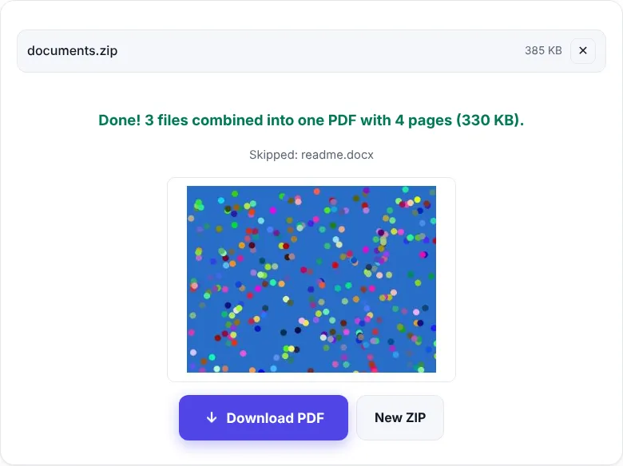

Many offices, colleges and scanning apps send documents as one ZIP file. To read them on a phone or upload them to a form you usually need a single PDF. You do not have to unzip anything first. Open [ZIP to PDF](/zip-to-pdf/), choose the .zip file, and every PDF, photo and text file inside is joined into one PDF in name order.

## How to convert a ZIP to PDF

1. Open **[ZIP to PDF](/zip-to-pdf/)** on your phone or computer.
2. Click **Choose ZIP file** and pick the .zip file, or drag it into the box.
3. Wait while each file is added. The progress bar shows the name of the file it is working on.
4. Read the result line. It says how many files were combined, how many pages the PDF has and its size.
5. If you see a **Skipped** line, check which files were left out (see the table below).
6. Look at the preview of the first page.
7. Click **Download PDF**. The PDF gets the same name as your ZIP file.

To convert another file, click **New ZIP**. The ZIP is opened inside your browser, so your documents are not uploaded anywhere.

## Which files inside the ZIP are used

| File type inside the ZIP | What happens |
|---|---|
| PDF | All its pages are added as they are |
| JPG, PNG, WebP, GIF, BMP, AVIF, HEIC | Each image becomes one A4 page, portrait or landscape to match the photo |
| TXT and Markdown (.md) | The text is laid out on A4 pages |
| CSV | Turned into a table with the first row as the header |
| HTML | The page text, headings and lists are laid out on A4 pages |
| Password protected PDF | Skipped |
| Word, Excel, PowerPoint, audio, video and others | Skipped and named in the Skipped line |

Hidden system files, like the __MACOSX folder that Mac computers add, are ignored on their own.

For a GIF, only the first frame is used. Very large photos are scaled down a little to keep the PDF a sensible size, which is still sharp enough for printing on A4.

## How the page order works

Pages follow the order of the file names, not the order in which you added them to the ZIP. Numbers are sorted the way people read them:

| File names in the ZIP | Order in the PDF |
|---|---|
| page1.jpg, page2.jpg, page10.jpg | page1, page2, page10 |
| IMG_0005.jpg, IMG_0012.jpg | IMG_0005, IMG_0012 |
| a-front.jpg, b-back.jpg | a-front, b-back |
| scans/page1.jpg, cover.pdf | cover.pdf first, then the scans folder |

If the order matters, for example a mark sheet front and back, rename the files with numbers like 01, 02, 03 before you make the ZIP. If you cannot change the ZIP, convert it anyway and fix the order afterwards with [Reorder Pages](/reorder-pdf-pages/). Our guide on [rearranging PDF pages](/guides/how-to-rearrange-pdf-pages/) shows how.

## How to make a ZIP of your files

Sometimes a portal asks for one PDF, but your scans are loose photos. You can zip them first, or skip the ZIP and use [JPG to PDF](/jpg-to-pdf/) with the photos directly. If you want a ZIP:

| Device | Steps |
|---|---|
| Windows | Select the files, right click, then choose Send to and Compressed (zipped) folder. On Windows 11 you may also see Compress to ZIP file |
| Mac | Select the files, right click (or Control click) and choose Compress |
| iPhone (Files app) | Tap More, then Select, choose the files, tap More at the bottom right and tap Compress |
| Android (Files by Google) | Select the files, tap More (three dots) and tap Compress. Other file manager apps use similar names |

On iPhone, several files are saved as Archive.zip in the same folder. Menu names can differ a little between versions, so look for Compress or Zip in your file manager.

## Common problems and fixes

**"No PDFs, images or text files were found in this ZIP."** The ZIP holds only files the tool does not read, such as Word or Excel files. Unzip it and convert those files with [Word to PDF](/word-to-pdf/) or [Excel to PDF](/excel-to-pdf/), then join them with [Merge PDF](/merge-pdf/).

**A PDF inside was skipped.** It is probably password protected. Unzip it, remove the password with [Unlock PDF](/unlock-pdf/) if you know it, and add it to the ZIP again. Bank statements and e-Aadhaar files are often locked like this.

**The ZIP itself asks for a password.** Password protected ZIP files cannot be opened by this tool. Extract the files with the password in your file manager first, then make a new ZIP or use [Merge PDF](/merge-pdf/) and [JPG to PDF](/jpg-to-pdf/).

**The PDF is too large to upload.** Photos from phone cameras make big pages. Shrink the result with [Compress PDF](/compress-pdf/). For tight limits, see [how to compress a PDF to 100 KB](/guides/compress-pdf-to-100kb/). Every portal sets its own size limit, so check the upload instructions on the official site.

**It is slow on my phone.** A ZIP with hundreds of large photos needs a lot of memory. Close other apps and tabs, or use a computer.

## After converting

- Need to add a cover page or another PDF? Use [Merge PDF](/merge-pdf/). Our [merge PDF guide](/guides/how-to-merge-pdf-files/) has the steps.
- Some pages sideways? Turn them with [Rotate PDF](/rotate-pdf/).
- Need only a few pages for a form? Take them out with [Split PDF](/split-pdf/).
