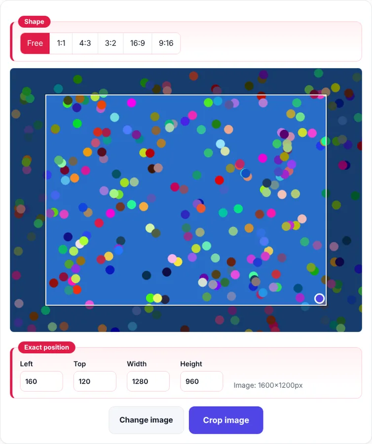

Cropping an image cuts away the edges so you keep only the part you need, like your face for a profile photo or one product from a group shot. You can do it in the browser on any phone or computer, without installing an app.

> **Short answer:** open [Crop Image](/crop-image/), choose your photo, pick a shape such as **1:1** or **16:9** (or keep **Free**), drag the box over the part you want, click **Crop image** and then **Download image**.

## How to crop an image online

1. Open **[Crop Image](/crop-image/)**.
2. Click **Choose image** or drag a photo into the box. JPG, PNG, WebP and iPhone HEIC photos work.
3. A crop box appears over the photo. The area outside the box is darkened.
4. Under **Shape**, pick a ratio: Free, 1:1, 4:3, 3:2, 16:9 or 9:16.
5. Drag inside the box to move it. Drag the **round handle** at the bottom right corner to make it bigger or smaller.
6. For exact sizes, type values in **Left**, **Top**, **Width** and **Height** under **Exact position**. The original size of your photo is shown next to them.
7. Click **Crop image**. The tool shows the new size in pixels and the file size.
8. Click **Download image**. Use **Adjust crop** if you want to change something.

The cropped photo is saved with "-cropped" added to its name. Your original stays as it was.

## Which ratio to choose

| Ratio | Shape | Common uses |
|---|---|---|
| Free | Any shape | Cutting out one part of a screenshot or document photo |
| 1:1 | Square | Profile photos, Instagram square posts, WhatsApp DP |
| 4:3 | Slightly wide | Normal phone camera photos, presentation slides |
| 3:2 | Wide | DSLR photos and standard photo prints |
| 16:9 | Wide screen | YouTube thumbnails, laptop wallpapers, banners |
| 9:16 | Tall | Instagram and WhatsApp Status, Reels, YouTube Shorts |

When you pick a ratio, the box keeps that shape while you resize it. Click **Free** to resize the width and height separately.

Social media sites change their recommended sizes from time to time. If you are making something for a specific platform, check its current help page for the size it wants.

## Crop to an exact size in pixels

Online forms, websites and print shops sometimes ask for a photo of an exact size, for example 600 x 600 pixels.

1. Choose your photo and click **Free**.
2. Type the **Width** and **Height** you need.
3. Change **Left** and **Top** to move the box to the right place. Left is the distance from the left edge, Top is the distance from the top edge, both in pixels.
4. Click **Crop image** and check the size shown in the result.

Cropping only cuts away pixels. If your photo is smaller than the size you need, the box cannot grow beyond the photo. To make a photo bigger or smaller without cutting anything, use [Resize Image](/resize-image/) after cropping.

## Cropping photos for forms and documents

For exam and job forms, crop first so that your face or signature fills the picture properly, then fix the file size. Every portal sets its own photo rules for size in pixels, size in KB and background, so read the official instructions of the form you are filling.

- Need a photo for an online form? See the [passport size photo guide](/guides/passport-size-photo-for-online-forms/).
- File too big after cropping? Follow the [reduce image size in KB guide](/guides/how-to-reduce-image-size-in-kb/) or use [Reduce Image Size in KB](/reduce-image-size-in-kb/).
- Photo lying on its side? Turn it with [Rotate Image](/rotate-image/) before you crop.

## Crop, resize or compress?

| You want to | Use |
|---|---|
| Remove edges or keep one part of the photo | [Crop Image](/crop-image/) |
| Change the width and height without cutting anything | [Resize Image](/resize-image/) |
| Make the file smaller in KB or MB | [Compress Image](/compress-image/) |
| Cut part of a PDF page | [Crop PDF](/crop-pdf/) |
| Cut part of an animated GIF | [Crop GIF](/crop-gif/) |

Crop Image saves a still picture. If you crop an animated GIF here you get only one frame, so use Crop GIF to keep the animation.

## Tips for a clean crop

- Leave a little space around faces and objects. A crop that is too tight looks cramped, and some apps cut the corners again into a circle.
- In a profile photo, keep the eyes in the top third for a natural look.
- Start from the original photo, not a WhatsApp forward. Forwarded photos are already compressed and have fewer pixels.
- Crop before you compress. With the edges gone there are fewer pixels, so the compressed file comes out smaller.
