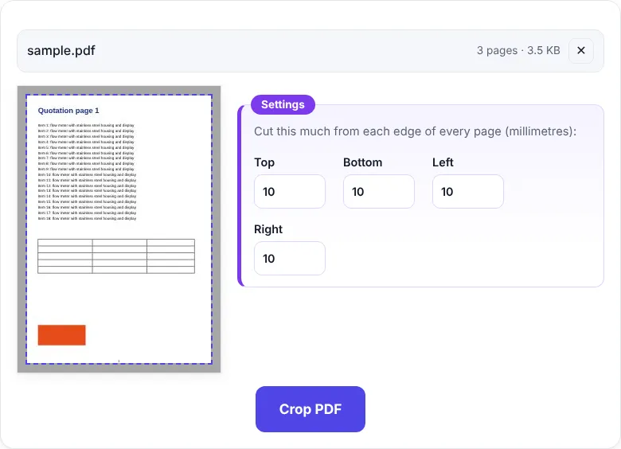

To crop a PDF, open **[Crop PDF](/crop-pdf/)**, choose your file, type how many **millimetres** to cut from the **Top**, **Bottom**, **Left** and **Right** of each page, check the dashed box on the preview, then click **Crop PDF** and **Download PDF**. It is free, needs no sign up and adds no watermark.

> **Short answer:** Choose the PDF, set the margins to cut in mm, click Crop PDF. The same margins are cut from every page.

## Why crop a PDF

Cropping trims the edges of each page. People in India often crop PDFs to:

- **Read on a phone** without zooming, by cutting the big white margins of a book or study notes
- **Remove scanner borders**, the grey or black strips that a scanner or photocopy machine leaves around a page
- **Cut printer marks** and extra space around a design, label or ticket
- **Make pages look neat** before you share them on WhatsApp or by email

Cropping does not change the words or pictures on the page. It only changes which part of the page is shown and printed.

## How to crop a PDF online

1. Open **[Crop PDF](/crop-pdf/)**.
2. Click **Choose PDF file** and pick your PDF, or drop it into the box.
3. The tool shows the file name, the number of pages and a preview of page 1.
4. In the **Top**, **Bottom**, **Left** and **Right** boxes, type how many millimetres to cut from each edge. Each box starts at 10.
5. Look at the **dashed box** on the preview. The part inside the box is kept and the darker part outside is cut.
6. Change the numbers until the dashed box sits just outside your text.
7. Click **Crop PDF**.
8. Click **Download PDF**. The new file ends with "-cropped" in its name.

To crop another file, click **New file**.

**Note:** The preview is a guide, not an exact copy. It is drawn as if the page were about 210 mm wide, like A4. On other page sizes the dashed box can be a little off, so open the downloaded file and check it once.

## How many millimetres to cut

You do not need exact numbers. Start small, check the result, and crop again if needed. This table gives a starting point:

| What you want to remove | Good starting value |
|---|---|
| Thin scanner or photocopy border | 3 to 5 mm on each side |
| Normal white margin of a typed document | 15 to 20 mm on each side |
| Wide book margin for phone reading | 20 to 25 mm left and right |
| Empty space at the bottom only | 0 for top, left and right, and a bigger number for bottom |

Some useful sizes to keep in mind:

| Size | In millimetres |
|---|---|
| 1 inch | 25.4 mm |
| Half inch | 12.7 mm |
| A4 page | 210 mm wide and 297 mm tall |

If you have a printed copy, you can also measure the margin with a ruler and type that number.

## Things to know before you crop

| Point | What it means |
|---|---|
| Same crop for every page | All pages lose the same margins. Odd and even book pages with different margins cannot be cropped separately |
| Page gets smaller | The cropped page is smaller than A4, so it prints with a smaller paper size unless your printer scales it |
| Hidden content may stay | The trimmed area is no longer shown or printed, but it may still be inside the file |
| Margins too large | If the margins add up to more than the page, you see "The margins are larger than the page. Please use smaller values." |

### Cropping is not a safe way to hide private details

Do not crop a page to hide an account number, signature or address. The cut part may still be inside the PDF. To remove details for good, use **[Redact PDF](/redact-pdf/)**. Our guide on [how to redact a PDF](/guides/how-to-redact-a-pdf/) explains the difference.

## Crop only some pages

The tool cuts every page in the same way. If only a few pages need cropping:

1. Use **[Extract Pages](/extract-pages/)** to take out the pages you want to crop.
2. Crop that small file with **[Crop PDF](/crop-pdf/)**.
3. Remove the old pages from the main file with **[Remove Pages](/remove-pages/)**.
4. Join the files back with **[Merge PDF](/merge-pdf/)**, then put the pages in the right place with **[Reorder PDF Pages](/reorder-pdf-pages/)**.

## After cropping

- **Need a full A4 page again?** Use **[Change Page Size](/page-size/)** and pick A4. The content is scaled to fit and centred. See [how to change PDF page size](/guides/how-to-change-pdf-page-size-letter-to-a4/) for the steps.
- **Page is sideways?** Fix it with **[Rotate PDF](/rotate-pdf/)**.
- **Want to check the result on your phone?** Open it in **[PDF Reader](/pdf-reader/)**, which has zoom and full screen.
- **Want to crop a photo, not a PDF?** Use **[Crop Image](/crop-image/)** for JPG and PNG files.

## Common problems and fixes

| Problem | Fix |
|---|---|
| Text at the edge was cut off | Use smaller numbers and crop the original file again |
| White margin is still there | Use bigger numbers for that side |
| The dashed box looks wrong | The preview is approximate. Download the file and check the real result |
| The file does not open | The PDF may be damaged. Try [Repair PDF](/repair-pdf/) first |
| The PDF asks for a password | Open it with [Unlock PDF](/unlock-pdf/) if you know the password, then crop |

## Cropping a PDF on a phone

The steps are the same on a phone. Open the tool in Chrome or Safari, tap **Choose PDF file** and pick the PDF from your Downloads or Files app. Type the numbers, tap **Crop PDF** and then **Download PDF**. Open the new file once to make sure no text was cut off before you send it.
