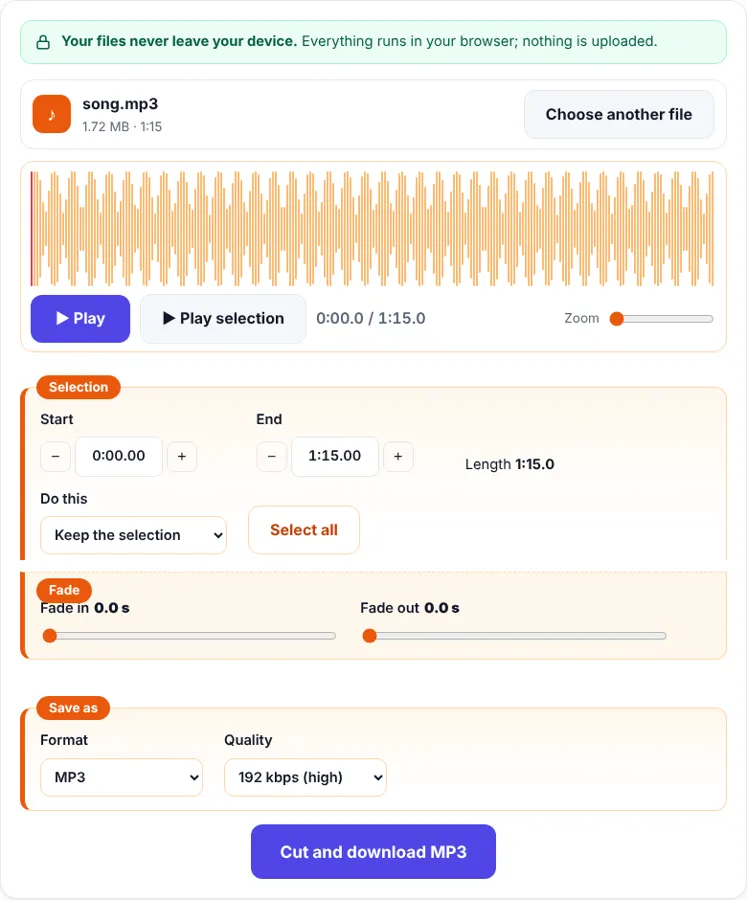

You can cut the chorus of a song for a school function, a short clip for a video, or the silence at the start of a voice note right in your browser. Open [MP3 Cutter](/mp3-cutter/), choose the file, drag the start and end handles to the part you want and click **Cut and download MP3**. The song is never uploaded.

## How to cut an MP3 song

1. Open **[MP3 Cutter](/mp3-cutter/)** in Chrome, Edge or Safari on your phone or computer.
2. Click **Choose audio file** and pick your song, or drag it into the box. MP3, WAV, M4A, AAC, OGG, FLAC and other common formats work.
3. Wait a moment while the waveform appears. The file name and the total length are shown at the top.
4. Drag the purple handles on the waveform to mark the start and the end of the part you want. On a phone, drag them with your finger.
5. Click **Play selection** to hear only that part. Adjust until it starts and ends at the right beat.
6. Under **Save as**, keep **MP3** and the quality **192 kbps (high)**, or change them.
7. Click **Cut and download MP3**. The file is saved with "-cut" added to the original name.

After that, a **Download again** button with the file size appears in case you need another copy.

## Getting the start and end exactly right

When the cut has to land on a word or a beat, dragging alone can be fiddly:

- Type the time in the **Start** and **End** boxes, like 0:45.50, and press Enter.
- Tap the minus and plus buttons to move the start or end by 0.1 second.
- Move the **Zoom** slider below the waveform to see more detail and place the handles more accurately.
- Click **Select all** to go back to the whole file and start again.

**Length**, next to the times, shows how long your clip will be. Apps like WhatsApp and Instagram change their limits from time to time, so check the current limit in the app before you cut.

## Keep a part or remove a part

The **Do this** menu decides what happens to your selection.

| Option | What you get | Good for |
|---|---|---|
| Keep the selection | Only the selected part is saved | Chorus, intro music, a short clip for a video or status |
| Remove the selection | Everything except the selected part, joined together | Removing an advert, a long pause, a cough or a wrong line from a recording |

When you remove a part, the two sides are joined with a tiny crossfade of a hundredth of a second so there is no click where they meet.

## Add a fade in and fade out

A clip that starts or stops suddenly in the middle of music sounds rough. In the **Fade** section, **Fade in** makes the sound rise slowly from silence at the start and **Fade out** takes it down slowly to silence at the end. Each slider goes from 0 to 5 seconds in half second steps. One or two seconds is usually enough for a song. Leave both at 0 for speech, where you want every word clear.

## Which format and quality to choose

| Save as | Quality options | File size | When to pick it |
|---|---|---|---|
| MP3 | 64 to 320 kbps (192 kbps is the default) | Small | Sharing on WhatsApp, playing on any phone, school or office events |
| M4A | 64 to 320 kbps | Small | iPhone and Apple apps, or when someone asks for M4A |
| WAV | No quality setting, saved without compression | Large | Editing further in other software, or keeping the best copy |

For speech, 128 kbps is usually plenty. For music you will play on speakers, 192 or 256 kbps is a good choice. Choosing a higher quality than the original file had only makes the file bigger. It will not sound better.

## Cut the sound from a video

MP3 Cutter also opens video files such as MP4, MOV and WEBM. Choose the video in step 2 and you will see the waveform of its sound. Select the part you want and save it as MP3. Only the sound is saved, not the picture. If you need the full sound track of a video without cutting, [Video to MP3](/video-to-mp3/) is quicker, and our guide on [extracting audio from a video](/guides/how-to-extract-audio-from-video/) explains it step by step.

## Problems and fixes

**The waveform does not appear.** The file may be damaged or may not really be an audio file. Try playing it in your phone's music player. If it does not play there either, download or copy the file again.

**It is very slow on my phone.** Long recordings, like a two hour lecture, need a lot of memory. Close other tabs or use a computer. The tool shows a note when a file is large.

**The cut file is too big to send.** Choose a lower quality such as 128 kbps, or shrink it afterwards with [Audio Compressor](/audio-compressor/). See [how to compress an MP3 file](/guides/how-to-compress-mp3-file/).

**I want this part as my phone ringtone.** Use [Ringtone Maker](/ringtone-maker/), which limits the length for ringtones and can save an M4R file for iPhone. Our [ringtone guide](/guides/how-to-make-ringtone-from-song/) shows how to set it on Android and iPhone.

**I want to join two cut parts.** Cut both, then join them with [Audio Joiner](/audio-joiner/).

## Is it safe and free?

Yes. The cutting is done inside your browser, so your songs and recordings stay on your phone or computer. There is no sign-up, no watermark and no limit on how many files you cut. Only cut songs for your own use, or where you have the right to use them.
