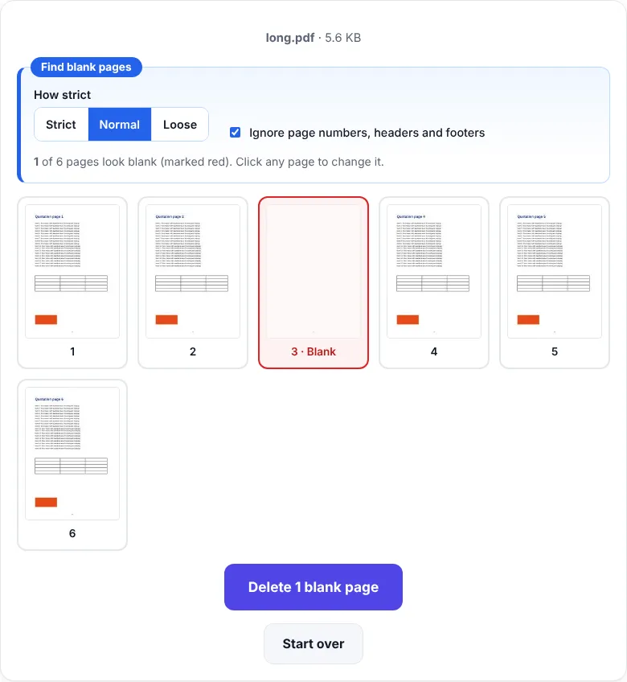

Scanned a stack of documents on both sides and now half the pages are empty? You can **delete blank pages from a PDF** for free. The tool looks at every page, finds the empty ones for you, even in scans with dust specks, gray paper or a lone page number, and removes them in one click. You check every page before anything is deleted.

## Why scanned PDFs have blank pages

| Cause | What happens |
|---|---|
| Two-sided (duplex) scanning | The empty back of every one-sided sheet is scanned too |
| Separator sheets | Blank sheets put between documents end up in the file |
| Word or PowerPoint exports | An extra page break or empty slide becomes a blank page |
| Merged files | A blank cover or end page from each file stays in the combined PDF |

Blank pages make the file bigger, waste paper when printed and look careless when you send the PDF to a bank, college or office.

## How to delete blank pages (step by step)

1. Open **[Delete Blank Pages](/delete-blank-pages/)**.
2. Click **Choose PDF file** or drag the PDF into the box.
3. Wait while every page is checked. You see a thumbnail of each page.
4. Blank pages are marked in **red** with the word **Blank** under them. The line above the pages tells you how many look blank.
5. Click any page to change the choice: a red page will be kept, a normal page will be removed.
6. Click **Delete blank pages** (the button shows how many pages will go).
7. Click **Download PDF**.

Your original file is not changed. If every page would be removed, the tool stops and asks you to keep at least one page.

## How the blank page check works

A scanned blank page is almost never pure white. The paper may be gray or cream, and the scanner adds dust specks and faint lines. The tool first works out the paper colour of each page, then counts only real marks. Single specks of dust are ignored.

You can change two settings:

| Setting | What it does | When to change it |
|---|---|---|
| How strict: Strict | Only pages with almost no marks count as blank | Pages with a faint signature or stamp are being caught |
| How strict: Normal | The default, right for most scans | Start here |
| How strict: Loose | Pages with a few more marks also count as blank | Dirty or noisy scans where blank pages are missed |
| Ignore page numbers, headers and footers | Marks near the top and bottom edge are not counted | Untick it if a page with only a header should be kept |

Changing a setting checks all pages again, so any pages you clicked by hand go back to the automatic choice.

## Check before you delete

The check is careful, but it only sees ink, not meaning. A page with a single signature line, a small stamp or a short note in pencil can look almost empty. Before you click delete:

- Look at every red page. Zoom in your browser if a thumbnail is too small.
- Watch for pages that must be there, like a "This page is intentionally left blank" page in an exam paper or legal document. Some offices want the full page count, so check their rules before removing anything.
- Keep the original scan until you have checked the new file.

## Other ways to remove pages

- **You know the page numbers.** Use [Remove Pages](/remove-pages/) and pick them. See [how to remove pages from a PDF](/guides/how-to-remove-pages-from-pdf/).
- **Pages are in the wrong order after removing.** Fix them with [Reorder Pages](/reorder-pdf-pages/).
- **Need to scan again.** For tips on clean phone scans, read [how to scan documents to PDF with your phone](/guides/scan-documents-to-pdf-with-phone/).

## After removing blank pages

The file is now shorter, but scanned pages are still large. To send it by email or upload it to a portal with a size limit, shrink it with [Compress PDF](/compress-pdf/). If you have several scanned files, join them first with [Merge PDF](/merge-pdf/), then delete the blank pages from the combined file in one go.

## Is my document safe?

Yes. Every page is checked inside your browser on your own phone or computer. The PDF is not uploaded to a server, which matters for bank statements, ID copies and other personal papers.
