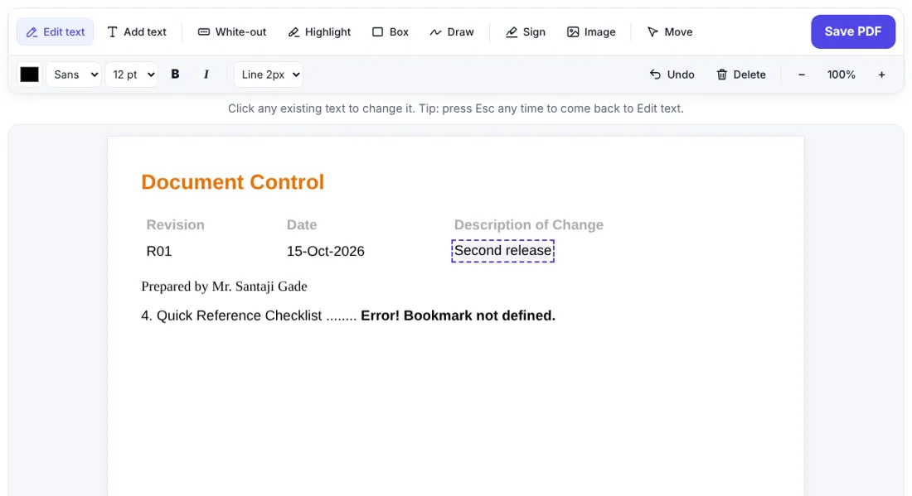

PDFs look the same on every device, which is great for sharing but annoying when you spot a typo, a wrong date or an old phone number. You do not need Adobe Acrobat or any software to fix it. **[Edit PDF](/edit-pdf/)** lets you click any line, type, and save, all in your browser.

## Three ways to change a PDF

| What you want | Tool in Edit PDF |
|---|---|
| Change existing words, numbers or dates | **Edit text** (click the line) |
| Add new text, for example to fill in a form | **Add text** |
| Hide something completely | **White-out** |

## How to edit existing text

1. Open **[Edit PDF](/edit-pdf/)** and choose your file.
2. **Edit text** is already selected. Move the mouse over the page and the lines you can edit light up.
3. **Click the line** you want to change. The cursor appears exactly where you clicked. You can also drag to select a few words.
4. Type your changes, then click anywhere outside the box.
5. Click **Save PDF**, then **Download PDF**.

The editor keeps the look of your document:

- It **reuses the original font** stored inside the PDF, so the new words match the rest of the page.
- Size, colour, bold and italic stay the same.
- The old text is removed from view and the background behind it is kept, even inside coloured table headers.

> **Tip:** Made a mistake? Press **Ctrl + Z** to undo and **Ctrl + Y** to redo.

## How to add new text

1. Choose **Add text** in the toolbar.
2. Click where the text should go and type.
3. Pick the font, size and colour, and use **B** or *I* for bold or italic. There are 19 fonts, including handwriting styles, and you can type the ₹ sign.
4. Use **Select / move** to drag it into place.

This is handy for forms that are not fillable, for notes, or for writing a date next to a signature.

## How to hide or remove something

Choose **White-out** and drag a box over anything you want to hide, such as an old address or a price. Then use **Add text** to write the new information on top.

> **Important:** White-out hides content visually, but the original text can still exist underneath and could be copied with special software. For really sensitive details, such as account numbers, turn the page into an image with [PDF to JPG](/pdf-to-jpg/) and back with [JPG to PDF](/jpg-to-pdf/), or remove the page with [Remove Pages](/remove-pages/).

## Editing scanned PDFs

| Kind of scan | What you can do |
|---|---|
| Scan with a hidden text layer (most scanner apps and office copiers) | Click a line and edit it. The old words are covered with the paper colour. |
| Plain picture scan, no text layer | Use **White-out** over the old words and **Add text** on top. |

Not sure which one you have? Try to select a word in any PDF reader. If you can select it, the scan has a text layer.

## Tips for the best result

- **Keep the length similar.** Each line is edited on its own and does not move the rest of the paragraph.
- **Zoom in** with the **+** button for small text.
- **Use the page list** on the left to jump between pages in long files.
- **Press Esc** to finish editing a line.

## Common edits people make

| Task | How |
|---|---|
| Fix a typo or wrong date | **Edit text**: click the line and retype |
| Update a phone number or address | **Edit text**, or White-out plus Add text |
| Fill in a printed form | **Add text** on each blank line |
| Mark important lines | **Highlight** |
| Add a logo or stamp | **Add image** |
| Tick boxes or add today's date | **Quick marks** (✓, ✗ and date) |
| Sign | **Add signature**: draw, type or upload |

## Editing on a phone

The editor works in phone browsers too. Tap a line to edit it, use **+** to zoom in, and tap **Save PDF** when you are done. For long documents, a computer with a mouse is easier.

## Related guides

- [How to sign a PDF without printing](/guides/how-to-sign-pdf-without-printing/)
- [How to remove pages from a PDF](/guides/how-to-remove-pages-from-pdf/)
