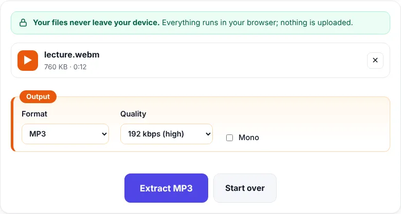

To extract audio from a video, open **[Video to MP3](/video-to-mp3/)**, click **Choose video file**, pick your MP4, MOV, WEBM, MKV or other video, keep **MP3** as the format, choose the **Quality**, and click **Extract MP3**. The audio file downloads when it is ready. It is free, needs no sign up, and the video never leaves your device.

> **Short answer:** Choose the video, keep MP3 and 192 kbps, click Extract MP3. For speech, 128 kbps is enough.

## Why take the audio out of a video

An audio file is much smaller than a video and plays with the screen off. Common reasons:

- **Online classes and lectures**: listen again while travelling, without using video data
- **Speeches, satsang and kirtan recordings** from a family function
- **Interviews and meetings** you recorded on your phone, to make notes
- **A song or tune** from your own video, to use as a [ringtone](/guides/how-to-make-ringtone-from-song/)
- **Voice overs and podcasts** that were first recorded as video

Only take audio from videos you made yourself or have the right to use.

## How to extract audio from a video

1. Open **[Video to MP3](/video-to-mp3/)**.
2. Click **Choose video file**, or drop the video into the box. MP4, MOV, WEBM, MKV, AVI, M4V, 3GP and more are accepted.
3. The video appears with its file size and length.
4. Under **Output**, keep **Format** as **MP3**, or choose M4A, WAV, AAC, OGG or FLAC.
5. Choose the **Quality**. It starts at **192 kbps (high)**.
6. Tick **Mono** if you want a single channel, for example for a lecture with one speaker.
7. Click **Extract MP3** (the button name follows the format you choose) and wait a few seconds.
8. The audio file downloads. The line under the file name now shows the new size, and a **Download** button lets you save it again.

To convert another video, click **Start over**. The tool works on one video at a time.

## Which format and quality to choose

| Format | Best for | Notes |
|---|---|---|
| MP3 | Almost everything | Plays on every phone, computer and car stereo |
| M4A | iPhone and Apple devices | Good sound for its size |
| WAV | Editing in audio software | No quality loss, but very large files |
| AAC | Apps that ask for AAC | Similar to M4A |
| OGG | Some websites and games | Uses our audio engine, which loads once |
| FLAC | Keeping full quality | Lossless, larger than MP3 |

For MP3, the quality (bitrate) decides the size. The numbers below are worked out from the bitrate, so real files can be a little different:

| Quality | Good for | Size for 1 minute (about) |
|---|---|---|
| 64 kbps | Voice notes | 0.5 MB |
| 96 kbps | Lectures and talks | 0.7 MB |
| 128 kbps | Speech and most music | 1 MB |
| 192 kbps | Music (default) | 1.4 MB |
| 320 kbps | Best quality music | 2.4 MB |

So a one hour lecture at 128 kbps is roughly 58 MB, and at 64 kbps roughly 29 MB.

**Tip:** A higher bitrate cannot make the sound better than it was in the video. If the video has poor sound, 128 kbps is enough.

## After you extract the audio

- **Keep only one part?** Use **[MP3 Cutter](/mp3-cutter/)**. It also opens videos, so you can cut first and skip this step.
- **File too big to share?** Use **[Audio Compressor](/audio-compressor/)** to lower the bitrate.
- **Voice is too soft?** Make it louder with **[Volume Booster](/volume-booster/)**.
- **Want a ringtone?** Use **[Ringtone Maker](/ringtone-maker/)**.
- **Want a moving picture instead of sound?** See [how to convert a video to GIF](/guides/how-to-convert-video-to-gif/).

## Common problems and fixes

| Problem | Fix |
|---|---|
| It says the video has no sound track | Some videos, such as screen recordings made without the microphone, have no audio. Play the video with sound on your device to check |
| The video does not open | Try another browser. If the file is damaged, play it in your gallery app first to check it works |
| Very large video is slow | Large files take longer. Close other tabs and keep the screen on until the download starts |
| The MP3 is too big | Choose a lower quality such as 96 or 128 kbps and extract again |
| The sound is cut at the start | Check the original video. The tool keeps the full sound track |

## Extract audio on a phone

The steps are the same on Android and iPhone. Open the tool in Chrome or Safari, tap **Choose video file** and pick the video from your gallery or files. Keep the screen on while it works. On Android the audio file goes to the **Downloads** folder. On iPhone it is saved to the **Files** app, usually in Downloads.

For WhatsApp videos, first save the video to your phone, then choose it in the tool.
