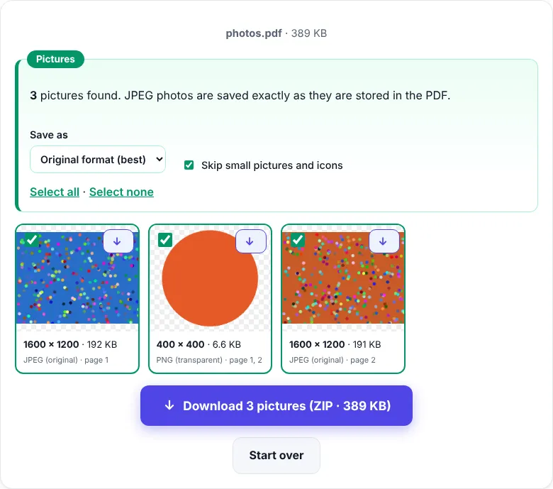

Need the photos from a brochure, a product catalogue, a project report or an e-book? You can **extract images from a PDF** for free in your browser. Every picture inside the file is found and saved in its original quality, which is much better than a screenshot. Pick the ones you want and download them one by one or as a ZIP.

## Why not just take a screenshot?

A screenshot only captures what is on your screen. If the picture is shown small, you get a small, blurry copy. Extracting takes the picture out of the PDF file itself, so you get the full size that was stored inside.

| Method | Quality | Good for |
|---|---|---|
| Screenshot | Only as big as your screen shows it | A quick look or a chat message |
| Extract images | The full size stored in the PDF | Reusing photos, logos and product pictures |
| Convert page to JPG | The whole page as one image, text included | Sharing a full page as a picture |

## How to extract images from a PDF (step by step)

1. Open **[Extract Images](/extract-images-from-pdf/)**.
2. Click **Choose PDF file** or drag the PDF into the box.
3. Wait a few seconds. All pictures are shown with their size in pixels, file size and page number.
4. Untick the pictures you do not need. Use **Select all** or **Select none** to save time.
5. In **Save as**, keep **Original format (best)**, or choose **PNG** or **JPG**.
6. Click the **Download** button at the bottom to get a ZIP of all ticked pictures. To save just one picture, click the small download button on its card.

The pictures are named after your PDF with the page number, so you can tell where each picture came from.

## Which "Save as" option to choose

| Option | What you get | When to use it |
|---|---|---|
| Original format (best) | JPEG photos exactly as stored, other pictures as PNG | Almost always. No quality is lost. |
| PNG | Every picture as PNG | Logos, drawings and pictures with transparent parts |
| JPG | Every picture as JPG with a white background | When a website or form accepts only JPG |

Pictures with transparent parts, like many logos, are saved as PNG and keep their transparency in the original format. If you pick JPG, the transparent parts become white. Not sure which format suits you? See [JPG vs PNG vs WebP](/guides/jpg-vs-png-vs-webp/).

## Small icons and missing pictures

By default, **Skip small pictures and icons** is ticked. This hides tiny bullets, lines and icons so you only see real pictures. If a small logo you need is missing, untick this option and the list is loaded again with every picture.

Some things in a PDF look like pictures but are not:

- **Charts and diagrams** made in Excel, Word or PowerPoint are often stored as drawing instructions, not as pictures. They will not show up in the list. Use [PDF to PNG](/pdf-to-png/) to turn that page into an image instead.
- **Text in a fancy font** is still text, not a picture.
- **Scanned PDFs** store each page as one big picture. Extracting gives you the full page images.

If the message **"No pictures were found in this PDF"** appears, the file most likely has only text and drawings. Converting the pages with [PDF to JPG](/pdf-to-jpg/) is the way to go.

## Is my PDF uploaded anywhere?

No. The pictures are found and saved inside your browser, on your own phone or computer. This matters when the PDF has personal photos or company material.

## What to do after extracting

- **Picture too big for a form?** Shrink it with [Compress Image](/compress-image/). For a target like 50 KB, see [how to reduce image size in KB](/guides/how-to-reduce-image-size-in-kb/).
- **Need a different format?** Change JPG, PNG or WebP with [Convert Image](/convert-image/).
- **Want the whole page, not just the photo?** Use [PDF to JPG](/pdf-to-jpg/) or [PDF to PNG](/pdf-to-png/).

## A note on copyright

Pictures in a PDF belong to whoever made them. Using photos from your own documents is fine. Before you reuse pictures from someone else's catalogue, book or report on a website or in print, check that you have permission.
