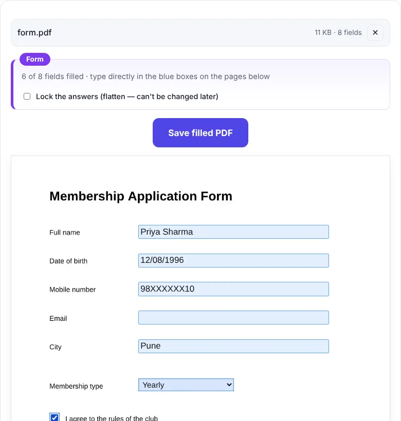

You got a PDF form on WhatsApp or email, such as a membership form, a school or college form, or a company joining form, and you do not have a laptop nearby. You can fill it on your phone for free, right in the browser, without installing any app.

> **Short answer:** open [PDF Form Filler](/pdf-form-filler/) in Chrome or Safari, tap **Choose PDF form**, type in the blue boxes, then tap **Save filled PDF** and **Download PDF**.

## First check: is your PDF a fillable form?

There are two kinds of PDF forms, and they are filled in different ways.

| Type of form | How to recognise it | Tool to use |
|---|---|---|
| Fillable form | Boxes become active when you tap them, or the tool shows blue boxes | [PDF Form Filler](/pdf-form-filler/) |
| Flat form (printed or scanned) | Just lines and empty boxes drawn on the page, nothing to tap | [Edit PDF](/edit-pdf/), using Add text |
| Special Adobe form (XFA) | Shows a blank page or a "please wait" message outside Adobe apps | Usually needs Adobe Acrobat Reader |

When you open a PDF in PDF Form Filler, it tells you straight away. If the file has no fillable fields, you see a message that sends you to Edit PDF, where you can type anywhere on the page.

## How to fill a PDF form on your phone

1. Save the PDF form to your phone. On WhatsApp, open the file and use **Save** or **Share** to keep it in your Downloads or Files.
2. Open **[PDF Form Filler](/pdf-form-filler/)** in Chrome, Safari or any modern browser.
3. Tap **Choose PDF form** and pick the file.
4. Wait a moment while it reads the form. Each page appears with **blue boxes** where you can type.
5. Tap a box and type your answer. Tap checkboxes to tick them, and use the drop-down lists to choose options.
6. Pinch to zoom out and scroll to check every page. The top line shows how many fields are filled, for example "6 of 8 fields filled".
7. If the form should not be changed later, tick **Lock the answers (flatten)**.
8. Tap **Save filled PDF** and then **Download PDF**.

The downloaded file has "filled" at the end of its name. You can now send it on WhatsApp or by email. If you want to change something, tap **Keep editing** before you download again.

## What you can fill

| Field type | What you do |
|---|---|
| Text box | Tap and type, for example name, mobile number or city |
| Big text box | Type longer answers like an address. Line breaks are kept |
| Checkbox | Tap to tick or untick |
| Radio buttons | Tap one choice, like Male or Female, Yes or No |
| Drop-down list | Tap and choose one option |

Some fields may be grey and not editable. The form maker set them as read only, so they cannot be changed.

## Typing in Hindi or other Indian languages

Switch your phone keyboard to Hindi, Marathi, Tamil or any other language and type as usual. When your answers contain such letters, PDF Form Filler adds a font that supports many languages, so the text shows correctly in the saved PDF. Open the downloaded file once to check that everything looks right.

## Lock the answers or not?

**Lock the answers** turns your typed answers into normal page content. Nobody can change them later, and the form looks the same in every PDF reader.

- **Lock** when you send a final form to an office, school or company.
- **Do not lock** if you may need to change details later, or if the office asks for an editable form.

You can also lock a form later with [Flatten PDF](/flatten-pdf/). Some offices have their own rules about this, so read the instructions that came with the form.

## After filling: sign, shrink and send

- **Need a signature?** Add it with [Sign PDF](/sign-pdf/). The [guide to signing a PDF without printing](/guides/how-to-sign-pdf-without-printing/) shows how.
- **Form not fillable?** Use [Edit PDF](/edit-pdf/) to type on it. See [how to edit text in a PDF for free](/guides/how-to-edit-text-in-pdf-free/).
- **File too big to upload?** Make it smaller with [Compress PDF](/compress-pdf/).
- **Online application on a portal?** Many government and exam portals have their own online form instead of a PDF. Always follow the instructions on the official website.

## Why use the browser instead of an app

You do not need to install anything, and there is no sign-up. The form is read and filled in your browser on your phone, which is useful when your phone storage is full or you only need to fill one form. The same page also works on a laptop or tablet.
